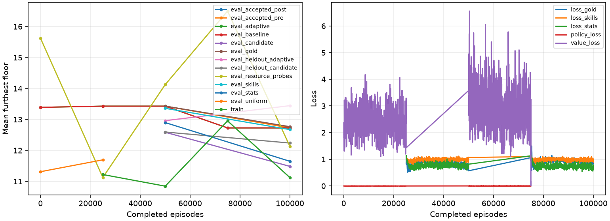

# Adaptive Shop V2 · 100,000 episodes

The local run completed 100,000 unique training episodes and all evaluations at the final boundary. The latest checkpoint is byte-identical to the 100,000-episode archive. SQLite agrees with the checkpoint's table watermarks and live-action count. Training processed 6,179,117 live actions in approximately 29 minutes and 31 seconds of measured training time, reached floor 38, and recorded 8 timeouts and 0 clears.

## Shop promotion and fixed-seed evaluation

The incumbent kept its original no-edit policy at both promotion boundaries. Candidate and incumbent use the same frozen PPO within each comparison. The fixed panel uses 128 seeds and the separate validation panel uses 256.

| Episodes | Fixed incumbent | Fixed candidate | Fixed delta | Validation incumbent | Validation candidate | Validation delta | Promoted |
|---:|---:|---:|---:|---:|---:|---:|---|
| 50,000 | 13.43 | 12.59 | −0.84 | 12.96 | 12.59 | −0.37 | No |
| 100,000 | 12.73 | 11.48 | −1.24 | 13.45 | 12.24 | −1.21 | No |

At 100,000 episodes the retained policy averaged **12.74 floors after Reward transfer**, with a median of 13, a maximum of 23, and no clears or timeouts on the fixed panel. The pre-transfer mean was 12.73, with one seed improving by two floors after transfer and the other 127 reaching the same floor. The final candidate reached floor 30 and timed out once on that panel. Its lower mean and the held-out deficit favored retaining the incumbent.

The matched Phase 3B-2 1M PPO with uniform-random shops averaged **11.31 floors**, 1.43 below the V2 retained policy. With the original PPO and no-edit shops, V2's step-zero control already averaged **13.39 floors**. The initial control is the closer reference for interpreting the retained policy's training gain. [Phase 3B-2 report](../combat_rl_1m/training_report.md) · [Floor reach](floor_reach.csv) · [Paired evaluations](paired_panel.csv) · [Promotion decisions](boundary_decisions.json)

## Reward transfer

The two Shop blocks recorded 499,186 Reward decisions, including 99,878 forced-random decisions (20.01%). Each transfer fitting sample included 3,276 forced Gold observations. On the held-out guidance states at 100,000, mean Gold probability rose by **0.030 percentage points**, and the mean KL was **0.00386**. Gold remained unselected in the deterministic fixed panel before and after guidance. On that panel the Potion selection rate at 90–100% HP moved from **80.55% to 79.95%**. These are small policy changes on the observed states. [Reward context](reward_context.csv) · [Experience counts](reward_experience_counts.csv) · [Q distributions](reward_q_distribution.csv) · [Transfer](reward_transfer.csv)

## Shop allocations

Values are mean / median for all observed shop exits in each fixed panel. The incumbent retained the no-edit policy throughout, and all of its recorded exits in these panels had zero unused stats and mana.

| Checkpoint | Incumbent exits | Incumbent unused stats | Incumbent unused mana | Candidate exits | Candidate unused stats | Candidate unused mana |
|---:|---:|---:|---:|---:|---:|---:|
| 0 | 103 | 0 / 0 | 0 / 0 | — | — | — |
| 25,000 | 94 | 0 / 0 | 0 / 0 | — | — | — |
| 50,000 | 94 | 0 / 0 | 0 / 0 | 96 | 1.88 / 0 | 12.54 / 4 |
| 75,000 | 88 | 0 / 0 | 0 / 0 | — | — | — |
| 100,000 | 88 | 0 / 0 | 0 / 0 | 88 | 2.74 / 0 | 17.64 / 6 |

At 100,000 the isolated fixed-panel changes relative to the incumbent were +0.04 floors for Gold, −1.08 for Stats and −0.05 for Skills. These panels share the frozen PPO. The resource distributions describe complete policy choices rather than holding other variables fixed. Separate one-edit probes pair legal edits with downstream simulator continuations. [Unused resource distributions](checkpoint_unused_resources.csv) · [No-edit rates](shop_no_edit.csv) · [Purchases](shop_purchases.csv) · [Single-head comparison labels](shop_comparisons.csv) · [Resource probes](strategy_verification.csv)

## Throughput and timeouts

Training throughput by 25,000-episode block was **80.4, 42.3, 95.8 and 41.1 episodes/s**. The two paired Shop blocks processed approximately 2.24 million additional comparison actions outside the live action counter. All eight training timeouts involved Mimic with identical recorded combat snapshots in the stored suffix. This identifies repeated observations without establishing a complete hidden-state loop. [Throughput](throughput.csv) · [Counterfactual throughput](counterfactual_throughput.csv) · [Evaluation timing](evaluation_timing.csv) · [Timeout counts](timeout_counts.csv)
