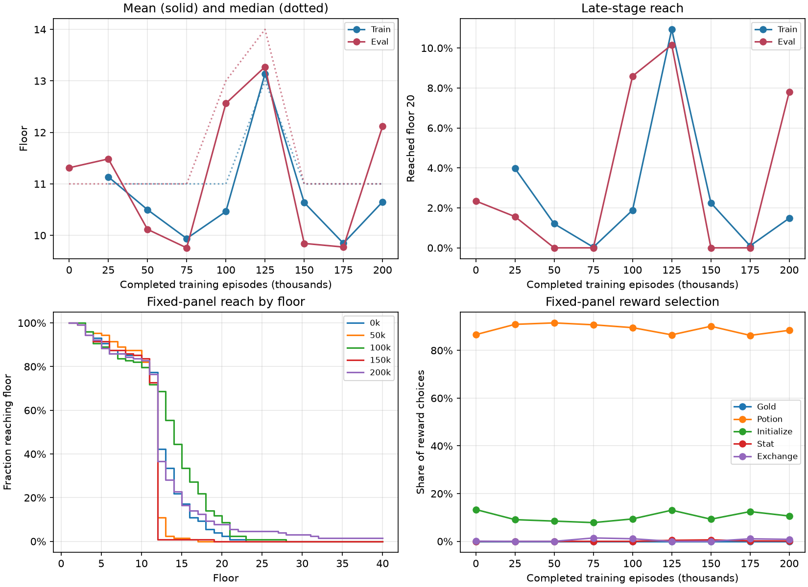
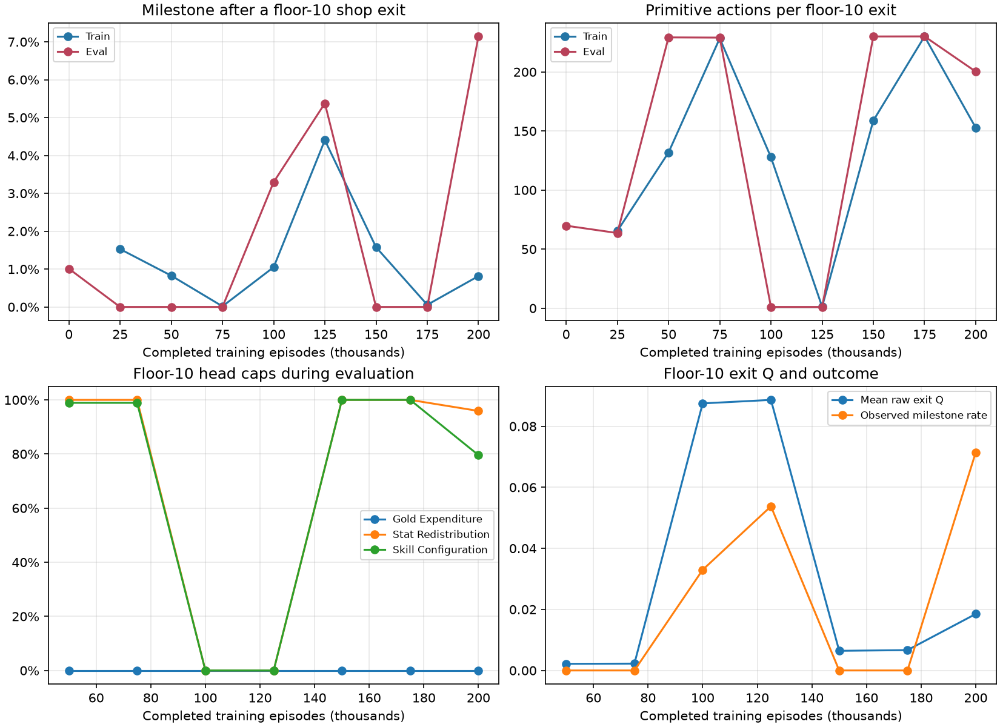
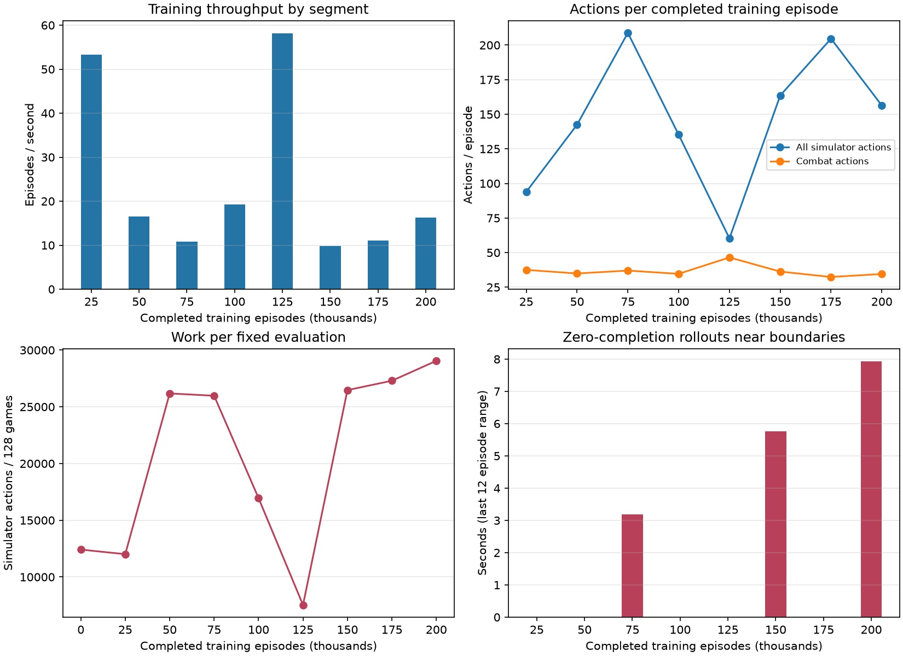

# Phase 3C interim analysis at 200,000 episodes

## Assessment

Alternating training produced a deeper upper tail on the fixed panel, with one game reaching **floor 70** at 200,000 episodes. The final panel mean was **12.12**, versus **11.31** for the pretrained PPO with uniform-random shops. The best panel mean was **13.27** at 125,000 episodes. Neither the 200,000 training episodes nor any fixed evaluation produced a clear. The data supports testing the alternating hypothesis under controlled comparisons before committing the remaining 800,000 episodes.

## Checkpoint and SQLite verification

The run committed **200,000 unique sequential training episodes** and **1,152 fixed-panel episodes** across nine checkpoints, including step 0. The final evaluation completed all 128 games and recorded **29,051 simulator actions**, which matches the sum of its episode rows. The latest checkpoint and the 200,000 archive are byte-identical. The saved count of 29,133,733 training actions matches the episode table. All four telemetry high-water marks and the replay high-water mark match SQLite. The retained replay contains 32,768 transitions.

The saved schema version and training configuration match the current resume loader. The PPO, online DQN and DQN target weight tensors load strictly, and both Adam optimizers restore with parameter state. The CPU, exploration and replay-sampling RNG states can be reconstructed, and the saved CUDA RNG count matches the available CUDA device count. There are no pending game slots. The saved schedule points to cycle 5, segment 9, with Combat and Reward as the next training target. Verification was performed offline without invoking the resume command or taking a training step. The interruption log ends in `KeyboardInterrupt` after a Windows pipe closure in the next training loop. The successful checkpoint and evaluation precede that error. [Checkpoint audit](checkpoint_audit.json) · [Boundary checkpoints](checkpoints.csv)

## Cohorts and comparisons

Training rows below describe disjoint 25,000-episode blocks with evolving weights or exploratory Shop behavior. Evaluation rows describe frozen checkpoint policies, one deterministic Combat and Reward choice per state, greedy DQN shops after 25,000, and fixed random streams for eligible nonlearned choices. The 128 seed pairs recur across checkpoints and also match both earlier PPO panels exactly. Resampling seed pairs quantifies variation on that panel, which the checkpoints share. Selecting a best checkpoint from this same panel introduces selection bias. A future untouched seed panel is needed to confirm the improvement.

| Historical reference | Training mean / median / max | Final panel mean / median / max | Clears |
|---|---|---|---:|
| Uniform random, 1,000,000 | 3.53 / 3 / 27 | 3.51 / 3 / 13 with paired random policy | 0 |
| Combat and Reward PPO, 100,000 | 10.27 / 11 / 34 | 10.68 / 11 / 22 | 0 |
| Combat and Reward PPO, 1,000,000 | 11.00 / 11 / 51 | 11.31 / 11 / 22 | 0 |

The historical million-game random cohort is descriptive. The 128-game random comparison uses the matched policy seed pairs from the PPO evaluation. [Random baseline](../baseline_random_1m_results.md) · [100,000 PPO](../combat_rl_100k/training_report.md) · [1,000,000 PPO](../combat_rl_1m/training_report.md)

### Training blocks · 25,000 games each

| End | Updated model | Mean / median / max | F11+ | F20+ | Timeouts | Shop entries / exits | Resolved milestones |
|---|---|---|---|---|---|---|---|
| 25k | PPO | 11.14 / 11 / 34 | 17272 | 993 | 2 | 17541/17541 | 269/17540 (1.53%) |
| 50k | Shop DQN | 10.50 / 11 / 51 | 18394 | 301 | 4 | 18564/18564 | 170/18562 (0.92%) |
| 75k | PPO | 9.94 / 11 / 22 | 17826 | 8 | 19 | 17829/17829 | 3/17810 (0.02%) |
| 100k | Shop DQN | 10.46 / 11 / 41 | 17618 | 472 | 1 | 17819/17819 | 201/17818 (1.13%) |
| 125k | PPO | 13.14 / 13 / 43 | 18190 | 2733 | 2 | 19013/19013 | 823/19012 (4.33%) |
| 150k | Shop DQN | 10.64 / 11 / 60 | 18141 | 562 | 6 | 18503/18503 | 362/18498 (1.96%) |
| 175k | PPO | 9.85 / 11 / 21 | 17746 | 25 | 5 | 17756/17756 | 10/17754 (0.06%) |
| 200k | Shop DQN | 10.65 / 11 / 80 | 18167 | 371 | 5 | 18383/18383 | 216/18380 (1.18%) |

### Fixed evaluations · 128 games each

| End | Updated model | Mean / median / max | F11+ | F20+ | Timeouts | Shop entries / exits | Resolved milestones | Paired floor change, 95% interval |
|---|---|---|---|---|---|---|---|---|
| 0k | Initial | 11.31 / 11 / 22 | 99 | 3 | 0 | 100/100 | 1/100 (1.00%) | — |
| 25k | PPO | 11.48 / 11 / 20 | 92 | 2 | 0 | 92/92 | 0/92 (0.00%) | +0.17 [-0.72, +1.06] |
| 50k | Shop DQN | 10.12 / 11 / 16 | 92 | 0 | 0 | 92/92 | 0/92 (0.00%) | -1.37 [-1.79, -0.98] |
| 75k | PPO | 9.76 / 11 / 13 | 92 | 0 | 0 | 92/92 | 0/92 (0.00%) | -0.36 [-0.94, +0.20] |
| 100k | Shop DQN | 12.56 / 13 / 27 | 92 | 11 | 1 | 95/95 | 3/94 (3.19%) | +2.80 [+2.27, +3.37] |
| 125k | PPO | 13.27 / 14 / 27 | 93 | 13 | 0 | 98/98 | 5/98 (5.10%) | +0.71 [-0.42, +1.87] |
| 150k | Shop DQN | 9.84 / 11 / 18 | 93 | 0 | 0 | 93/93 | 0/93 (0.00%) | -3.43 [-4.05, -2.83] |
| 175k | PPO | 9.77 / 11 / 13 | 98 | 0 | 0 | 98/98 | 0/98 (0.00%) | -0.07 [-0.56, +0.41] |
| 200k | Shop DQN | 12.12 / 11 / 70 | 98 | 10 | 0 | 112/112 | 14/112 (12.50%) | +2.34 [+1.34, +3.64] |

Shop milestone rates count visits, so multiple visits from one episode can contribute. All recorded shop entries had exits. There were 199,956 training defeats and 1,151 evaluation defeats. Rat (22,773), Skeleton (22,483) and Wisp (19,901) were the most commonly recorded training defeat opponents. Counts by floor and opponent are available in the accompanying tables. [Floor reach](floor_reach.csv) · [Cohort outcomes](episodes_by_segment.csv) · [Paired comparisons](paired_evaluations.csv)

### What moved when each model changed

All eight checkpoint comparisons confirmed that only the intended model's weights changed. The first DQN interval reduced mean depth by 1.37 floors with PPO frozen. The following PPO interval recovered none of that drop on average. The second DQN interval recovered 2.80 floors, with 84 seeds improving and none falling. PPO then added 0.71 floors to the point estimate at 125,000, with a paired interval spanning zero. The next DQN interval erased that gain and more, reducing the mean by 3.43 floors. The next PPO interval was flat. The final DQN interval regained 2.34 floors with 46 seeds improving and two falling. The final policy was +0.80 floors versus the starting PPO, with a 95% paired interval of −0.52 to +2.32. The floor-70 seed had reached floor 11 at the starting checkpoint. Across the other 127 seed pairs, the mean gain was 0.35 floors. The final policy was +1.44 versus the earlier 100,000 PPO and +8.61 versus matched uniform random.

The proposed sequence was visible around 100,000–125,000 through preserved allocations and deeper continuation. Its next Shop interval reversed the gains. The checkpoints show cases of downstream adaptation and of regression, with limited evidence of stable cumulative improvement. The fixed panel evaluates the two policies together and cannot isolate interactions within the PPO intervals without crossed checkpoint evaluations.

## Combat and Reward behavior

Gold was never selected in any of the nine frozen evaluation panels. At 200,000, Reward selected Potion 1,258 times, Initialize 151, Exchange 12, Stat twice, and Gold zero times. At 125,000, the best-mean panel selected Potion 1,359 times, Initialize 205 times and Stat seven times. Potion and Initialize together account for 99.0% of choices in the last panel. Longer games provide more reward opportunities, so the selection shares describe the visited states and do not estimate preferences under a common state distribution. Exploratory training counts and greedy panel counts are reported separately. No learned Gold preference is visible at evaluation time.

Recorded combat choices are skill-name or slot selections. The skill-cast counter records executions through the simulator's resolution hook. A chosen attack can be preempted or otherwise fail to reach that hook. The telemetry records neither legal exposure nor action probabilities for the combat heads, so selection shares use total choices within a cohort. [Action frequencies by segment and skill](policy_actions.csv)

Wolf Fang, Skull Dagger and Thunder remained the dominant skill choices in most frozen panels. At 200,000 their shares were 19.75%, 16.08% and 16.25%, and Sacrifice accounted for 10.46%. A diagnostic exception occurred at 100,000. Counter made up 65.41% of combat selections on the fixed panel, but 9,945 of its 10,052 selections came from one 10,000-action Mimic timeout on floor 12. Train-time Sacrifice rose to 21.06% in the 50,001–75,000 block and was 8.22% in the last block. The skill table separates actual casts and selections for each block, including cases in which they diverged.

Gold reached 0.245% of exploratory reward selections in the 100,001–125,000 block and fell to zero in the final block. Training Exchange reached 1.834% in the 75,001–100,000 block and 1.594% in the last one. These are frequencies of realized choices. The logs lack action probabilities and counterfactual gold spend or survival, so they do not establish a learned valuation of each reward.

## Shop behavior and DQN diagnostics

An exit succeeds at floors 10–80 when the next shop is reached, at floor 90 when floor 100 is entered after the required events, and at the special floor-99 shop on a clear. Confirmed defeat before the milestone counts as failure. An action-limit timeout before the milestone is censored. The association tables compare final shop states within shop floor, segment and exact PPO version. They weight the within-version rate differences by overlap where both groups have resolved visits. Training and fixed evaluation remain separate. Resources on entry, prior decisions, exploration and the downstream combat trajectory can all confound these associations.

### Gold and purchasing

Gold was scarce on floor-10 entry. In the last training block, 609 of 18,167 exits (3.35%) had arrived with gold. Across all floor-10 visits in that block, mean entry gold was 30.83, spend 9.80, and retention 21.03. During the stronger 125,000 block, the corresponding means were 59.09, 41.00 and 18.09. On the final frozen panel, only four of 98 floor-10 visits arrived with gold and three spent it: 5,300 gold arrived in aggregate, 3,000 was spent and 2,300 retained. The complete shop-floor table separates visits with gold from pooled averages. Later-shop averages are sensitive to very few funded visits.

At floor 10 in the last block, the learner bought 67 blue keys, one red key and eight blue mana potions, unlocking 68 slots. Frequent cost reductions were Counter (12), Drain (11), Meditation (9), Curse (8) and Acceleration or Afterimage (seven each). The 125,000 block bought 445 blue keys and 15 red keys, and reduced Shooting Star's cost 129 times. This is evidence of actual spending behavior under available resources, with no consistent allocation of surplus demonstrated.

There were 168 recorded engine Rerolls in training, two in the initial random block. For the 166 with paired DQN telemetry, prices ranged from 100 to 800 and averaged 222.29 gold. Mean ACC moved from 0.470 to 0.548, EVA from 0.289 to 0.265, and DR from 0.313 to 0.259. Base and current values matched at these snapshots, with all recorded values between zero and two. These are observed random outcomes. No Reroll occurred in the last training block. [Economy by shop floor](shop_by_floor.csv) · [Purchases, reductions and edits](shop_actions.csv) · [Reroll distributions](shop_reroll_distributions.csv)

### Stat allocations and skill settings

At the 100,000 and 125,000 fixed evaluations, every floor-10 visit kept the base stats at 100/100/100/100 and used all mana. Mean unused stats and mana were 0.0 in both panels. At 150,000 and 175,000 the respective mean unused stat totals rose to 272.5 and 242.4 and unused mana to 123.9 and 120.7. Final-panel mean ATK/DEF/HP/SPD was 44.1/80.4/141.1/52.6 with 81.9 unused points and 84.0 unused mana. For the final training block, floor-10 changes included +1 340,812 times, −1 344,033, +10 234,299, −10 123,593 and 86,394 resets. The same block recorded 1,386,818 replacements, 147,228 Memorize and 29,228 Forget actions at floor 10. Mean used mana there was 42.7 out of 170.0.

Investment varied by skill. Of the 39 Wolf Fang slots in final-evaluation floor-10 loadouts, 14 had zero uses and mean assigned uses were 12.8. Thunder appeared in 18 and averaged 20.0, with none at zero. Acceleration was equipped in 28 slots and 26 had zero uses. These are assignment counts at exit. The loadout table retains slot order.

The strongest final-block floor-10 association was HP as the unique highest stat: 96/2,400 successes (4.00%) versus 52/15,764 (0.33%). Using all stat points was associated with a +1.47 percentage-point milestone difference and using all mana with +1.01 points. No all-minimum exit succeeded (0/1,593). Having a skill with zero uses was associated with −0.90 points. A single skill consuming over half of spent mana was associated with −0.30 points. One stat taking over half of allocated points was associated with −0.63 points (8,008 versus 10,156 resolved visits). These figures compare exact PPO versions with common support and come from the final block, during which the PPO was frozen. They describe the outcomes of bundled choices. The same spending or stat pattern may have a different association when the downstream PPO, starting resources or encounter mix changes. At floor 20, the final training block succeeded on 43/148 resolved exits and the frozen panel on 3/7. Higher-floor cells quickly become too small to rank configurations. [Resource and stat distributions](shop_numeric_distributions.csv) · [Loadouts](shop_loadouts.csv) · [Memorize distributions](shop_memorize.csv) · [Version-stratified associations](shop_associations_stratified.csv) · [Underlying counts](shop_associations.csv)

### DQN learning and repeated actions

On the final frozen panel's 98 floor-10 visits, mean modifications per head were Gold 0.03, Stats 95.92 and Skills 99.60. All Gold decisions ended early. Stats hit its cap on 94/98 visits and Skills on 78/98. The Stats head made 5,364 immediate repeats and 2,404 adjacent inverse edits. Skills had 9,467 inverse edits. At 175,000 both later heads hit their caps on all 98 visits, and none passed the milestone. At 200,000, seven of 98 passed despite substantial repeated work. Repeats explain computational cost. Allocation quality and downstream survival determine whether the resulting policy is useful.

Recorded DQN loss pools the heads. Head-specific loss was not stored. Median logged last-minibatch loss by DQN block was 1.79e−5, 1.31e−5, 7.51e−6 and 7.90e−6. At 200,000 the last loss was 6.49e−7. The small final loss coincided with poor replay target diversity. At 25,000, 77 of 2,684 terminal labels were positive. At 125,000 there were 329 positives among 8,180 terminal transitions in the retained window. At 200,000, zero of 431 terminal rows were positive and 26,611 of 32,768 replay rows belonged to Stats. These are retained snapshots, which can differ markedly from the full segment outcomes. The first uniform segment produced 105,720 verified compatible transitions cumulatively. The epsilon schedule fell to its 0.10 floor before the end of the first DQN block. In the final floor-10 training cohort the realized exploration fractions were approximately 10.4%, 10.0% and 10.0% for Gold, Stats and Skills.

For final-evaluation floor-10 exits, raw mean Q was 0.0185 and measured success was 7/98 (7.14%). The corresponding first-choice means for Gold, Stats and Skills were 0.0238, 0.0240 and 0.0081. At 100,000 the exit mean was 0.0875 with 3/91 successes, excluding one censored visit. At 150,000 it was 0.0064 with zero of 93. Selected-action Q distributions and raw-Q bands are available for each head. Visit outcome comparisons use the first decision per head and the exit decision so that repeated edits do not over-weight a visit. The sign of the mean error changes and positive events are sparse, which limits interpretation as calibrated probabilities. [Head actions and caps](shop_head_activity.csv) · [Action distribution](shop_head_actions.csv) · [Raw Q bands](shop_head_q.csv) · [Q against resolved outcomes](shop_q_outcomes.csv) · [Loss and exploration schedule](rollout_metrics.csv) · [Replay composition](replay_composition.csv)

## Computational performance and tail stalls

All five action totals reported during training reproduce exactly in SQLite. The archived evaluations at 175,000 and 200,000 added 27,296 and 29,051 actions. In particular, 125,000 consumed 7,531 actions, while 150,000 consumed 26,472. The performance tables use deltas of cumulative training timers for comparable segment rates. Individual console rates refer to a rollout, so they can differ from these segment averages.

| End | Episodes/s | Actions/s | Actions/game | Combat/game | Shops/game | Tail no-completion seconds |
|---|---|---|---|---|---|---|
| 25k | 53.3 | 5,008 | 93.9 | 37.5 | 0.702 | 0.00 |
| 50k | 16.6 | 2,360 | 142.5 | 34.9 | 0.743 | 0.00 |
| 75k | 10.8 | 2,265 | 208.8 | 37.0 | 0.713 | 3.19 |
| 100k | 19.2 | 2,602 | 135.2 | 34.7 | 0.713 | 0.00 |
| 125k | 58.1 | 3,505 | 60.3 | 46.5 | 0.761 | 0.00 |
| 150k | 9.8 | 1,605 | 163.6 | 36.3 | 0.740 | 5.76 |
| 175k | 11.1 | 2,262 | 204.6 | 32.4 | 0.710 | 0.00 |
| 200k | 16.3 | 2,553 | 156.3 | 34.5 | 0.735 | 7.93 |

The saved early rollout rates include 58.1–81.1 episodes/s in the initial uniform-shop segment, 10.8–12.9 early in Cycle 2 PPO, 68.1–108.0 early in Cycle 3 PPO, 8.7 during an early Cycle 3 Shop rollout, and 11.3–14.2 early in Cycle 4 PPO. These values support the reported pattern, with brief point rates outside those ranges. The 125,000 block was deeper and had more combat actions and shop visits per game than the 175,000 block. It was still over five times faster by episodes/s because floor-10 shops averaged 1.25 primitive actions per visit versus about 230. The 150,000 panel also used 3.5 times the primitive actions of the deeper 125,000 panel. Its evaluation lasted 9.09 s versus 1.43 s.

The run used 12 game slots across six worker processes, batched CPU inference and CUDA updates. The timer recorded about 7,151 s in ordered shop application and 2,282 s in shop inference. Shop application includes a synchronous worker call, encoding and mask generation in the worker, and returning shop results. The bridge finishes pending shops before advancing other combat slots and calls workers once per batch of pending DQN choices. The timer cannot isolate State Encoding, Action Masking, simulator work and IPC within that path. Separately instrumented Combat and Reward worker rounds recorded about 656 s of critical-path simulation and 249 s of IPC and synchronization residual. The run recorded 290 s for PPO inference, 287 s for PPO updates, 130 s for DQN updates, 59 s for replay reads and 26 s for checkpoint saves. Replay and episode inserts plus SQLite commits were not isolated. These timers include overlapping scopes and host timings on CUDA paths, so summing them does not produce an exclusive profile.

The resource sampler reported a cumulative mean of 13.65% for process-tree CPU and 19.12% system CPU, a 2,459 MiB process-tree RSS peak, 1.21% mean GPU utilization and 334 MiB peak device VRAM usage. System RAM used peaked at 23,204 MiB. One-second sampling and cumulative boundary snapshots can miss bursts and cannot assign resource peaks to individual phases. These counters support a shop and worker coordination bottleneck. They do not explain every short-term speed swing. [Segment throughput](performance.csv) · [Timing scopes](profile.csv) · [Resource samples](resources_cumulative.csv) · [Evaluation timing](evaluation_timing.csv)

Tail seconds count only logged training rollouts beginning within the final 12 completions. Zero in that column can mean a single rollout crossed the entire cutoff. At 75,000, 150,000 and 200,000 the zero-completion rollouts within that range accounted for 3.19, 5.76 and 7.93 seconds, respectively. They establish stalls within the measured rollouts. The saved data cannot reconstruct exact console pause duration outside the timers.

The last completed games at 75,000 were two floor-11 **Mummy** combat timeouts. The final two at 150,000 were a floor-9 **Mimic** combat timeout and a floor-12 **Slime** combat timeout, in that order. At 200,000 the last game was a floor-6 **Mimic** timeout with no shop actions. Each hit the 10,000-action limit. Across training and evaluation, the 45 timeouts occurred in combat against Mimic (23), Slime (17), Mummy (4) and Kettle (1). The saved endings and action counts establish long combat tails. They do not preserve per-turn HP, skill choices in sequence, or runner slot histories, so an exact repeating state or the previously documented Mimic mechanism cannot be established for those individual games. [Last twelve completions per boundary](training_boundary_tail.csv) · [Termination causes](termination_causes.csv) · [Prior Mimic investigation](../mimic_timeout_analysis.md)

## Floor-35 event

| Split | Route | Choices | Mean / max floor | F40+ | F50+ | F60+ | F70+ | F80+ | F99 shop used | Clears |
|---|---|---:|---|---:|---:|---:|---:|---:|---:|---:|
| Training | A | 27 | 44.48 / 70 | 27 | 6 | 1 | 1 | 0 | 0 | 0 |
| Training | B | 22 | 46.27 / 80 | 21 | 8 | 2 | 1 | 1 | 0 | 0 |
| Evaluation | B | 2 | 55.50 / 70 | 2 | 1 | 1 | 1 | 0 | 0 | 0 |

There were no recorded A choices on the fixed panels. The two recorded B choices came from the 200,000 panel. The denominator is episodes that actually selected the event, not every episode that entered floor 35. The samples are too small to rank routes, and floor 99 was outside observed play. [Counts by block and route](routes.csv) · [Reach counts by route](route_floor_reach.csv)

## Decision before another long run

1. **Overall performance improved intermittently.** The final run gained depth in the upper tail and improved on 175,000, while its average advantage over the initial PPO remains uncertain. The 125,000 checkpoint is the strongest candidate by mean and median depth on this panel. The 200,000 checkpoint is strongest by maximum depth.
2. **The DQN discovered useful behaviors alongside costly reversals.** The 100,000 and 125,000 checkpoints preserved usable allocations and cut shop work. Other checkpoints exhausted the editing budgets while leaving many resources unused. The final training data identifies promising resource patterns for controlled follow-up, especially HP investment, but does not establish an optimal build.
3. **PPO adaptation was limited and inconsistent.** The 100,000–125,000 block improved the point estimates for survival and depth while sharing the same fixed shop model. Other PPO intervals did not improve the mean. Greedy Gold selection never appeared.
4. **Defer the remaining 800,000 under the current settings.** First compare frozen cross-pairs of PPO and Shop checkpoints on a fresh seed panel. Compare 100,000, 125,000 and 200,000 on floor reach and shop milestones, while holding one model fixed to measure the other. Add interval-aware sampling diagnostics for positive terminal labels and per-head loss. Investigate shop bridge time per decision and state and mask costs separately. Capture compact end-of-episode telemetry around combat action-limit tails so that repeated states can be diagnosed from future runs.

No training, tuning, replay mutation, or game/learner changes were performed for this interim report.

## Reproduce the tables and figures

Run `.venv\Scripts\python.exe docs\alternating_rl_200k\analyze.py` from the project root with the original local experiment and historical SQLite files in their existing folders. The script opens source databases in query-only mode, reads trusted local checkpoints onto CPU, and writes the aggregates and figures into this report directory. The published artifacts contain aggregate metrics and completion ordinals. Original databases, seeds and model parameters remain local.
