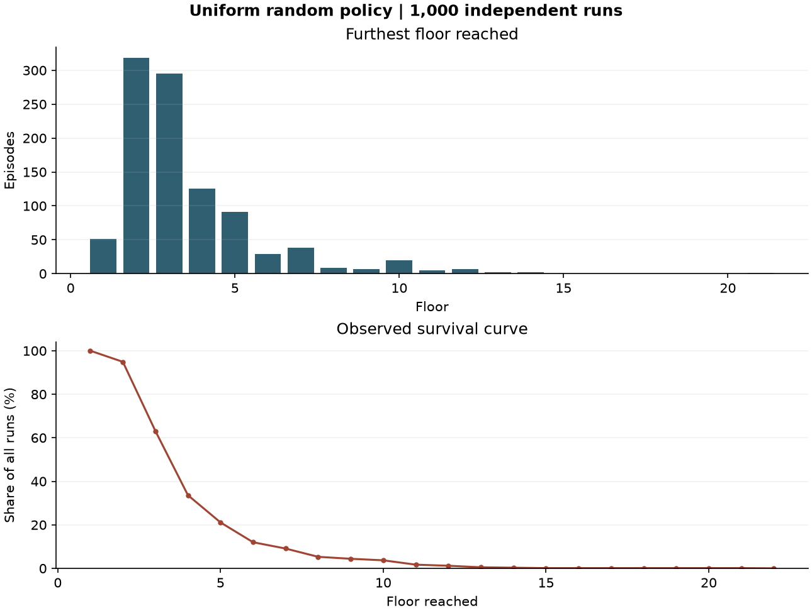
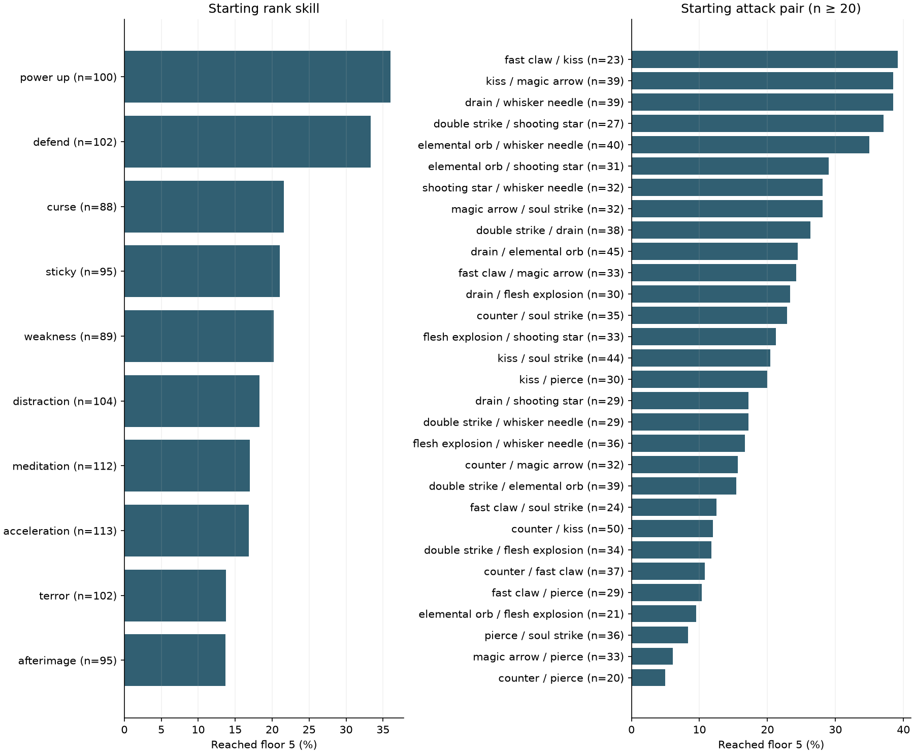

# Phase 3A. Uniform Random Policy 1,000판 기준선

**16개 CPU 워커에서 독립적으로 1,000판을 실행했다.** 일반 패배 1,000판, 클리어 0판, 타임아웃 0판, 오류 0판이었다. 최고 도달 지점은 **21층**이다. 5층에 211판(21.1%), 10층에 37판(3.7%)이 도달했다.

## 실험 조건

- 실행 시작 시각은 2026-11-26 03:54:47 EST다. Windows 11, Python 3.12.10, Ryzen AI 7 350(8코어/16스레드)에서 실행했다.
- 시뮬레이터 기준 커밋은 `ec70a7ba6b9a5a102501b813bef581a9a36cb444`이다. 각 워커는 독립된 엔진을 재사용하고 매 판 명시적 게임 시드로 초기화했다. Windows spawn 프로세스를 16개 띄우고 공통 시작 지점에 도달하도록 했다.
- 마스터 시드 **314159**에서 중복 없는 정수 2,000개를 뽑아 게임·정책에 한 쌍씩 사용했다. 정책은 전투, 보상, 상점, 이벤트 등 각 현재 합법 행동 목록에서 한 항목을 균등 선택했다.
- 한 판 최대 10,000행동 또는 판 시작 후 30초를 허용했다. 시간 제한은 행동 사이에서 확인한다. 일반 패배는 엔진의 게임 오버만 의미하며, 제한 초과와 실행 예외는 각각 별도로 기록한다.
- [실험 코드](../experiments/random_baseline.py)와 Matplotlib 3.11.2로 결과를 생성했다. SQLite와 집계 JSON은 로컬에 저장했다.

## 전체 성과와 실행 시간

| 게임 오버 | 클리어 | 타임아웃 | 실행 오류 |
|---:|---:|---:|---:|
| 1,000 | 0 | 0 | 0 |

관측 클리어율은 0%다. 독립 이항 모형으로 이 결과의 단측 95% 상한을 계산하면 약 0.30%다. 이 구간은 이 랜덤 정책의 클리어율에 해당한다.

| 게임당 지표 | 평균 | 중앙값 | P95 | 최댓값 |
|---|---:|---:|---:|---:|
| 행동 수 | 18.44 | 12 | 49 | 872 |
| 실행 시간 | 3.04 ms | 2.10 ms | 8.01 ms | 85.66 ms |

1,000판의 전체 시뮬레이션 벽시계 시간은 **0.733초**였다. 이 시간은 프로세스 준비, 워밍업용 엔진 생성, 시뮬레이션, 결과 수집을 포함한다. 게임당 시간은 reset부터 마지막 행동 및 결과 분류까지이며, 개별 워커가 병행 실행됐으므로 합계와 전체 벽시계 시간은 다르다. SQLite 저장과 그래프 렌더링은 두 시간 지표에서 제외했다. P95는 최근접 순위다.

## 도달 층과 층별 생존율

최종 도달은 해당 층을 마지막으로 관측한 판 수다. 도달률의 분모는 전체 1,000판이다. 다음 층 진입률은 해당 층에 도달한 판 중 다음 층에 들어간 비율이다. 22–100층은 진입 표본이 0이라 조건부 비율을 표시하지 않았다.

| 층 | 최종 도달 | 도달 판 수 | 전체 도달률 | 다음 층 진입률 |
|---:|---:|---:|---:|---:|
| 1 | 51 | 1000 | 100.0% | 94.9% (949/1000) |
| 2 | 318 | 949 | 94.9% | 66.5% (631/949) |
| 3 | 295 | 631 | 63.1% | 53.2% (336/631) |
| 4 | 125 | 336 | 33.6% | 62.8% (211/336) |
| 5 | 91 | 211 | 21.1% | 56.9% (120/211) |
| 6 | 29 | 120 | 12.0% | 75.8% (91/120) |
| 7 | 38 | 91 | 9.1% | 58.2% (53/91) |
| 8 | 9 | 53 | 5.3% | 83.0% (44/53) |
| 9 | 7 | 44 | 4.4% | 84.1% (37/44) |
| 10 | 20 | 37 | 3.7% | 45.9% (17/37) |
| 11 | 5 | 17 | 1.7% | 70.6% (12/17) |
| 12 | 7 | 12 | 1.2% | 41.7% (5/12) |
| 13 | 2 | 5 | 0.5% | 60.0% (3/5) |
| 14 | 2 | 3 | 0.3% | 33.3% (1/3) |
| 15 | 0 | 1 | 0.1% | 100.0% (1/1) |
| 16 | 0 | 1 | 0.1% | 100.0% (1/1) |
| 17 | 0 | 1 | 0.1% | 100.0% (1/1) |
| 18 | 0 | 1 | 0.1% | 100.0% (1/1) |
| 19 | 0 | 1 | 0.1% | 100.0% (1/1) |
| 20 | 0 | 1 | 0.1% | 100.0% (1/1) |
| 21 | 1 | 1 | 0.1% | 0.0% (0/1) |
| 22–100 | 0 | 0 | 0% | — |

## 몬스터별 사망 빈도와 초기 지역

사망 빈도는 패배 시 교전 중이던 적을 기준으로 집계했다. 반동이나 동시 사망도 같은 적에 집계하므로 마지막 피해의 원인이나 조우당 사망 위험을 뜻하지 않는다. Ella 첫 변형(#51)이 91회로 가장 많았고, Skeleton 55회, Creature 54회가 뒤를 이었다. 표에 없는 몬스터의 관측 사망 빈도는 0이다.

몬스터별 사망 빈도 전체

| ID | 몬스터 | 사망 판 수 |
|---:|---|---:|
| 51 | Ella | 91 |
| 33 | Skeleton | 55 |
| 6 | Creature | 54 |
| 10 | Esteed | 45 |
| 20 | Lizardman | 43 |
| 36 | Undine | 40 |
| 25 | Naga | 36 |
| 28 | Rat | 34 |
| 4 | Bonemare | 33 |
| 18 | Jiangshi | 33 |
| 37 | Unicorn | 33 |
| 27 | Phoneix | 32 |
| 16 | Iceminion | 31 |
| 26 | Phantom | 31 |
| 1 | Arachne | 28 |
| 2 | Balloon | 28 |
| 29 | Rhinoman | 28 |
| 40 | Wyvern | 28 |
| 15 | Hawgle | 27 |
| 21 | Mimic | 25 |
| 32 | Shieldminion | 25 |
| 31 | Scorpion | 23 |
| 38 | Werewolf | 20 |
| 12 | Gnome | 18 |
| 3 | Banshee | 15 |
| 14 | Golem | 15 |
| 13 | Goldenmonkey | 14 |
| 34 | Slime | 14 |
| 39 | Wisp | 13 |
| 19 | Kettle | 11 |
| 35 | Troll | 10 |
| 24 | Mummy | 9 |
| 8 | Doppelganger | 8 |
| 41 | Genie | 7 |
| 42 | Grimreaper | 6 |
| 5 | Chimera | 5 |
| 9 | Dullahan | 5 |
| 23 | Monocle | 5 |
| 7 | Cyclops | 4 |
| 11 | Fireminion | 3 |
| 17 | Jack | 3 |
| 30 | Salamander | 3 |
| 22 | Minocentaur | 2 |
| 44 | Necromancer | 2 |
| 46 | Queen | 2 |
| 43 | Lionheart | 1 |
| 47 | Superminion | 1 |
| 48 | Tarrasque | 1 |

| 초기 지역 | 판 수 | 평균 도달 층 | 5층 도달 | 10층 도달 |
|---|---:|---:|---:|---:|
| Forest | 122 | 2.93 | 12/122 (9.8%) | 2/122 (1.6%) |
| Fort | 93 | 3.86 | 31/93 (33.3%) | 6/93 (6.5%) |
| Graveyard | 116 | 3.66 | 23/116 (19.8%) | 9/116 (7.8%) |
| Highland | 120 | 3.08 | 15/120 (12.5%) | 1/120 (0.8%) |
| Mansion | 109 | 3.28 | 19/109 (17.4%) | 0/109 (0.0%) |
| Party | 119 | 4.95 | 59/119 (49.6%) | 14/119 (11.8%) |
| Ruin | 103 | 2.97 | 14/103 (13.6%) | 0/103 (0.0%) |
| Spiritland | 126 | 3.67 | 28/126 (22.2%) | 4/126 (3.2%) |
| Temple | 92 | 3.15 | 10/92 (10.9%) | 1/92 (1.1%) |

Party의 5층 진입 49.6%와 10층 진입 11.8%가 지역군 중 가장 높았다. 최고층 21층에 도달한 한 판은 Spiritland에서 시작했다. 첫 지역은 시작 기술과 적 구성을 함께 바꾸므로 지역 자체의 효과로 해석하기 어렵다.

## 초기 스킬 구성

슬롯 순서를 포함한 4개 스킬의 정확한 구성은 **767종**이었다. 569종은 1회만 등장했고, 가장 잦은 4종도 각 4회다. 전체 구성의 비교는 이 표본에서 변동성이 크다. 아래에 시작 기본기, 랭크 기술, 순서를 무시한 공격 기술 쌍으로 묶은 결과를 함께 제시한다.

| 시작 기본기 | 판 수 | 평균 도달 층 | 5층 도달 | 10층 도달 |
|---|---:|---:|---:|---:|
| skull dagger | 345 | 3.00 | 41/345 (11.9%) | 3/345 (0.9%) |
| thunder | 318 | 3.59 | 73/318 (23.0%) | 15/318 (4.7%) |
| wolf fang | 337 | 3.98 | 97/337 (28.8%) | 19/337 (5.6%) |

| 랭크 기술 | 판 수 | 평균 도달 층 | 5층 도달 | 10층 도달 |
|---|---:|---:|---:|---:|
| power up | 100 | 4.38 | 36/100 (36.0%) | 9/100 (9.0%) |
| defend | 102 | 4.32 | 34/102 (33.3%) | 9/102 (8.8%) |
| curse | 88 | 3.59 | 19/88 (21.6%) | 4/88 (4.5%) |
| sticky | 95 | 3.23 | 20/95 (21.1%) | 1/95 (1.1%) |
| weakness | 89 | 3.45 | 18/89 (20.2%) | 1/89 (1.1%) |
| distraction | 104 | 3.28 | 19/104 (18.3%) | 2/104 (1.9%) |
| meditation | 112 | 3.40 | 19/112 (17.0%) | 6/112 (5.4%) |
| acceleration | 113 | 3.11 | 19/113 (16.8%) | 1/113 (0.9%) |
| terror | 102 | 3.20 | 14/102 (13.7%) | 2/102 (2.0%) |
| afterimage | 95 | 3.24 | 13/95 (13.7%) | 2/95 (2.1%) |

랭크 기술에서는 Power Up(36.0%)과 Defend(33.3%)의 5층 도달률이 높았다. 공격 쌍 30종 중 Fast Claw + Kiss가 9/23(39.1%)으로 높았고, Drain + Whisker Needle과 Kiss + Magic Arrow는 각각 15/39(38.5%)였다. 순위는 기술 간 인과적 우위를 입증하지 않으며, 공격 쌍의 작은 표본과 첫 지역 구성을 고려해야 한다.

| 가장 자주 관측한 전체 구성 | 판 수 | 평균 도달 층 | 5층 도달 | 10층 도달 |
|---|---:|---:|---:|---:|
| skull dagger / drain / elemental orb / acceleration | 4 | 4.00 | 2/4 (50.0%) | 0/4 (0.0%) |
| thunder / flesh explosion / double strike / acceleration | 4 | 3.25 | 0/4 (0.0%) | 0/4 (0.0%) |
| thunder / kiss / soul strike / afterimage | 4 | 6.50 | 2/4 (50.0%) | 1/4 (25.0%) |
| wolf fang / soul strike / kiss / terror | 4 | 2.50 | 0/4 (0.0%) | 0/4 (0.0%) |

## 로컬 기록과 재현

공식 측정의 로컬 파일은 `data/baseline_random_1000/baseline.sqlite3`와 `data/baseline_random_1000/summary.json`이다. SQLite의 `run`에는 설정, `episodes`에는 판 ID, 두 시드, 초기 지역과 슬롯 순서, 종료 구분, 최고층, 사망 시 교전 적, 행동 수 및 판별 실행 시간이 있다. 집계 JSON에는 모든 층과 초기 구성의 집계가 있다.

Windows에서는 프로젝트 가상환경에 `experiments/requirements-baseline.txt`를 설치한 뒤 루트의 `run_baseline_random_1000.bat`을 실행한다. 기본 실행은 `data/baseline_<UTC timestamp>/`에 SQLite, JSON, PNG 3개를 저장한다. 출력 폴더를 고정하려면 존재하지 않는 폴더를 지정한다.

~~~bat
.venv\Scripts\python.exe -m pip install -r experiments\requirements-baseline.txt
run_baseline_random_1000.bat --games 1000 --workers 16 --master-seed 314159 --output data\baseline_replay
~~~

SQLite `integrity_check`, 두 시드의 2,000개 전체 고유성, 층별 합계와 사망 집계 합을 확인했다. Windows 배치 파일로 재실행한 1,000판은 시간 필드를 제외한 모든 판별 기록이 기준 실행과 일치했다. 타임아웃·오류 분리 동작은 별도 테스트로 확인했다. 게임 로직과 실제 학습·보상 모델은 이번 변경에 포함되지 않았다.
