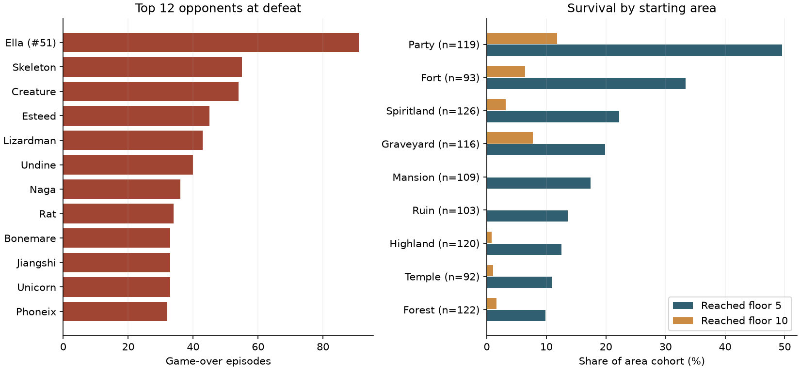

# Phase 3A. Uniform Random Policy Baseline (1,000 Games)

**We ran 1,000 independent games across 16 CPU workers.** The results were 1,000 losses, 0 clears, 0 timeouts, and 0 errors. The highest floor reached was **floor 21**. In total, 211 games (21.1%) reached floor 5, and 37 games (3.7%) reached floor 10.

## Experimental Setup

- The run started at 2026-11-26 03:54:47 EST. It used Windows 11, Python 3.12.10, and a Ryzen AI 7 350 (8 cores, 16 threads).
- The simulator was at commit `ec70a7ba6b9a5a102501b813bef581a9a36cb444`. Each worker reused its own engine and reset it with an explicit game seed before each game. All 16 worker processes used the Windows spawn start method and synchronized at a common starting point.
- We drew 2,000 unique integers from the master seed **314159** and assigned each run a pair consisting of a game seed and a policy seed. At each decision in combat, rewards, shops, events, and other game states, the policy sampled uniformly from the current list of legal actions.
- Each game had a limit of 10,000 actions or 30 seconds from its start. The time limit was checked between actions. A loss was recorded only when the engine reported game over. Games that exceeded a limit and games that raised an exception were recorded separately.
- We generated the results with the [experiment code](../experiments/random_baseline.py) and Matplotlib 3.11.2. The SQLite database and summary JSON were saved locally.

## Overall Results and Runtime

| Game over | Clears | Timeouts | Runtime errors |
|---:|---:|---:|---:|
| 1,000 | 0 | 0 | 0 |

The observed clear rate was 0%. Under a binomial model with independent games, the one-sided 95% upper confidence bound for this random policy’s clear rate is approximately 0.30%.

| Per-game metric | Mean | Median | P95 | Maximum |
|---|---:|---:|---:|---:|
| Actions | 18.44 | 12 | 49 | 872 |
| Runtime | 3.04 ms | 2.10 ms | 8.01 ms | 85.66 ms |

The total simulation wall-clock time for 1,000 games was **0.733 seconds**. This includes process setup, engine creation for warm-up, simulation, and result collection. Per-game runtime spans the engine reset through the final action and outcome classification. Because workers ran in parallel, the sum of individual runtimes differs from the total wall-clock time. Both timing metrics exclude SQLite writes and chart rendering. P95 uses the nearest-rank method.

## Floors Reached and Survival by Floor

Games ending on a floor are those for which it was the last floor observed. The overall reach rate uses all 1,000 games as its denominator. The next-floor entry rate is the share of games that entered the next floor among those that reached the current floor. For floors 22–100, the conditional rate is undefined because 0 games reached them.

| Floor | Games ending here | Games reaching floor | Overall reach rate | Next-floor entry rate |
|---:|---:|---:|---:|---:|
| 1 | 51 | 1000 | 100.0% | 94.9% (949/1000) |
| 2 | 318 | 949 | 94.9% | 66.5% (631/949) |
| 3 | 295 | 631 | 63.1% | 53.2% (336/631) |
| 4 | 125 | 336 | 33.6% | 62.8% (211/336) |
| 5 | 91 | 211 | 21.1% | 56.9% (120/211) |
| 6 | 29 | 120 | 12.0% | 75.8% (91/120) |
| 7 | 38 | 91 | 9.1% | 58.2% (53/91) |
| 8 | 9 | 53 | 5.3% | 83.0% (44/53) |
| 9 | 7 | 44 | 4.4% | 84.1% (37/44) |
| 10 | 20 | 37 | 3.7% | 45.9% (17/37) |
| 11 | 5 | 17 | 1.7% | 70.6% (12/17) |
| 12 | 7 | 12 | 1.2% | 41.7% (5/12) |
| 13 | 2 | 5 | 0.5% | 60.0% (3/5) |
| 14 | 2 | 3 | 0.3% | 33.3% (1/3) |
| 15 | 0 | 1 | 0.1% | 100.0% (1/1) |
| 16 | 0 | 1 | 0.1% | 100.0% (1/1) |
| 17 | 0 | 1 | 0.1% | 100.0% (1/1) |
| 18 | 0 | 1 | 0.1% | 100.0% (1/1) |
| 19 | 0 | 1 | 0.1% | 100.0% (1/1) |
| 20 | 0 | 1 | 0.1% | 100.0% (1/1) |
| 21 | 1 | 1 | 0.1% | 0.0% (0/1) |
| 22–100 | 0 | 0 | 0% | — |

## Death Counts by Monster and Starting Area

Death counts are grouped by the enemy the player was fighting when the game ended in a loss. Recoil deaths and simultaneous deaths count toward that enemy, so the figures capture the encounter at the time of death. They cannot establish the source of the final damage or the risk of death per encounter. The first Ella variant (#51) had the highest count at 91, followed by Skeleton at 55 and Creature at 54. All monsters omitted from the table had 0 observed deaths.

Full death counts by monster

| ID | Monster | Deaths |
|---:|---|---:|
| 51 | Ella | 91 |
| 33 | Skeleton | 55 |
| 6 | Creature | 54 |
| 10 | Esteed | 45 |
| 20 | Lizardman | 43 |
| 36 | Undine | 40 |
| 25 | Naga | 36 |
| 28 | Rat | 34 |
| 4 | Bonemare | 33 |
| 18 | Jiangshi | 33 |
| 37 | Unicorn | 33 |
| 27 | Phoneix | 32 |
| 16 | Iceminion | 31 |
| 26 | Phantom | 31 |
| 1 | Arachne | 28 |
| 2 | Balloon | 28 |
| 29 | Rhinoman | 28 |
| 40 | Wyvern | 28 |
| 15 | Hawgle | 27 |
| 21 | Mimic | 25 |
| 32 | Shieldminion | 25 |
| 31 | Scorpion | 23 |
| 38 | Werewolf | 20 |
| 12 | Gnome | 18 |
| 3 | Banshee | 15 |
| 14 | Golem | 15 |
| 13 | Goldenmonkey | 14 |
| 34 | Slime | 14 |
| 39 | Wisp | 13 |
| 19 | Kettle | 11 |
| 35 | Troll | 10 |
| 24 | Mummy | 9 |
| 8 | Doppelganger | 8 |
| 41 | Genie | 7 |
| 42 | Grimreaper | 6 |
| 5 | Chimera | 5 |
| 9 | Dullahan | 5 |
| 23 | Monocle | 5 |
| 7 | Cyclops | 4 |
| 11 | Fireminion | 3 |
| 17 | Jack | 3 |
| 30 | Salamander | 3 |
| 22 | Minocentaur | 2 |
| 44 | Necromancer | 2 |
| 46 | Queen | 2 |
| 43 | Lionheart | 1 |
| 47 | Superminion | 1 |
| 48 | Tarrasque | 1 |

| Starting area | Games | Mean floor reached | Reached floor 5 | Reached floor 10 |
|---|---:|---:|---:|---:|
| Forest | 122 | 2.93 | 12/122 (9.8%) | 2/122 (1.6%) |
| Fort | 93 | 3.86 | 31/93 (33.3%) | 6/93 (6.5%) |
| Graveyard | 116 | 3.66 | 23/116 (19.8%) | 9/116 (7.8%) |
| Highland | 120 | 3.08 | 15/120 (12.5%) | 1/120 (0.8%) |
| Mansion | 109 | 3.28 | 19/109 (17.4%) | 0/109 (0.0%) |
| Party | 119 | 4.95 | 59/119 (49.6%) | 14/119 (11.8%) |
| Ruin | 103 | 2.97 | 14/103 (13.6%) | 0/103 (0.0%) |
| Spiritland | 126 | 3.67 | 28/126 (22.2%) | 4/126 (3.2%) |
| Temple | 92 | 3.15 | 10/92 (10.9%) | 1/92 (1.1%) |

Party had the highest reach rates among starting areas, at 49.6% for floor 5 and 11.8% for floor 10. The only game to reach floor 21, the highest floor reached, started in Spiritland. Starting areas vary in both starting skills and enemy composition, making it difficult to isolate the effect of the area itself.

## Starting Skill Loadouts

There were **767 distinct four-skill loadouts** when slot order was included. Of those, 569 appeared only once, and the 4 most common each appeared 4 times. Comparisons across complete loadouts are noisy in this sample. The results below also group games by starting basic skill, rank skill, and unordered attack-skill pair.

| Starting basic skill | Games | Mean floor reached | Reached floor 5 | Reached floor 10 |
|---|---:|---:|---:|---:|
| skull dagger | 345 | 3.00 | 41/345 (11.9%) | 3/345 (0.9%) |
| thunder | 318 | 3.59 | 73/318 (23.0%) | 15/318 (4.7%) |
| wolf fang | 337 | 3.98 | 97/337 (28.8%) | 19/337 (5.6%) |

| Rank skill | Games | Mean floor reached | Reached floor 5 | Reached floor 10 |
|---|---:|---:|---:|---:|
| power up | 100 | 4.38 | 36/100 (36.0%) | 9/100 (9.0%) |
| defend | 102 | 4.32 | 34/102 (33.3%) | 9/102 (8.8%) |
| curse | 88 | 3.59 | 19/88 (21.6%) | 4/88 (4.5%) |
| sticky | 95 | 3.23 | 20/95 (21.1%) | 1/95 (1.1%) |
| weakness | 89 | 3.45 | 18/89 (20.2%) | 1/89 (1.1%) |
| distraction | 104 | 3.28 | 19/104 (18.3%) | 2/104 (1.9%) |
| meditation | 112 | 3.40 | 19/112 (17.0%) | 6/112 (5.4%) |
| acceleration | 113 | 3.11 | 19/113 (16.8%) | 1/113 (0.9%) |
| terror | 102 | 3.20 | 14/102 (13.7%) | 2/102 (2.0%) |
| afterimage | 95 | 3.24 | 13/95 (13.7%) | 2/95 (2.1%) |

Among rank skills, Power Up (36.0%) and Defend (33.3%) had high floor 5 reach rates. Among the 30 attack-skill pairs, Fast Claw + Kiss had a high reach rate at 9/23 (39.1%). Drain + Whisker Needle and Kiss + Magic Arrow each reached floor 5 in 15/39 games (38.5%). These are observational rankings, and interpreting them requires accounting for the small samples per attack-skill pair and the mix of starting areas.

| Most common complete loadouts | Games | Mean floor reached | Reached floor 5 | Reached floor 10 |
|---|---:|---:|---:|---:|
| skull dagger / drain / elemental orb / acceleration | 4 | 4.00 | 2/4 (50.0%) | 0/4 (0.0%) |
| thunder / flesh explosion / double strike / acceleration | 4 | 3.25 | 0/4 (0.0%) | 0/4 (0.0%) |
| thunder / kiss / soul strike / afterimage | 4 | 6.50 | 2/4 (50.0%) | 1/4 (25.0%) |
| wolf fang / soul strike / kiss / terror | 4 | 2.50 | 0/4 (0.0%) | 0/4 (0.0%) |

## Local Records and Reproduction

The official measurement files are stored locally at `data/baseline_random_1000/baseline.sqlite3` and `data/baseline_random_1000/summary.json`. In SQLite, `run` stores the configuration. The `episodes` table stores the game ID, both seeds, the starting area and slot order, the outcome category, the highest floor, the enemy in combat at the time of death, the action count, and the per-game runtime. The JSON summarizes every floor and starting loadout.

On Windows, install `experiments/requirements-baseline.txt` in the project’s virtual environment, then run `run_baseline_random_1000.bat` from the project root. By default, the runner writes the SQLite database, JSON summary, and 3 PNG files to `data/baseline_<UTC timestamp>/`. To set a fixed output path, specify a directory that does not yet exist.

~~~bat
.venv\Scripts\python.exe -m pip install -r experiments\requirements-baseline.txt
run_baseline_random_1000.bat --games 1000 --workers 16 --master-seed 314159 --output data\baseline_replay
~~~

We ran SQLite’s `integrity_check`, confirmed that all 2,000 game and policy seeds were unique, and checked the floor totals and the sum of the death counts. Replaying 1,000 games with the Windows batch file reproduced every per-game field apart from timing. Separate tests confirmed that timeouts and errors are recorded as distinct outcomes. Game logic and the actual training and reward models were outside the scope of this change.
