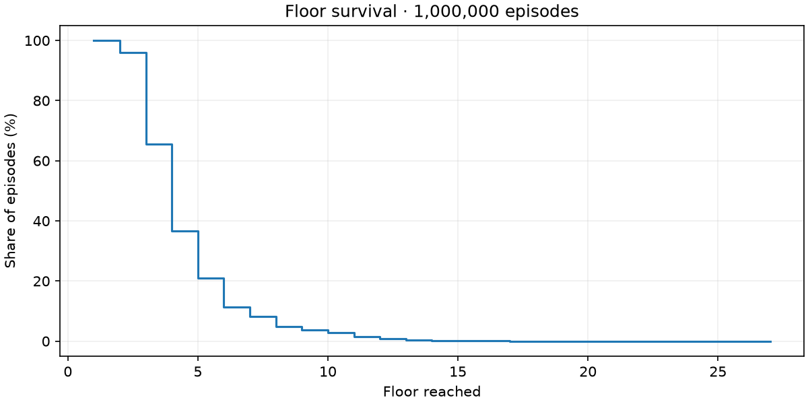
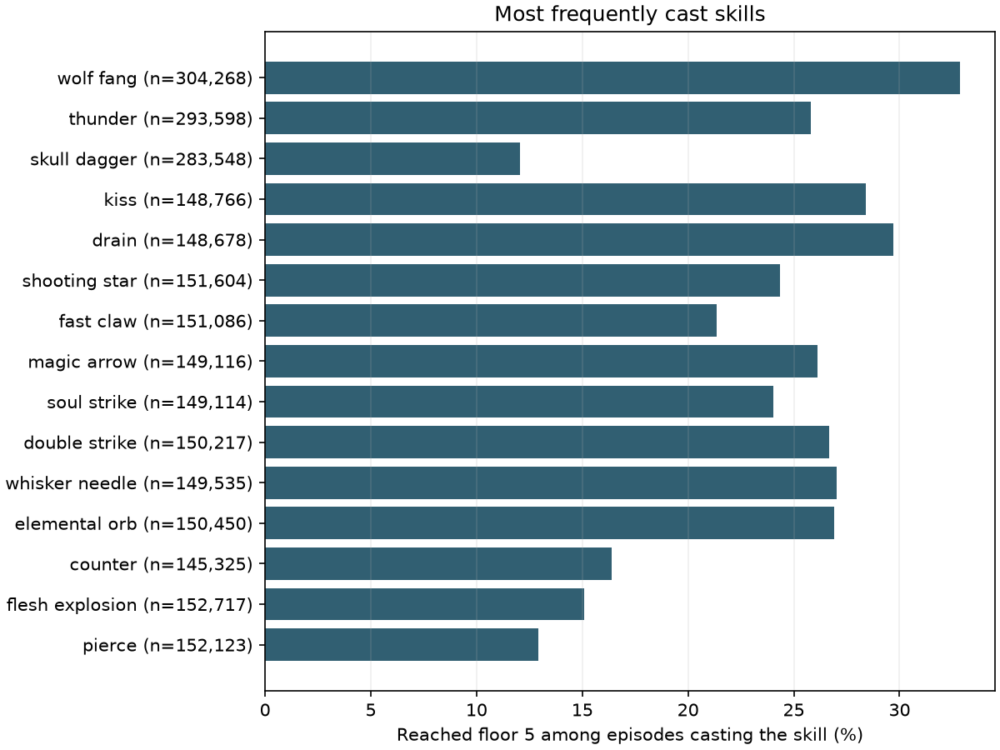

# Uniform Random Policy Baseline (1,000,000 Episodes)

Completed locally on 2026-11-26 with the [resumable runner](baseline_random_1m.md). The run used master seed 314159 and committed 7,813 batches. One episode reached floor 27, the highest observed. Floor 5 was reached in 210,555 episodes (21.0555%), floor 10 in 27,955 (2.7955%), and floor 20 in 64 (0.0064%).

All 87 timeouts reached the 10,000-action limit. The game-over count excludes those episodes. No clears or execution errors were recorded.

| Outcome | Episodes |
|---|---:|
| cleared | 0 |
| game_over | 999,913 |
| timeout | 87 |
| error | 0 |

Mean actions: 18.13. Mean episode runtime: 0.0036 seconds.

## Floor survival

| Floor | Reached | Of all runs | Advanced | Defeats | Incomplete |
|---:|---:|---:|---:|---:|---:|
| 1 | 1,000,000 | 100.00% | 959,226 | 40,774 | 0 |
| 2 | 959,226 | 95.92% | 654,475 | 304,694 | 57 |
| 3 | 654,475 | 65.45% | 365,781 | 288,675 | 19 |
| 4 | 365,781 | 36.58% | 210,555 | 155,217 | 9 |
| 5 | 210,555 | 21.06% | 112,565 | 97,990 | 0 |
| 6 | 112,565 | 11.26% | 82,671 | 29,892 | 2 |
| 7 | 82,671 | 8.27% | 48,049 | 34,622 | 0 |
| 8 | 48,049 | 4.80% | 36,277 | 11,772 | 0 |
| 9 | 36,277 | 3.63% | 27,955 | 8,322 | 0 |
| 10 | 27,955 | 2.80% | 14,120 | 13,835 | 0 |
| 11 | 14,120 | 1.41% | 7,995 | 6,125 | 0 |
| 12 | 7,995 | 0.80% | 3,605 | 4,390 | 0 |
| 13 | 3,605 | 0.36% | 1,696 | 1,909 | 0 |
| 14 | 1,696 | 0.17% | 878 | 818 | 0 |
| 15 | 878 | 0.09% | 507 | 371 | 0 |
| 16 | 507 | 0.05% | 301 | 206 | 0 |
| 17 | 301 | 0.03% | 161 | 140 | 0 |
| 18 | 161 | 0.02% | 101 | 60 | 0 |
| 19 | 101 | 0.01% | 64 | 37 | 0 |
| 20 | 64 | 0.01% | 22 | 42 | 0 |
| 21 | 22 | 0.00% | 10 | 12 | 0 |
| 22 | 10 | 0.00% | 7 | 3 | 0 |
| 23 | 7 | 0.00% | 3 | 4 | 0 |
| 24 | 3 | 0.00% | 3 | 0 | 0 |
| 25 | 3 | 0.00% | 1 | 2 | 0 |
| 26 | 1 | 0.00% | 1 | 0 | 0 |
| 27 | 1 | 0.00% | 0 | 1 | 0 |
| 28 | 0 | 0.00% | 0 | 0 | 0 |
| 29 | 0 | 0.00% | 0 | 0 | 0 |
| 30 | 0 | 0.00% | 0 | 0 | 0 |
| 31 | 0 | 0.00% | 0 | 0 | 0 |
| 32 | 0 | 0.00% | 0 | 0 | 0 |
| 33 | 0 | 0.00% | 0 | 0 | 0 |
| 34 | 0 | 0.00% | 0 | 0 | 0 |
| 35 | 0 | 0.00% | 0 | 0 | 0 |
| 36 | 0 | 0.00% | 0 | 0 | 0 |
| 37 | 0 | 0.00% | 0 | 0 | 0 |
| 38 | 0 | 0.00% | 0 | 0 | 0 |
| 39 | 0 | 0.00% | 0 | 0 | 0 |
| 40 | 0 | 0.00% | 0 | 0 | 0 |
| 41 | 0 | 0.00% | 0 | 0 | 0 |
| 42 | 0 | 0.00% | 0 | 0 | 0 |
| 43 | 0 | 0.00% | 0 | 0 | 0 |
| 44 | 0 | 0.00% | 0 | 0 | 0 |
| 45 | 0 | 0.00% | 0 | 0 | 0 |
| 46 | 0 | 0.00% | 0 | 0 | 0 |
| 47 | 0 | 0.00% | 0 | 0 | 0 |
| 48 | 0 | 0.00% | 0 | 0 | 0 |
| 49 | 0 | 0.00% | 0 | 0 | 0 |
| 50 | 0 | 0.00% | 0 | 0 | 0 |
| 51 | 0 | 0.00% | 0 | 0 | 0 |
| 52 | 0 | 0.00% | 0 | 0 | 0 |
| 53 | 0 | 0.00% | 0 | 0 | 0 |
| 54 | 0 | 0.00% | 0 | 0 | 0 |
| 55 | 0 | 0.00% | 0 | 0 | 0 |
| 56 | 0 | 0.00% | 0 | 0 | 0 |
| 57 | 0 | 0.00% | 0 | 0 | 0 |
| 58 | 0 | 0.00% | 0 | 0 | 0 |
| 59 | 0 | 0.00% | 0 | 0 | 0 |
| 60 | 0 | 0.00% | 0 | 0 | 0 |
| 61 | 0 | 0.00% | 0 | 0 | 0 |
| 62 | 0 | 0.00% | 0 | 0 | 0 |
| 63 | 0 | 0.00% | 0 | 0 | 0 |
| 64 | 0 | 0.00% | 0 | 0 | 0 |
| 65 | 0 | 0.00% | 0 | 0 | 0 |
| 66 | 0 | 0.00% | 0 | 0 | 0 |
| 67 | 0 | 0.00% | 0 | 0 | 0 |
| 68 | 0 | 0.00% | 0 | 0 | 0 |
| 69 | 0 | 0.00% | 0 | 0 | 0 |
| 70 | 0 | 0.00% | 0 | 0 | 0 |
| 71 | 0 | 0.00% | 0 | 0 | 0 |
| 72 | 0 | 0.00% | 0 | 0 | 0 |
| 73 | 0 | 0.00% | 0 | 0 | 0 |
| 74 | 0 | 0.00% | 0 | 0 | 0 |
| 75 | 0 | 0.00% | 0 | 0 | 0 |
| 76 | 0 | 0.00% | 0 | 0 | 0 |
| 77 | 0 | 0.00% | 0 | 0 | 0 |
| 78 | 0 | 0.00% | 0 | 0 | 0 |
| 79 | 0 | 0.00% | 0 | 0 | 0 |
| 80 | 0 | 0.00% | 0 | 0 | 0 |
| 81 | 0 | 0.00% | 0 | 0 | 0 |
| 82 | 0 | 0.00% | 0 | 0 | 0 |
| 83 | 0 | 0.00% | 0 | 0 | 0 |
| 84 | 0 | 0.00% | 0 | 0 | 0 |
| 85 | 0 | 0.00% | 0 | 0 | 0 |
| 86 | 0 | 0.00% | 0 | 0 | 0 |
| 87 | 0 | 0.00% | 0 | 0 | 0 |
| 88 | 0 | 0.00% | 0 | 0 | 0 |
| 89 | 0 | 0.00% | 0 | 0 | 0 |
| 90 | 0 | 0.00% | 0 | 0 | 0 |
| 91 | 0 | 0.00% | 0 | 0 | 0 |
| 92 | 0 | 0.00% | 0 | 0 | 0 |
| 93 | 0 | 0.00% | 0 | 0 | 0 |
| 94 | 0 | 0.00% | 0 | 0 | 0 |
| 95 | 0 | 0.00% | 0 | 0 | 0 |
| 96 | 0 | 0.00% | 0 | 0 | 0 |
| 97 | 0 | 0.00% | 0 | 0 | 0 |
| 98 | 0 | 0.00% | 0 | 0 | 0 |
| 99 | 0 | 0.00% | 0 | 0 | 0 |
| 100 | 0 | 0.00% | 0 | 0 | 0 |

## Monster encounters

| ID | Monster | Encounters | Wins | Losses | Unresolved |
|---:|---|---:|---:|---:|---:|
| 51 | Ella | 210,555 | 112,565 | 97,990 | 0 |
| 6 | Creature | 94,216 | 39,838 | 54,378 | 0 |
| 33 | Skeleton | 325,571 | 272,412 | 53,159 | 0 |
| 10 | Esteed | 78,538 | 34,815 | 43,723 | 0 |
| 4 | Bonemare | 100,252 | 60,323 | 39,929 | 0 |
| 36 | Undine | 123,321 | 84,669 | 38,652 | 0 |
| 20 | Lizardman | 61,279 | 24,737 | 36,542 | 0 |
| 16 | Iceminion | 78,397 | 41,969 | 36,428 | 0 |
| 28 | Rat | 287,169 | 252,051 | 35,118 | 0 |
| 18 | Jiangshi | 100,871 | 68,101 | 32,770 | 0 |
| 1 | Arachne | 62,218 | 30,882 | 31,336 | 0 |
| 27 | Phoneix | 78,701 | 47,588 | 31,113 | 0 |
| 37 | Unicorn | 52,241 | 21,470 | 30,771 | 0 |
| 2 | Balloon | 83,971 | 54,131 | 29,840 | 0 |
| 26 | Phantom | 94,341 | 64,606 | 29,735 | 0 |
| 25 | Naga | 193,838 | 165,229 | 28,609 | 0 |
| 29 | Rhinoman | 61,318 | 33,757 | 27,561 | 0 |
| 15 | Hawgle | 52,098 | 24,806 | 27,292 | 0 |
| 32 | Shieldminion | 38,663 | 12,062 | 26,601 | 0 |
| 40 | Wyvern | 51,871 | 25,916 | 25,955 | 0 |
| 21 | Mimic | 47,209 | 24,302 | 22,820 | 87 |
| 35 | Troll | 32,313 | 9,735 | 22,578 | 0 |
| 24 | Mummy | 213,664 | 192,233 | 21,431 | 0 |
| 3 | Banshee | 99,759 | 80,504 | 19,255 | 0 |
| 38 | Werewolf | 29,436 | 12,625 | 16,811 | 0 |
| 13 | Goldenmonkey | 32,412 | 16,499 | 15,913 | 0 |
| 31 | Scorpion | 29,470 | 13,937 | 15,533 | 0 |
| 14 | Golem | 78,110 | 64,356 | 13,754 | 0 |
| 12 | Gnome | 40,035 | 27,369 | 12,666 | 0 |
| 19 | Kettle | 196,417 | 184,349 | 12,068 | 0 |
| 39 | Wisp | 264,531 | 253,345 | 11,186 | 0 |
| 34 | Slime | 123,252 | 113,496 | 9,756 | 0 |
| 23 | Monocle | 26,195 | 16,639 | 9,556 | 0 |
| 9 | Dullahan | 12,829 | 7,032 | 5,797 | 0 |
| 30 | Salamander | 13,906 | 9,262 | 4,644 | 0 |
| 8 | Doppelganger | 5,897 | 1,963 | 3,934 | 0 |
| 41 | Genie | 9,988 | 6,080 | 3,908 | 0 |
| 42 | Grimreaper | 4,821 | 1,699 | 3,122 | 0 |
| 17 | Jack | 7,978 | 4,900 | 3,078 | 0 |
| 11 | Fireminion | 5,415 | 2,469 | 2,946 | 0 |
| 46 | Queen | 5,100 | 2,416 | 2,684 | 0 |
| 5 | Chimera | 4,151 | 2,413 | 1,738 | 0 |
| 22 | Minocentaur | 3,847 | 2,297 | 1,550 | 0 |
| 7 | Cyclops | 2,755 | 1,235 | 1,520 | 0 |
| 44 | Necromancer | 3,142 | 1,941 | 1,201 | 0 |
| 43 | Lionheart | 1,230 | 469 | 761 | 0 |
| 47 | Superminion | 1,052 | 376 | 676 | 0 |
| 48 | Tarrasque | 1,037 | 371 | 666 | 0 |
| 49 | Vampire | 1,090 | 440 | 650 | 0 |
| 45 | Ogre | 559 | 350 | 209 | 0 |

## Skill cohorts

Percentages below use the number of episodes in each cohort. Later acquisition requires surviving long enough to obtain the skill, so these rates describe association.

| Skill | Acquired | Equipped | Cast episodes | Casts | Peak uses | F5 / F10 if acquired | F5 / F10 if equipped | F5 / F10 if cast |
|---|---:|---:|---:|---:|---:|---|---|---|
| wolf fang | 486,166 | 335,087 | 304,268 | 1,604,959 | 23 | 28.4% / 4.4% | 30.2% / 5.1% | 32.9% / 5.3% |
| thunder | 515,206 | 337,204 | 293,598 | 1,096,176 | 22 | 30.9% / 4.9% | 23.8% / 3.9% | 25.8% / 3.1% |
| skull dagger | 514,823 | 335,653 | 283,548 | 760,663 | 22 | 21.8% / 3.2% | 11.1% / 1.7% | 12.1% / 1.0% |
| kiss | 223,886 | 168,962 | 148,766 | 598,593 | 13 | 34.9% / 7.1% | 26.6% / 5.7% | 28.4% / 4.9% |
| drain | 202,565 | 167,354 | 148,678 | 593,936 | 12 | 32.4% / 5.5% | 27.1% / 4.7% | 29.7% / 4.7% |
| shooting star | 240,398 | 167,613 | 151,604 | 551,299 | 13 | 26.4% / 4.0% | 22.7% / 3.3% | 24.3% / 3.0% |
| fast claw | 193,912 | 167,013 | 151,086 | 545,541 | 12 | 23.6% / 3.4% | 19.7% / 2.7% | 21.3% / 2.7% |
| magic arrow | 181,899 | 167,063 | 149,116 | 540,855 | 13 | 27.3% / 4.7% | 23.9% / 3.9% | 26.1% / 3.9% |
| soul strike | 229,899 | 167,706 | 149,114 | 536,867 | 12 | 27.0% / 4.4% | 22.2% / 3.4% | 24.1% / 3.1% |
| double strike | 211,084 | 167,463 | 150,217 | 533,007 | 12 | 26.1% / 4.3% | 24.4% / 4.0% | 26.7% / 4.2% |
| whisker needle | 225,123 | 166,565 | 149,535 | 529,594 | 13 | 23.9% / 3.9% | 24.7% / 4.1% | 27.0% / 4.2% |
| elemental orb | 178,935 | 168,220 | 150,450 | 525,204 | 12 | 28.6% / 5.6% | 24.9% / 4.1% | 26.9% / 3.8% |
| counter | 199,367 | 168,826 | 145,325 | 473,892 | 12 | 23.3% / 4.2% | 15.3% / 2.2% | 16.4% / 1.4% |
| flesh explosion | 174,924 | 167,447 | 152,717 | 406,531 | 12 | 18.0% / 2.4% | 14.4% / 1.2% | 15.1% / 0.8% |
| pierce | 192,737 | 167,250 | 152,123 | 383,865 | 12 | 17.6% / 2.0% | 12.2% / 0.9% | 12.9% / 0.6% |
| defend | 170,882 | 102,064 | 89,518 | 371,596 | 12 | 34.2% / 7.5% | 27.4% / 6.4% | 28.5% / 5.1% |
| afterimage | 131,539 | 101,860 | 89,979 | 347,293 | 13 | 34.3% / 8.5% | 26.0% / 6.5% | 27.4% / 5.9% |
| weakness | 175,276 | 100,810 | 89,336 | 333,368 | 12 | 30.7% / 4.6% | 21.3% / 3.0% | 22.3% / 2.2% |
| distraction | 147,407 | 102,081 | 89,485 | 308,317 | 11 | 32.6% / 6.2% | 20.2% / 3.6% | 20.3% / 1.9% |
| acceleration | 127,210 | 100,597 | 89,340 | 298,242 | 12 | 26.3% / 3.8% | 18.8% / 2.2% | 19.9% / 1.7% |
| power up | 148,018 | 101,648 | 89,546 | 297,633 | 13 | 38.7% / 9.1% | 30.5% / 7.7% | 32.4% / 7.0% |
| sticky | 129,912 | 100,272 | 88,937 | 289,116 | 12 | 27.4% / 4.3% | 17.7% / 2.1% | 18.4% / 1.4% |
| meditation | 241,186 | 101,992 | 89,305 | 286,840 | 13 | 28.4% / 4.9% | 20.1% / 4.0% | 20.2% / 2.3% |
| curse | 181,758 | 101,347 | 89,446 | 285,697 | 12 | 25.1% / 4.7% | 21.6% / 3.3% | 22.4% / 2.3% |
| terror | 113,022 | 101,594 | 89,499 | 284,804 | 12 | 24.3% / 5.1% | 18.0% / 2.7% | 18.3% / 1.5% |
| sacrifice | 0 | 0 | 23,200 | 95,103 | 0 | — | — | 76.6% / 37.8% |
| paralyze | 50,463 | 2,411 | 57 | 63 | 3 | 68.8% / 18.3% | 100.0% / 100.0% | 100.0% / 100.0% |
| heal | 52,303 | 1,995 | 43 | 47 | 3 | 66.3% / 16.6% | 100.0% / 100.0% | 100.0% / 100.0% |
| recovery | 53,697 | 2,375 | 43 | 45 | 4 | 70.4% / 19.3% | 100.0% / 100.0% | 100.0% / 100.0% |
| regenerate | 28,808 | 1,718 | 42 | 43 | 4 | 74.6% / 22.7% | 100.0% / 100.0% | 100.0% / 100.0% |
| typereverse | 51,456 | 1,985 | 31 | 33 | 4 | 58.8% / 14.4% | 100.0% / 100.0% | 100.0% / 100.0% |
| immune | 28,790 | 1,637 | 30 | 33 | 4 | 79.4% / 22.9% | 100.0% / 100.0% | 100.0% / 100.0% |
| sing | 17,160 | 1,174 | 24 | 25 | 3 | 76.8% / 24.2% | 100.0% / 100.0% | 100.0% / 100.0% |
| tornado | 1,897 | 823 | 19 | 21 | 3 | 100.0% / 100.0% | 100.0% / 100.0% | 100.0% / 100.0% |
| despair | 24,702 | 847 | 18 | 19 | 3 | 65.2% / 16.5% | 100.0% / 100.0% | 100.0% / 100.0% |
| sturdy kick | 18,028 | 556 | 16 | 18 | 3 | 60.6% / 15.3% | 100.0% / 100.0% | 100.0% / 100.0% |
| tie up | 52,087 | 423 | 15 | 17 | 2 | 36.8% / 5.9% | 100.0% / 100.0% | 100.0% / 100.0% |
| aim | 6,453 | 1,088 | 16 | 17 | 3 | 100.0% / 61.4% | 100.0% / 100.0% | 100.0% / 100.0% |
| bonemerang | 75,325 | 1,116 | 16 | 16 | 5 | 37.6% / 7.5% | 100.0% / 100.0% | 100.0% / 100.0% |
| magician hat | 1,791 | 807 | 16 | 16 | 3 | 100.0% / 100.0% | 100.0% / 100.0% | 100.0% / 100.0% |
| battojutsu | 3,342 | 376 | 12 | 14 | 3 | 100.0% / 69.8% | 100.0% / 100.0% | 100.0% / 100.0% |
| release | 23,218 | 425 | 11 | 14 | 3 | 58.2% / 11.5% | 100.0% / 100.0% | 100.0% / 100.0% |
| fracture | 20,586 | 432 | 12 | 13 | 3 | 51.4% / 9.1% | 100.0% / 100.0% | 100.0% / 100.0% |
| plague | 62,394 | 776 | 13 | 13 | 3 | 37.1% / 6.7% | 100.0% / 100.0% | 100.0% / 100.0% |
| rigid | 19,296 | 465 | 9 | 12 | 2 | 59.5% / 13.1% | 100.0% / 100.0% | 100.0% / 100.0% |
| veilguard | 1,074 | 500 | 11 | 11 | 4 | 100.0% / 100.0% | 100.0% / 100.0% | 100.0% / 100.0% |
| undead missile | 1,256 | 567 | 10 | 10 | 3 | 100.0% / 100.0% | 100.0% / 100.0% | 100.0% / 100.0% |
| icebolt | 14,720 | 359 | 8 | 9 | 3 | 53.7% / 12.1% | 100.0% / 100.0% | 100.0% / 100.0% |
| molt | 46,761 | 252 | 7 | 8 | 5 | 25.5% / 4.4% | 100.0% / 100.0% | 100.0% / 100.0% |
| jiujitsu | 70,224 | 219 | 8 | 8 | 2 | 16.4% / 2.6% | 100.0% / 100.0% | 100.0% / 100.0% |
| discharge | 12,429 | 321 | 7 | 7 | 2 | 54.4% / 13.6% | 100.0% / 100.0% | 100.0% / 100.0% |
| flame wheel | 3,407 | 413 | 7 | 7 | 3 | 100.0% / 55.1% | 100.0% / 100.0% | 100.0% / 100.0% |
| deathscythe | 560 | 228 | 6 | 6 | 2 | 100.0% / 100.0% | 100.0% / 100.0% | 100.0% / 100.0% |
| firebird | 16,247 | 430 | 5 | 5 | 3 | 55.2% / 12.6% | 100.0% / 100.0% | 100.0% / 100.0% |
| fog | 23,980 | 686 | 5 | 5 | 3 | 63.7% / 14.6% | 100.0% / 100.0% | 100.0% / 100.0% |
| will of wisp | 70,277 | 471 | 5 | 5 | 3 | 26.3% / 4.4% | 100.0% / 100.0% | 100.0% / 100.0% |
| revive | 554 | 246 | 5 | 5 | 3 | 100.0% / 100.0% | 100.0% / 100.0% | 100.0% / 100.0% |
| shadowstar | 146 | 68 | 4 | 4 | 2 | 100.0% / 100.0% | 100.0% / 100.0% | 100.0% / 100.0% |
| earth castle | 8,549 | 313 | 4 | 4 | 3 | 67.7% / 19.0% | 100.0% / 100.0% | 100.0% / 100.0% |
| pumpkin seed | 1,857 | 325 | 4 | 4 | 4 | 100.0% / 63.8% | 100.0% / 100.0% | 100.0% / 100.0% |
| dinolize | 7,567 | 88 | 4 | 4 | 2 | 39.1% / 6.1% | 100.0% / 100.0% | 100.0% / 100.0% |
| sap screw | 13,171 | 289 | 4 | 4 | 3 | 48.0% / 9.5% | 100.0% / 100.0% | 100.0% / 100.0% |
| mimic | 21,087 | 173 | 3 | 3 | 3 | 45.2% / 4.5% | 100.0% / 100.0% | 100.0% / 100.0% |
| poison tail | 8,128 | 84 | 2 | 3 | 3 | 40.4% / 6.7% | 100.0% / 100.0% | 100.0% / 100.0% |
| tiger claw | 407 | 183 | 2 | 2 | 2 | 100.0% / 100.0% | 100.0% / 100.0% | 100.0% / 100.0% |
| blood leech | 114 | 58 | 2 | 2 | 2 | 100.0% / 100.0% | 100.0% / 100.0% | 100.0% / 100.0% |
| rage | 4,030 | 53 | 2 | 2 | 2 | 43.7% / 9.1% | 100.0% / 100.0% | 100.0% / 100.0% |
| blessed horn | 6,705 | 65 | 2 | 2 | 2 | 40.3% / 7.0% | 100.0% / 100.0% | 100.0% / 100.0% |
| shield slam | 3,690 | 46 | 2 | 2 | 2 | 47.0% / 8.7% | 100.0% / 100.0% | 100.0% / 100.0% |
| hybrid attack | 1,004 | 82 | 2 | 2 | 3 | 100.0% / 46.4% | 100.0% / 100.0% | 100.0% / 100.0% |
| fireball | 964 | 60 | 1 | 1 | 2 | 100.0% / 42.1% | 100.0% / 100.0% | 100.0% / 100.0% |
| spider web | 9,397 | 92 | 1 | 1 | 2 | 35.8% / 6.1% | 100.0% / 100.0% | 100.0% / 100.0% |
| heart of lion | 189 | 80 | 1 | 1 | 3 | 100.0% / 100.0% | 100.0% / 100.0% | 100.0% / 100.0% |
| recoilless | 10,448 | 136 | 1 | 1 | 3 | 41.0% / 6.4% | 100.0% / 100.0% | 100.0% / 100.0% |
| trick or treat | 2,789 | 37 | 1 | 1 | 2 | 35.3% / 6.2% | 100.0% / 100.0% | 100.0% / 100.0% |
| flash beak | 7,823 | 84 | 1 | 1 | 2 | 40.8% / 6.8% | 100.0% / 100.0% | 100.0% / 100.0% |
| judgement | 134 | 61 | 1 | 1 | 4 | 100.0% / 100.0% | 100.0% / 100.0% | 100.0% / 100.0% |
| gold rush | 4,888 | 55 | 1 | 1 | 2 | 38.9% / 5.8% | 100.0% / 100.0% | 100.0% / 100.0% |
| stinger | 4,587 | 52 | 1 | 1 | 2 | 39.7% / 8.4% | 100.0% / 100.0% | 100.0% / 100.0% |
| imitation | 229 | 45 | 1 | 1 | 2 | 100.0% / 78.2% | 100.0% / 100.0% | 100.0% / 100.0% |
| bullseye | 994 | 88 | 0 | 0 | 2 | 100.0% / 55.0% | 100.0% / 100.0% | — |
| blindfist | 431 | 53 | 0 | 0 | 4 | 100.0% / 45.9% | 100.0% / 100.0% | — |
| acid stone | 111 | 48 | 0 | 0 | 2 | 100.0% / 100.0% | 100.0% / 100.0% | — |

The local run directory, `data/baseline_random_1m/`, contains acquisition-floor counts, clear counts by cohort, and usage totals in `summary.json`. The episode database `baseline.sqlite3` is also local.

