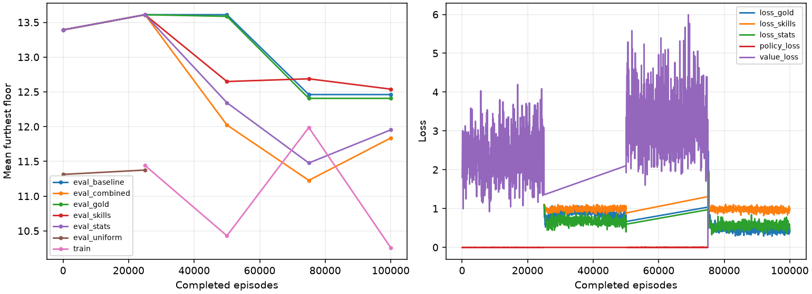

# Phase 3C baseline-relative Shop results · 100,000 episodes

The local run completed 100,000 training episodes and the five final evaluation panels of 128 games each. The checkpoint and SQLite watermarks agree, and the latest checkpoint is byte-identical to the 100,000-episode archive. Training processed 8,997,681 live simulator actions in 36 minutes and 47 seconds of measured rollout and update time. It recorded eight training timeouts and no clears. The combined policy reached floor 33 in the final evaluation. The highest training floor across all four blocks was 60.

## Fixed-seed evaluation

Each column uses the same 128 game and policy seed pairs. Step 0 uses the original 1M PPO, and the uniform-shop evaluation at that step reproduces its published mean of 11.31. The policies below share the PPO checkpoint within each column.

| Shop policy | Initial mean floor | 25k | 50k | 75k | 100k | 100k median / max | 100k change vs no edits |
|---|---:|---:|---:|---:|---:|---:|---:|
| No edits | 13.39 | 13.61 | 13.61 | 12.46 | 12.46 | 13 / 21 | — |
| Gold only | 13.39 | 13.61 | 13.59 | 12.41 | 12.41 | 13 / 21 | −0.05 |
| Stats only | 13.39 | 13.61 | 12.34 | 11.48 | 11.95 | 12 / 28 | −0.51 |
| Skills only | 13.39 | 13.61 | 12.65 | 12.69 | 12.54 | 13 / 25 | +0.08 |
| Combined | 13.39 | 13.61 | 12.02 | 11.23 | 11.84 | 12 / 33 | −0.63 |

There were no clears or timeouts in these fixed panels. At 100,000 the combined policy averaged 0.52 floors above the historical 1M PPO with uniform-random shops, but averaged 0.63 floors below the current PPO with no-edit shops. In that latter pairing it went farther on 22 seeds, tied on 65, and went less far on 41. Both policies reached floor 11 on 90 seeds. The combined policy reached floor 20 on nine seeds, and the no-edit policy reached it on eleven. The floor-33 run shows a deeper maximum, while the mean and paired outcomes show no aggregate gain from enabling the combined Shop policy in this panel. [Historical 1M PPO report](../combat_rl_1m/training_report.md) · [Paired comparisons](paired_panel.csv) · [Floor reach](floor_reach.csv)

## Shop learning and throughput

The two Shop blocks recorded 81,084 comparison rows. All three heads received 1,492 updates by the final checkpoint. In the last Shop block, a random Stats edit at floor 10 averaged 2.97 floors below the matching no-edit continuation. Random Skills edits averaged 0.91 floors lower. Gold averaged 0.01 floors lower, with no edits in 8,770 of 12,552 comparisons. These training comparisons describe random proposals under the frozen PPO, separate from the learned policies' fixed-seed results. [Comparison labels and raw floor differences](shop_comparisons.csv) · [Reward context](reward_context.csv)

The first 25,000 games ran at 70.9 episodes/s with uniform shops. The next Shop block ran at 33.1 episodes/s, the next PPO block at 51.6, and the final Shop block at 40.6. The last block's paired continuations added 1,097,896 branch actions outside the live-action counter and about 254 seconds of synchronized comparison time. [Throughput](throughput.csv) · [Evaluation timings](evaluation_timing.csv)
