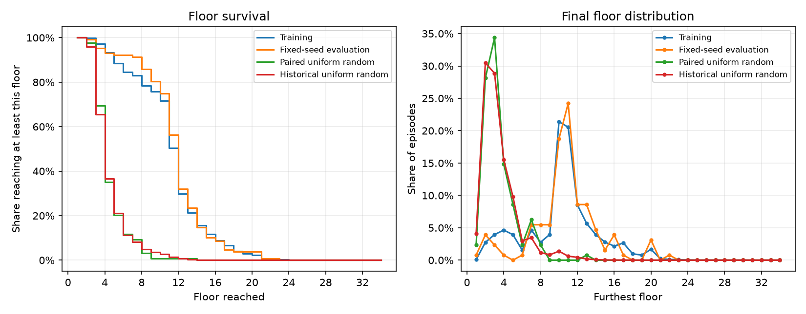
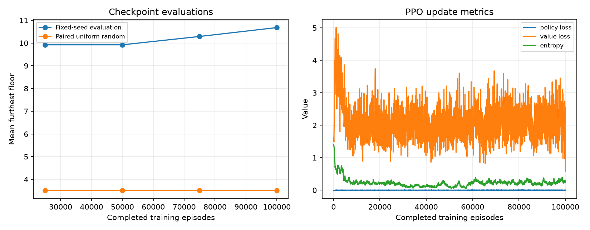

# Combat and Reward reinforcement learning results

The local run was stopped after **100,000 completed training episodes**. The last completed rollout recorded 7,742,848 simulator actions and 4,419,660 policy decisions over 1,462.82 seconds of measured training time (about 24 minutes 23 seconds). This timer covers rollout collection and PPO updates. Evaluation and checkpoint time are separate. Twelve games had started but were still in progress and are excluded from the training outcome counts. The 100,000-episode evaluation panel completed for both policies.

The trained policy selects combat skills and victory rewards. Shop and Event decisions use uniform random sampling, so unallocated resources and depleted loadouts can remain a performance bottleneck. Training samples evolve with the policy, while checkpoint evaluation uses fixed separate seed panels.

The historical 1,000,000-episode uniform random baseline is a descriptive benchmark. Paired uniform-random evaluation uses the same game seeds and action cap as the learned policy for its panel. Reaching a floor means reaching it at any point in an episode. [Original baseline report](https://github.com/KyleIm/Clear-The-Dungeon-Project/blob/main/docs/baseline_random_1m_results.md)

## Outcomes and floor reach

| Cohort | Episodes | Mean floor | Median floor | Max floor | Clear rate | Timeout rate | Mean actions |
|---|---:|---:|---:|---:|---:|---:|---:|
| Training | 100,000 | 10.27 | 11 | 34 | 0.0000% | 0.0150% | 77.40 |
| Historical uniform random | 1,000,000 | 3.53 | 3 | 27 | 0.0000% | 0.0087% | 18.13 |
| Fixed-seed evaluation at 25,000 | 128 | 9.92 | 10 | 20 | 0.0000% | 0.0000% | 64.97 |
| Fixed-seed evaluation at 50,000 | 128 | 9.92 | 10 | 20 | 0.0000% | 0.0000% | 64.97 |
| Fixed-seed evaluation at 75,000 | 128 | 10.29 | 11 | 20 | 0.0000% | 0.0000% | 70.44 |
| Fixed-seed evaluation at 100,000 | 128 | 10.68 | 11 | 22 | 0.0000% | 0.0000% | 73.21 |
| Paired uniform random at 25,000 | 128 | 3.51 | 3 | 13 | 0.0000% | 0.0000% | 16.34 |
| Paired uniform random at 50,000 | 128 | 3.51 | 3 | 13 | 0.0000% | 0.0000% | 16.34 |
| Paired uniform random at 75,000 | 128 | 3.51 | 3 | 13 | 0.0000% | 0.0000% | 16.34 |
| Paired uniform random at 100,000 | 128 | 3.51 | 3 | 13 | 0.0000% | 0.0000% | 16.34 |

### Latest floor reach and distribution

Each cell shows final episode count at that floor and the share reaching at least that floor.

| Floor | Training | Fixed-seed evaluation | Paired uniform random | Historical uniform random |
|---:|---:|---:|---:|---:|
| 1 | 78 · 100.0000% | 1 · 100.0000% | 3 · 100.0000% | 40,774 · 100.0000% |
| 2 | 2,750 · 99.9220% | 5 · 99.2188% | 36 · 97.6562% | 304,751 · 95.9226% |
| 3 | 3,953 · 97.1720% | 3 · 95.3125% | 44 · 69.5312% | 288,694 · 65.4475% |
| 4 | 4,645 · 93.2190% | 1 · 92.9688% | 19 · 35.1562% | 155,226 · 36.5781% |
| 5 | 3,933 · 88.5740% | 0 · 92.1875% | 11 · 20.3125% | 97,990 · 21.0555% |
| 6 | 1,563 · 84.6410% | 1 · 92.1875% | 3 · 11.7188% | 29,894 · 11.2565% |
| 7 | 4,626 · 83.0780% | 7 · 91.4062% | 8 · 9.3750% | 34,622 · 8.2671% |
| 8 | 2,769 · 78.4520% | 7 · 85.9375% | 3 · 3.1250% | 11,772 · 4.8049% |
| 9 | 3,975 · 75.6830% | 7 · 80.4688% | 0 · 0.7812% | 8,322 · 3.6277% |
| 10 | 21,390 · 71.7080% | 24 · 75.0000% | 0 · 0.7812% | 13,835 · 2.7955% |
| 11 | 20,540 · 50.3180% | 31 · 56.2500% | 0 · 0.7812% | 6,125 · 1.4120% |
| 12 | 8,538 · 29.7780% | 11 · 32.0312% | 0 · 0.7812% | 4,390 · 0.7995% |
| 13 | 5,689 · 21.2400% | 11 · 23.4375% | 1 · 0.7812% | 1,909 · 0.3605% |
| 14 | 3,931 · 15.5510% | 6 · 14.8438% | 0 · 0.0000% | 818 · 0.1696% |
| 15 | 2,788 · 11.6200% | 2 · 10.1562% | 0 · 0.0000% | 371 · 0.0878% |
| 16 | 2,170 · 8.8320% | 5 · 8.5938% | 0 · 0.0000% | 206 · 0.0507% |
| 17 | 2,659 · 6.6620% | 1 · 4.6875% | 0 · 0.0000% | 140 · 0.0301% |
| 18 | 984 · 4.0030% | 0 · 3.9062% | 0 · 0.0000% | 60 · 0.0161% |
| 19 | 782 · 3.0190% | 0 · 3.9062% | 0 · 0.0000% | 37 · 0.0101% |
| 20 | 1,686 · 2.2370% | 4 · 3.9062% | 0 · 0.0000% | 42 · 0.0064% |
| 21 | 239 · 0.5510% | 0 · 0.7812% | 0 · 0.0000% | 12 · 0.0022% |
| 22 | 112 · 0.3120% | 1 · 0.7812% | 0 · 0.0000% | 3 · 0.0010% |
| 23 | 73 · 0.2000% | 0 · 0.0000% | 0 · 0.0000% | 4 · 0.0007% |
| 24 | 45 · 0.1270% | 0 · 0.0000% | 0 · 0.0000% | 0 · 0.0003% |
| 25 | 13 · 0.0820% | 0 · 0.0000% | 0 · 0.0000% | 2 · 0.0003% |
| 26 | 18 · 0.0690% | 0 · 0.0000% | 0 · 0.0000% | 0 · 0.0001% |
| 27 | 18 · 0.0510% | 0 · 0.0000% | 0 · 0.0000% | 1 · 0.0001% |
| 28 | 5 · 0.0330% | 0 · 0.0000% | 0 · 0.0000% | 0 · 0.0000% |
| 29 | 8 · 0.0280% | 0 · 0.0000% | 0 · 0.0000% | 0 · 0.0000% |
| 30 | 14 · 0.0200% | 0 · 0.0000% | 0 · 0.0000% | 0 · 0.0000% |
| 31 | 3 · 0.0060% | 0 · 0.0000% | 0 · 0.0000% | 0 · 0.0000% |
| 32 | 1 · 0.0030% | 0 · 0.0000% | 0 · 0.0000% | 0 · 0.0000% |
| 33 | 1 · 0.0020% | 0 · 0.0000% | 0 · 0.0000% | 0 · 0.0000% |
| 34 | 1 · 0.0010% | 0 · 0.0000% | 0 · 0.0000% | 0 · 0.0000% |

### Evaluation metadata

- eval at 25,000 took 1.85 seconds.
- random at 25,000 took 0.63 seconds.
- eval at 50,000 took 1.41 seconds.
- random at 50,000 took 0.65 seconds.
- eval at 75,000 took 2.25 seconds.
- random at 75,000 took 0.65 seconds.
- eval at 100,000 took 1.68 seconds.
- random at 100,000 took 0.58 seconds.

## Training decisions

Recorded shop exits: **50,875**. Mean unused stat points 126.88 and mean remaining mana 79.90. The shares of exits with any unused stat points or mana were 46.11% and 49.53% respectively.

### Combat actions

| Selection or reason | Count | Share of group |
|---|---:|---:|
| slot_1 | 2,197,689 | 62.98% |
| slot_3 | 519,372 | 14.88% |
| slot_2 | 491,917 | 14.10% |
| sacrifice | 171,398 | 4.91% |
| slot_4 | 109,151 | 3.13% |
| slot_5 | 7 | 0.00% |
| slot_6 | 2 | 0.00% |

### Reward actions

| Selection or reason | Count | Share of group |
|---|---:|---:|
| Potion | 909,225 | 98.06% |
| Initialize | 14,401 | 1.55% |
| Gold | 1,620 | 0.17% |
| Stat | 980 | 0.11% |
| Exchange | 968 | 0.10% |

### Most frequent shop actions

| Selection or reason | Count | Share of group |
|---|---:|---:|
| shop_back | 203,256 | 6.12% |
| shop_menu costs | 51,383 | 1.55% |
| reset_redistribution | 50,959 | 1.53% |
| leave_shop | 50,875 | 1.53% |
| shop_menu stats | 50,817 | 1.53% |
| shop_menu skills | 50,775 | 1.53% |
| shop_menu merchandise | 50,281 | 1.51% |
| adjust_stat attack 1 | 46,675 | 1.40% |
| adjust_stat defense 1 | 46,549 | 1.40% |
| adjust_stat speed 1 | 46,458 | 1.40% |
| adjust_stat hp 1 | 46,436 | 1.40% |
| adjust_stat speed 10 | 42,761 | 1.29% |
| adjust_stat defense 10 | 42,715 | 1.29% |
| adjust_stat hp 10 | 42,529 | 1.28% |
| adjust_stat attack 10 | 42,527 | 1.28% |

### Most frequent defeat opponents

| Selection or reason | Count | Share of group |
|---|---:|---:|
| Skeleton | 6,310 | 6.31% |
| Rat | 5,523 | 5.52% |
| Superminion | 4,413 | 4.41% |
| Creature | 4,365 | 4.37% |
| Wisp | 4,031 | 4.03% |
| Ella | 3,933 | 3.93% |
| Balloon | 3,907 | 3.91% |
| Troll | 3,571 | 3.57% |
| Queen | 3,188 | 3.19% |
| Shieldminion | 3,179 | 3.18% |
| Grimreaper | 3,153 | 3.15% |
| Naga | 2,771 | 2.77% |
| Esteed | 2,661 | 2.66% |
| Vampire | 2,641 | 2.64% |
| Necromancer | 2,592 | 2.59% |

### Timeout reasons

| Selection or reason | Count | Share of group |
|---|---:|---:|
| action_limit · combat · Mimic | 15 | 100.00% |

## Fixed-seed evaluation decisions

Recorded shop exits: **73**. Mean unused stat points 116.96 and mean remaining mana 78.58. The shares of exits with any unused stat points or mana were 46.58% and 47.95% respectively.

### Combat actions

| Selection or reason | Count | Share of group |
|---|---:|---:|
| slot_1 | 2,884 | 68.91% |
| slot_2 | 739 | 17.66% |
| slot_3 | 307 | 7.34% |
| sacrifice | 178 | 4.25% |
| slot_4 | 77 | 1.84% |

### Reward actions

| Selection or reason | Count | Share of group |
|---|---:|---:|
| Potion | 1,187 | 95.80% |
| Initialize | 52 | 4.20% |

### Most frequent shop actions

| Selection or reason | Count | Share of group |
|---|---:|---:|
| shop_back | 270 | 6.84% |
| shop_menu costs | 78 | 1.98% |
| adjust_stat attack 1 | 73 | 1.85% |
| leave_shop | 73 | 1.85% |
| adjust_stat speed 10 | 72 | 1.82% |
| adjust_stat defense 1 | 68 | 1.72% |
| shop_menu stats | 67 | 1.70% |
| reset_redistribution | 67 | 1.70% |
| adjust_stat attack 10 | 66 | 1.67% |
| shop_menu merchandise | 64 | 1.62% |
| adjust_stat hp 1 | 63 | 1.60% |
| adjust_stat defense -1 | 61 | 1.55% |
| adjust_stat speed 1 | 61 | 1.55% |
| shop_menu skills | 61 | 1.55% |
| adjust_stat defense 10 | 57 | 1.44% |

### Most frequent defeat opponents

| Selection or reason | Count | Share of group |
|---|---:|---:|
| Rat | 11 | 8.59% |
| Skeleton | 10 | 7.81% |
| Creature | 9 | 7.03% |
| Balloon | 8 | 6.25% |
| Shieldminion | 6 | 4.69% |
| Ogre | 6 | 4.69% |
| Phoneix | 5 | 3.91% |
| Esteed | 5 | 3.91% |
| Wisp | 5 | 3.91% |
| Mummy | 4 | 3.12% |
| Vampire | 4 | 3.12% |
| Superminion | 4 | 3.12% |
| Queen | 4 | 3.12% |
| Gnome | 4 | 3.12% |
| Cyclops | 3 | 2.34% |

## Paired uniform random decisions

Recorded shop exits: **1**. Mean unused stat points 0.00 and mean remaining mana 0.00. The shares of exits with any unused stat points or mana were 0.00% and 0.00% respectively.

### Combat actions

| Selection or reason | Count | Share of group |
|---|---:|---:|
| slot_1 | 480 | 27.15% |
| slot_3 | 438 | 24.77% |
| slot_2 | 426 | 24.10% |
| slot_4 | 421 | 23.81% |
| sacrifice | 3 | 0.17% |

### Reward actions

| Selection or reason | Count | Share of group |
|---|---:|---:|
| Initialize | 69 | 21.50% |
| Gold | 68 | 21.18% |
| Potion | 63 | 19.63% |
| Exchange | 61 | 19.00% |
| Stat | 60 | 18.69% |

### Most frequent shop actions

| Selection or reason | Count | Share of group |
|---|---:|---:|
| shop_menu merchandise | 1 | 33.33% |
| shop_back | 1 | 33.33% |
| leave_shop | 1 | 33.33% |

### Most frequent defeat opponents

| Selection or reason | Count | Share of group |
|---|---:|---:|
| Ella | 11 | 8.59% |
| Undine | 10 | 7.81% |
| Creature | 9 | 7.03% |
| Esteed | 7 | 5.47% |
| Scorpion | 6 | 4.69% |
| Hawgle | 6 | 4.69% |
| Lizardman | 6 | 4.69% |
| Arachne | 6 | 4.69% |
| Jiangshi | 5 | 3.91% |
| Iceminion | 5 | 3.91% |
| Rat | 5 | 3.91% |
| Skeleton | 5 | 3.91% |
| Phoneix | 4 | 3.12% |
| Monocle | 4 | 3.12% |
| Unicorn | 4 | 3.12% |
