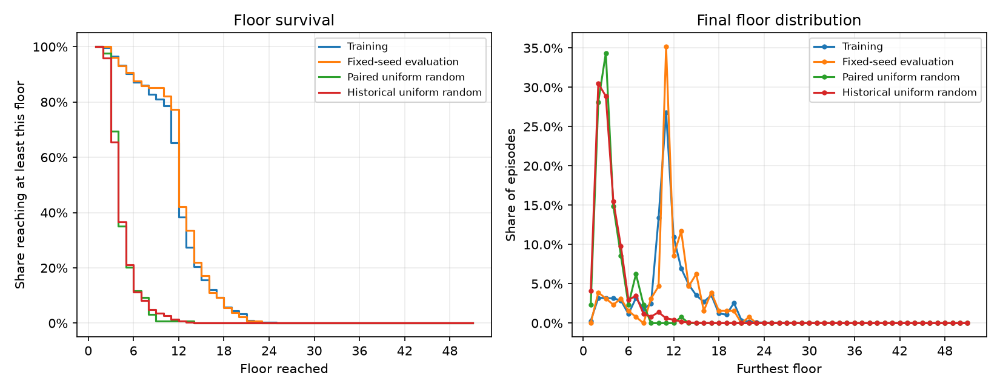
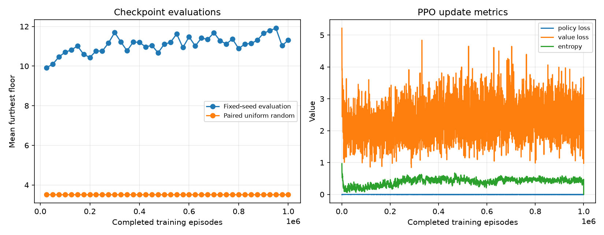

# Combat and Reward PPO · 1,000,000-episode results

The optimized local run completed its full **1,000,000-episode** budget, with 89,472,157 simulator actions, 46,323,550 policy decisions, and 30,177 PPO updates. The recorded collection and optimization time was **4 hours 12 minutes** (15,118.51 seconds), excluding evaluation and checkpoint time. The final checkpoint and SQLite commit watermarks agree. The database contains all 40 learned-policy evaluation panels and their 40 paired random panels.

## Final checkpoint

On the same 128 game and policy seed pairs, masked argmax averaged **floor 11.31** versus **3.51** for uniform random, a difference of **7.80 floors**. It went farther on 114 seeds, tied on seven, and went less far on seven. The learned policy reached floor 11 on **99/128** seeds and floor 20 on **3/128**. Both policies ended all 128 games in defeat. The final checkpoint's maximum was floor 22. During training, the furthest episode reached floor 51.

The earlier 100,000-episode run averaged floor 10.68 on the same panel. The final million-episode checkpoint averaged 0.63 floors higher. The best mean within this run was 11.91 at 950,000 episodes. These panels reuse the same seeds across checkpoints. [Earlier 100,000-episode results](../combat_rl_100k/training_report.md)

The trained policy selects combat skills and victory rewards. Shop and Event decisions use uniform random sampling, so unallocated resources and depleted loadouts can remain a performance bottleneck. Training samples evolve with the policy, while checkpoint evaluation uses fixed separate seed panels.

The historical 1,000,000-episode uniform random baseline is a descriptive benchmark. Paired uniform-random evaluation uses the same game seeds and action cap as the learned policy for its panel. Reaching a floor means reaching it at any point in an episode. [Original baseline report](https://github.com/KyleIm/Clear-The-Dungeon-Project/blob/main/docs/baseline_random_1m_results.md)

## Outcomes and floor reach

| Cohort | Episodes | Mean floor | Median floor | Max floor | Clear rate | Timeout rate | Mean actions |
|---|---:|---:|---:|---:|---:|---:|---:|
| Training | 1,000,000 | 11.00 | 11 | 51 | 0.0000% | 0.0090% | 89.47 |
| Historical uniform random | 1,000,000 | 3.53 | 3 | 27 | 0.0000% | 0.0087% | 18.13 |
| Fixed-seed evaluation at 25,001 | 128 | 9.92 | 10 | 20 | 0.0000% | 0.0000% | 64.97 |
| Fixed-seed evaluation at 50,001 | 128 | 10.09 | 10 | 20 | 0.0000% | 0.0000% | 69.39 |
| Fixed-seed evaluation at 75,000 | 128 | 10.46 | 11 | 21 | 0.0000% | 0.0000% | 69.61 |
| Fixed-seed evaluation at 100,001 | 128 | 10.70 | 11 | 20 | 0.0000% | 0.0000% | 70.77 |
| Fixed-seed evaluation at 125,000 | 128 | 10.81 | 11 | 20 | 0.0000% | 0.0000% | 79.28 |
| Fixed-seed evaluation at 150,000 | 128 | 11.02 | 11 | 21 | 0.0000% | 0.0000% | 73.59 |
| Fixed-seed evaluation at 175,000 | 128 | 10.59 | 11 | 20 | 0.0000% | 0.0000% | 74.38 |
| Fixed-seed evaluation at 200,000 | 128 | 10.44 | 11 | 21 | 0.0000% | 0.0000% | 74.92 |
| Fixed-seed evaluation at 225,000 | 128 | 10.77 | 11 | 23 | 0.0000% | 0.0000% | 68.41 |
| Fixed-seed evaluation at 250,000 | 128 | 10.76 | 11 | 22 | 0.0000% | 0.0000% | 82.83 |
| Fixed-seed evaluation at 275,000 | 128 | 11.16 | 11 | 21 | 0.0000% | 0.0000% | 92.74 |
| Fixed-seed evaluation at 300,000 | 128 | 11.70 | 12 | 20 | 0.0000% | 0.0000% | 95.66 |
| Fixed-seed evaluation at 325,000 | 128 | 11.22 | 11 | 21 | 0.0000% | 0.0000% | 81.00 |
| Fixed-seed evaluation at 350,000 | 128 | 10.77 | 11 | 23 | 0.0000% | 0.0000% | 86.48 |
| Fixed-seed evaluation at 375,000 | 128 | 11.22 | 11 | 22 | 0.0000% | 0.0000% | 90.28 |
| Fixed-seed evaluation at 400,000 | 128 | 11.20 | 11 | 21 | 0.0000% | 0.0000% | 78.02 |
| Fixed-seed evaluation at 425,000 | 128 | 10.97 | 11 | 20 | 0.0000% | 0.0000% | 85.67 |
| Fixed-seed evaluation at 450,000 | 128 | 11.05 | 11 | 23 | 0.0000% | 0.0000% | 96.77 |
| Fixed-seed evaluation at 475,000 | 128 | 10.67 | 11 | 20 | 0.0000% | 0.0000% | 89.98 |
| Fixed-seed evaluation at 500,000 | 128 | 11.11 | 11 | 20 | 0.0000% | 0.0000% | 89.12 |
| Fixed-seed evaluation at 525,000 | 128 | 11.20 | 11 | 20 | 0.0000% | 0.0000% | 85.77 |
| Fixed-seed evaluation at 550,001 | 128 | 11.62 | 11 | 22 | 0.0000% | 0.0000% | 97.33 |
| Fixed-seed evaluation at 575,000 | 128 | 10.94 | 11 | 24 | 0.0000% | 0.0000% | 92.16 |
| Fixed-seed evaluation at 600,000 | 128 | 11.48 | 11 | 21 | 0.0000% | 0.0000% | 96.63 |
| Fixed-seed evaluation at 625,000 | 128 | 11.02 | 11 | 20 | 0.0000% | 0.0000% | 89.16 |
| Fixed-seed evaluation at 650,000 | 128 | 11.42 | 11 | 26 | 0.0000% | 0.0000% | 94.17 |
| Fixed-seed evaluation at 675,001 | 128 | 11.34 | 11 | 20 | 0.0000% | 0.0000% | 99.16 |
| Fixed-seed evaluation at 700,000 | 128 | 11.69 | 11 | 20 | 0.0000% | 0.0000% | 95.18 |
| Fixed-seed evaluation at 725,001 | 128 | 11.28 | 11 | 20 | 0.0000% | 0.0000% | 94.09 |
| Fixed-seed evaluation at 750,001 | 128 | 11.12 | 11 | 20 | 0.0000% | 0.0000% | 91.98 |
| Fixed-seed evaluation at 775,000 | 128 | 11.37 | 11 | 20 | 0.0000% | 0.0000% | 90.75 |
| Fixed-seed evaluation at 800,000 | 128 | 10.88 | 11 | 22 | 0.0000% | 0.0000% | 95.87 |
| Fixed-seed evaluation at 825,001 | 128 | 11.12 | 11 | 26 | 0.0000% | 0.0000% | 90.76 |
| Fixed-seed evaluation at 850,000 | 128 | 11.14 | 11 | 20 | 0.0000% | 0.0000% | 88.95 |
| Fixed-seed evaluation at 875,001 | 128 | 11.30 | 11 | 30 | 0.0000% | 0.0000% | 92.76 |
| Fixed-seed evaluation at 900,001 | 128 | 11.66 | 11 | 26 | 0.0000% | 0.0000% | 101.79 |
| Fixed-seed evaluation at 925,000 | 128 | 11.79 | 11 | 20 | 0.0000% | 0.0000% | 94.80 |
| Fixed-seed evaluation at 950,000 | 128 | 11.91 | 11 | 21 | 0.0000% | 0.0000% | 94.05 |
| Fixed-seed evaluation at 975,000 | 128 | 11.03 | 11 | 20 | 0.0000% | 0.0000% | 97.01 |
| Fixed-seed evaluation at 1,000,000 | 128 | 11.31 | 11 | 22 | 0.0000% | 0.0000% | 96.98 |
| Paired uniform random at 25,001 | 128 | 3.51 | 3 | 13 | 0.0000% | 0.0000% | 16.34 |
| Paired uniform random at 50,001 | 128 | 3.51 | 3 | 13 | 0.0000% | 0.0000% | 16.34 |
| Paired uniform random at 75,000 | 128 | 3.51 | 3 | 13 | 0.0000% | 0.0000% | 16.34 |
| Paired uniform random at 100,001 | 128 | 3.51 | 3 | 13 | 0.0000% | 0.0000% | 16.34 |
| Paired uniform random at 125,000 | 128 | 3.51 | 3 | 13 | 0.0000% | 0.0000% | 16.34 |
| Paired uniform random at 150,000 | 128 | 3.51 | 3 | 13 | 0.0000% | 0.0000% | 16.34 |
| Paired uniform random at 175,000 | 128 | 3.51 | 3 | 13 | 0.0000% | 0.0000% | 16.34 |
| Paired uniform random at 200,000 | 128 | 3.51 | 3 | 13 | 0.0000% | 0.0000% | 16.34 |
| Paired uniform random at 225,000 | 128 | 3.51 | 3 | 13 | 0.0000% | 0.0000% | 16.34 |
| Paired uniform random at 250,000 | 128 | 3.51 | 3 | 13 | 0.0000% | 0.0000% | 16.34 |
| Paired uniform random at 275,000 | 128 | 3.51 | 3 | 13 | 0.0000% | 0.0000% | 16.34 |
| Paired uniform random at 300,000 | 128 | 3.51 | 3 | 13 | 0.0000% | 0.0000% | 16.34 |
| Paired uniform random at 325,000 | 128 | 3.51 | 3 | 13 | 0.0000% | 0.0000% | 16.34 |
| Paired uniform random at 350,000 | 128 | 3.51 | 3 | 13 | 0.0000% | 0.0000% | 16.34 |
| Paired uniform random at 375,000 | 128 | 3.51 | 3 | 13 | 0.0000% | 0.0000% | 16.34 |
| Paired uniform random at 400,000 | 128 | 3.51 | 3 | 13 | 0.0000% | 0.0000% | 16.34 |
| Paired uniform random at 425,000 | 128 | 3.51 | 3 | 13 | 0.0000% | 0.0000% | 16.34 |
| Paired uniform random at 450,000 | 128 | 3.51 | 3 | 13 | 0.0000% | 0.0000% | 16.34 |
| Paired uniform random at 475,000 | 128 | 3.51 | 3 | 13 | 0.0000% | 0.0000% | 16.34 |
| Paired uniform random at 500,000 | 128 | 3.51 | 3 | 13 | 0.0000% | 0.0000% | 16.34 |
| Paired uniform random at 525,000 | 128 | 3.51 | 3 | 13 | 0.0000% | 0.0000% | 16.34 |
| Paired uniform random at 550,001 | 128 | 3.51 | 3 | 13 | 0.0000% | 0.0000% | 16.34 |
| Paired uniform random at 575,000 | 128 | 3.51 | 3 | 13 | 0.0000% | 0.0000% | 16.34 |
| Paired uniform random at 600,000 | 128 | 3.51 | 3 | 13 | 0.0000% | 0.0000% | 16.34 |
| Paired uniform random at 625,000 | 128 | 3.51 | 3 | 13 | 0.0000% | 0.0000% | 16.34 |
| Paired uniform random at 650,000 | 128 | 3.51 | 3 | 13 | 0.0000% | 0.0000% | 16.34 |
| Paired uniform random at 675,001 | 128 | 3.51 | 3 | 13 | 0.0000% | 0.0000% | 16.34 |
| Paired uniform random at 700,000 | 128 | 3.51 | 3 | 13 | 0.0000% | 0.0000% | 16.34 |
| Paired uniform random at 725,001 | 128 | 3.51 | 3 | 13 | 0.0000% | 0.0000% | 16.34 |
| Paired uniform random at 750,001 | 128 | 3.51 | 3 | 13 | 0.0000% | 0.0000% | 16.34 |
| Paired uniform random at 775,000 | 128 | 3.51 | 3 | 13 | 0.0000% | 0.0000% | 16.34 |
| Paired uniform random at 800,000 | 128 | 3.51 | 3 | 13 | 0.0000% | 0.0000% | 16.34 |
| Paired uniform random at 825,001 | 128 | 3.51 | 3 | 13 | 0.0000% | 0.0000% | 16.34 |
| Paired uniform random at 850,000 | 128 | 3.51 | 3 | 13 | 0.0000% | 0.0000% | 16.34 |
| Paired uniform random at 875,001 | 128 | 3.51 | 3 | 13 | 0.0000% | 0.0000% | 16.34 |
| Paired uniform random at 900,001 | 128 | 3.51 | 3 | 13 | 0.0000% | 0.0000% | 16.34 |
| Paired uniform random at 925,000 | 128 | 3.51 | 3 | 13 | 0.0000% | 0.0000% | 16.34 |
| Paired uniform random at 950,000 | 128 | 3.51 | 3 | 13 | 0.0000% | 0.0000% | 16.34 |
| Paired uniform random at 975,000 | 128 | 3.51 | 3 | 13 | 0.0000% | 0.0000% | 16.34 |
| Paired uniform random at 1,000,000 | 128 | 3.51 | 3 | 13 | 0.0000% | 0.0000% | 16.34 |

### Latest floor reach and distribution

Each cell shows final episode count at that floor and the share reaching at least that floor.

| Floor | Training | Fixed-seed evaluation | Paired uniform random | Historical uniform random |
|---:|---:|---:|---:|---:|
| 1 | 2,936 · 100.0000% | 0 · 100.0000% | 3 · 100.0000% | 40,774 · 100.0000% |
| 2 | 32,113 · 99.7064% | 5 · 100.0000% | 36 · 97.6562% | 304,751 · 95.9226% |
| 3 | 31,946 · 96.4951% | 4 · 96.0938% | 44 · 69.5312% | 288,694 · 65.4475% |
| 4 | 31,490 · 93.3005% | 3 · 92.9688% | 19 · 35.1562% | 155,226 · 36.5781% |
| 5 | 28,889 · 90.1515% | 4 · 90.6250% | 11 · 20.3125% | 97,990 · 21.0555% |
| 6 | 11,744 · 87.2626% | 2 · 87.5000% | 3 · 11.7188% | 29,894 · 11.2565% |
| 7 | 31,908 · 86.0882% | 1 · 85.9375% | 8 · 9.3750% | 34,622 · 8.2671% |
| 8 | 18,257 · 82.8974% | 0 · 85.1562% | 3 · 3.1250% | 11,772 · 4.8049% |
| 9 | 24,851 · 81.0717% | 4 · 85.1562% | 0 · 0.7812% | 8,322 · 3.6277% |
| 10 | 133,767 · 78.5866% | 6 · 82.0312% | 0 · 0.7812% | 13,835 · 2.7955% |
| 11 | 268,254 · 65.2099% | 45 · 77.3438% | 0 · 0.7812% | 6,125 · 1.4120% |
| 12 | 109,514 · 38.3845% | 11 · 42.1875% | 0 · 0.7812% | 4,390 · 0.7995% |
| 13 | 69,683 · 27.4331% | 15 · 33.5938% | 1 · 0.7812% | 1,909 · 0.3605% |
| 14 | 48,956 · 20.4648% | 6 · 21.8750% | 0 · 0.0000% | 818 · 0.1696% |
| 15 | 35,404 · 15.5692% | 8 · 17.1875% | 0 · 0.0000% | 371 · 0.0878% |
| 16 | 26,937 · 12.0288% | 2 · 10.9375% | 0 · 0.0000% | 206 · 0.0507% |
| 17 | 35,692 · 9.3351% | 5 · 9.3750% | 0 · 0.0000% | 140 · 0.0301% |
| 18 | 12,299 · 5.7659% | 2 · 5.4688% | 0 · 0.0000% | 60 · 0.0161% |
| 19 | 10,820 · 4.5360% | 2 · 3.9062% | 0 · 0.0000% | 37 · 0.0101% |
| 20 | 25,634 · 3.4540% | 2 · 2.3438% | 0 · 0.0000% | 42 · 0.0064% |
| 21 | 3,763 · 0.8906% | 0 · 0.7812% | 0 · 0.0000% | 12 · 0.0022% |
| 22 | 1,701 · 0.5143% | 1 · 0.7812% | 0 · 0.0000% | 3 · 0.0010% |
| 23 | 970 · 0.3442% | 0 · 0.0000% | 0 · 0.0000% | 4 · 0.0007% |
| 24 | 655 · 0.2472% | 0 · 0.0000% | 0 · 0.0000% | 0 · 0.0003% |
| 25 | 468 · 0.1817% | 0 · 0.0000% | 0 · 0.0000% | 2 · 0.0003% |
| 26 | 340 · 0.1349% | 0 · 0.0000% | 0 · 0.0000% | 0 · 0.0001% |
| 27 | 433 · 0.1009% | 0 · 0.0000% | 0 · 0.0000% | 1 · 0.0001% |
| 28 | 142 · 0.0576% | 0 · 0.0000% | 0 · 0.0000% | 0 · 0.0000% |
| 29 | 106 · 0.0434% | 0 · 0.0000% | 0 · 0.0000% | 0 · 0.0000% |
| 30 | 242 · 0.0328% | 0 · 0.0000% | 0 · 0.0000% | 0 · 0.0000% |
| 31 | 29 · 0.0086% | 0 · 0.0000% | 0 · 0.0000% | 0 · 0.0000% |
| 32 | 24 · 0.0057% | 0 · 0.0000% | 0 · 0.0000% | 0 · 0.0000% |
| 33 | 14 · 0.0033% | 0 · 0.0000% | 0 · 0.0000% | 0 · 0.0000% |
| 34 | 6 · 0.0019% | 0 · 0.0000% | 0 · 0.0000% | 0 · 0.0000% |
| 35 | 10 · 0.0013% | 0 · 0.0000% | 0 · 0.0000% | 0 · 0.0000% |
| 36 | 1 · 0.0003% | 0 · 0.0000% | 0 · 0.0000% | 0 · 0.0000% |
| 37 | 1 · 0.0002% | 0 · 0.0000% | 0 · 0.0000% | 0 · 0.0000% |
| 38 | 0 · 0.0001% | 0 · 0.0000% | 0 · 0.0000% | 0 · 0.0000% |
| 39 | 0 · 0.0001% | 0 · 0.0000% | 0 · 0.0000% | 0 · 0.0000% |
| 40 | 0 · 0.0001% | 0 · 0.0000% | 0 · 0.0000% | 0 · 0.0000% |
| 41 | 0 · 0.0001% | 0 · 0.0000% | 0 · 0.0000% | 0 · 0.0000% |
| 42 | 0 · 0.0001% | 0 · 0.0000% | 0 · 0.0000% | 0 · 0.0000% |
| 43 | 0 · 0.0001% | 0 · 0.0000% | 0 · 0.0000% | 0 · 0.0000% |
| 44 | 0 · 0.0001% | 0 · 0.0000% | 0 · 0.0000% | 0 · 0.0000% |
| 45 | 0 · 0.0001% | 0 · 0.0000% | 0 · 0.0000% | 0 · 0.0000% |
| 46 | 0 · 0.0001% | 0 · 0.0000% | 0 · 0.0000% | 0 · 0.0000% |
| 47 | 0 · 0.0001% | 0 · 0.0000% | 0 · 0.0000% | 0 · 0.0000% |
| 48 | 0 · 0.0001% | 0 · 0.0000% | 0 · 0.0000% | 0 · 0.0000% |
| 49 | 0 · 0.0001% | 0 · 0.0000% | 0 · 0.0000% | 0 · 0.0000% |
| 50 | 0 · 0.0001% | 0 · 0.0000% | 0 · 0.0000% | 0 · 0.0000% |
| 51 | 1 · 0.0001% | 0 · 0.0000% | 0 · 0.0000% | 0 · 0.0000% |

### Evaluation metadata

- eval at 25,001 took 1.61 seconds.
- random at 25,001 took 0.59 seconds.
- eval at 50,001 took 1.64 seconds.
- random at 50,001 took 0.56 seconds.
- eval at 75,000 took 1.73 seconds.
- random at 75,000 took 0.58 seconds.
- eval at 100,001 took 1.71 seconds.
- random at 100,001 took 0.57 seconds.
- eval at 125,000 took 1.81 seconds.
- random at 125,000 took 0.64 seconds.
- eval at 150,000 took 1.75 seconds.
- random at 150,000 took 0.57 seconds.
- eval at 175,000 took 1.62 seconds.
- random at 175,000 took 0.55 seconds.
- eval at 200,000 took 1.82 seconds.
- random at 200,000 took 0.57 seconds.
- eval at 225,000 took 1.50 seconds.
- random at 225,000 took 0.57 seconds.
- eval at 250,000 took 1.81 seconds.
- random at 250,000 took 0.59 seconds.
- eval at 275,000 took 2.04 seconds.
- random at 275,000 took 0.54 seconds.
- eval at 300,000 took 2.08 seconds.
- random at 300,000 took 0.54 seconds.
- eval at 325,000 took 2.38 seconds.
- random at 325,000 took 0.67 seconds.
- eval at 350,000 took 2.25 seconds.
- random at 350,000 took 0.75 seconds.
- eval at 375,000 took 2.28 seconds.
- random at 375,000 took 0.63 seconds.
- eval at 400,000 took 2.08 seconds.
- random at 400,000 took 0.69 seconds.
- eval at 425,000 took 2.03 seconds.
- random at 425,000 took 0.60 seconds.
- eval at 450,000 took 1.98 seconds.
- random at 450,000 took 0.62 seconds.
- eval at 475,000 took 2.04 seconds.
- random at 475,000 took 0.63 seconds.
- eval at 500,000 took 1.98 seconds.
- random at 500,000 took 0.62 seconds.
- eval at 525,000 took 2.19 seconds.
- random at 525,000 took 0.54 seconds.
- eval at 550,001 took 2.18 seconds.
- random at 550,001 took 0.55 seconds.
- eval at 575,000 took 1.99 seconds.
- random at 575,000 took 0.60 seconds.
- eval at 600,000 took 2.04 seconds.
- random at 600,000 took 0.54 seconds.
- eval at 625,000 took 1.99 seconds.
- random at 625,000 took 0.57 seconds.
- eval at 650,000 took 1.94 seconds.
- random at 650,000 took 0.53 seconds.
- eval at 675,001 took 2.19 seconds.
- random at 675,001 took 0.62 seconds.
- eval at 700,000 took 2.06 seconds.
- random at 700,000 took 0.56 seconds.
- eval at 725,001 took 2.16 seconds.
- random at 725,001 took 0.54 seconds.
- eval at 750,001 took 1.98 seconds.
- random at 750,001 took 0.53 seconds.
- eval at 775,000 took 2.01 seconds.
- random at 775,000 took 0.56 seconds.
- eval at 800,000 took 2.13 seconds.
- random at 800,000 took 0.59 seconds.
- eval at 825,001 took 1.93 seconds.
- random at 825,001 took 0.53 seconds.
- eval at 850,000 took 2.01 seconds.
- random at 850,000 took 0.54 seconds.
- eval at 875,001 took 2.04 seconds.
- random at 875,001 took 0.62 seconds.
- eval at 900,001 took 2.01 seconds.
- random at 900,001 took 0.66 seconds.
- eval at 925,000 took 2.39 seconds.
- random at 925,000 took 0.73 seconds.
- eval at 950,000 took 2.18 seconds.
- random at 950,000 took 0.67 seconds.
- eval at 975,000 took 2.15 seconds.
- random at 975,000 took 0.62 seconds.
- eval at 1,000,000 took 1.81 seconds.
- random at 1,000,000 took 0.63 seconds.

## Training decisions

Recorded shop exits: **661,093**. Mean unused stat points 127.30 and mean remaining mana 80.20. The shares of exits with any unused stat points or mana were 46.18% and 49.92% respectively.

### Combat actions

| Selection or reason | Count | Share of group |
|---|---:|---:|
| slot_1 | 18,779,142 | 51.70% |
| slot_3 | 6,925,367 | 19.07% |
| slot_2 | 6,767,125 | 18.63% |
| sacrifice | 2,078,029 | 5.72% |
| slot_4 | 1,770,539 | 4.87% |
| slot_5 | 226 | 0.00% |
| slot_6 | 6 | 0.00% |

### Reward actions

| Selection or reason | Count | Share of group |
|---|---:|---:|
| Potion | 8,725,484 | 87.23% |
| Initialize | 1,162,908 | 11.63% |
| Gold | 47,591 | 0.48% |
| Stat | 38,140 | 0.38% |
| Exchange | 28,993 | 0.29% |

### Most frequent shop actions

| Selection or reason | Count | Share of group |
|---|---:|---:|
| shop_back | 2,643,420 | 6.13% |
| reset_redistribution | 661,880 | 1.53% |
| shop_menu stats | 661,431 | 1.53% |
| leave_shop | 661,093 | 1.53% |
| shop_menu costs | 660,871 | 1.53% |
| shop_menu skills | 660,854 | 1.53% |
| shop_menu merchandise | 660,264 | 1.53% |
| adjust_stat attack 1 | 610,467 | 1.41% |
| adjust_stat hp 1 | 610,240 | 1.41% |
| adjust_stat speed 1 | 609,414 | 1.41% |
| adjust_stat defense 1 | 608,952 | 1.41% |
| adjust_stat speed 10 | 556,162 | 1.29% |
| adjust_stat hp 10 | 555,693 | 1.29% |
| adjust_stat defense 10 | 554,969 | 1.29% |
| adjust_stat attack 10 | 554,798 | 1.29% |

### Event actions

| Selection or reason | Count | Share of group |
|---|---:|---:|
| ella help | 2 | 66.67% |
| ella pickpocket | 1 | 33.33% |

### Most frequent defeat opponents

| Selection or reason | Count | Share of group |
|---|---:|---:|
| Skeleton | 79,763 | 7.98% |
| Rat | 73,567 | 7.36% |
| Wisp | 53,355 | 5.34% |
| Creature | 41,366 | 4.14% |
| Troll | 38,439 | 3.84% |
| Naga | 36,852 | 3.69% |
| Balloon | 36,672 | 3.67% |
| Esteed | 34,347 | 3.44% |
| Shieldminion | 32,615 | 3.26% |
| Superminion | 30,985 | 3.10% |
| Ella | 28,899 | 2.89% |
| Mummy | 28,503 | 2.85% |
| Kettle | 27,172 | 2.72% |
| Queen | 26,002 | 2.60% |
| Arachne | 23,177 | 2.32% |

### Timeout reasons

| Selection or reason | Count | Share of group |
|---|---:|---:|
| action_limit · combat · Mimic | 86 | 95.56% |
| action_limit · combat · Slime | 4 | 4.44% |

## Fixed-seed evaluation decisions

Recorded shop exits: **100**. Mean unused stat points 137.40 and mean remaining mana 77.98. The shares of exits with any unused stat points or mana were 54.00% and 47.00% respectively.

### Combat actions

| Selection or reason | Count | Share of group |
|---|---:|---:|
| slot_1 | 2,118 | 50.73% |
| slot_2 | 1,322 | 31.66% |
| slot_3 | 351 | 8.41% |
| sacrifice | 270 | 6.47% |
| slot_4 | 114 | 2.73% |

### Reward actions

| Selection or reason | Count | Share of group |
|---|---:|---:|
| Potion | 1,143 | 86.59% |
| Initialize | 176 | 13.33% |
| Exchange | 1 | 0.08% |

### Most frequent shop actions

| Selection or reason | Count | Share of group |
|---|---:|---:|
| shop_back | 408 | 5.90% |
| shop_menu costs | 110 | 1.59% |
| adjust_stat attack 1 | 108 | 1.56% |
| adjust_stat hp 1 | 107 | 1.55% |
| reset_redistribution | 104 | 1.50% |
| shop_menu merchandise | 103 | 1.49% |
| shop_menu stats | 100 | 1.45% |
| leave_shop | 100 | 1.45% |
| adjust_stat defense 1 | 99 | 1.43% |
| adjust_stat defense -1 | 95 | 1.37% |
| adjust_stat attack 10 | 95 | 1.37% |
| shop_menu skills | 95 | 1.37% |
| adjust_stat speed 10 | 95 | 1.37% |
| adjust_stat speed 1 | 89 | 1.29% |
| adjust_stat defense 10 | 89 | 1.29% |

### Most frequent defeat opponents

| Selection or reason | Count | Share of group |
|---|---:|---:|
| Skeleton | 17 | 13.28% |
| Balloon | 10 | 7.81% |
| Wisp | 8 | 6.25% |
| Rat | 7 | 5.47% |
| Creature | 7 | 5.47% |
| Troll | 6 | 4.69% |
| Naga | 6 | 4.69% |
| Superminion | 6 | 4.69% |
| Mummy | 6 | 4.69% |
| Phoneix | 5 | 3.91% |
| Kettle | 5 | 3.91% |
| Ella | 4 | 3.12% |
| Mimic | 4 | 3.12% |
| Shieldminion | 4 | 3.12% |
| Unicorn | 3 | 2.34% |

## Paired uniform random decisions

Recorded shop exits: **1**. Mean unused stat points 0.00 and mean remaining mana 0.00. The shares of exits with any unused stat points or mana were 0.00% and 0.00% respectively.

### Combat actions

| Selection or reason | Count | Share of group |
|---|---:|---:|
| slot_1 | 480 | 27.15% |
| slot_3 | 438 | 24.77% |
| slot_2 | 426 | 24.10% |
| slot_4 | 421 | 23.81% |
| sacrifice | 3 | 0.17% |

### Reward actions

| Selection or reason | Count | Share of group |
|---|---:|---:|
| Initialize | 69 | 21.50% |
| Gold | 68 | 21.18% |
| Potion | 63 | 19.63% |
| Exchange | 61 | 19.00% |
| Stat | 60 | 18.69% |

### Most frequent shop actions

| Selection or reason | Count | Share of group |
|---|---:|---:|
| shop_menu merchandise | 1 | 33.33% |
| shop_back | 1 | 33.33% |
| leave_shop | 1 | 33.33% |

### Most frequent defeat opponents

| Selection or reason | Count | Share of group |
|---|---:|---:|
| Ella | 11 | 8.59% |
| Undine | 10 | 7.81% |
| Creature | 9 | 7.03% |
| Esteed | 7 | 5.47% |
| Scorpion | 6 | 4.69% |
| Hawgle | 6 | 4.69% |
| Lizardman | 6 | 4.69% |
| Arachne | 6 | 4.69% |
| Jiangshi | 5 | 3.91% |
| Iceminion | 5 | 3.91% |
| Rat | 5 | 3.91% |
| Skeleton | 5 | 3.91% |
| Phoneix | 4 | 3.12% |
| Monocle | 4 | 3.12% |
| Unicorn | 4 | 3.12% |
