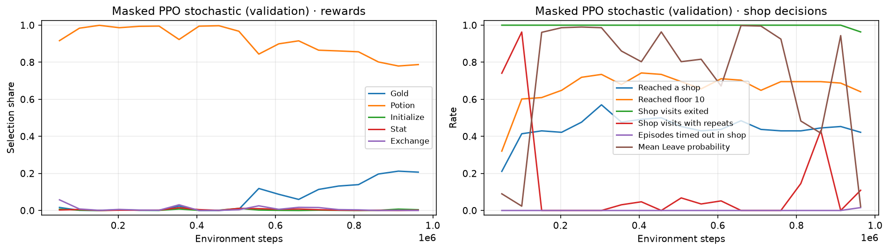

# Detailed evaluation decisions

Tables show the latest panel for each curriculum stage, policy and split. Policy probabilities are conditional on the legal action mask. The trends include the sampled evaluation panels.

## Masked PPO stochastic (validation) · stage 1 · step 50,688

### Combat

| Skill | Available decisions | Selected | Selection when available | Mean model probability when available |
|---|---:|---:|---:|---:|
| acceleration | 185 | 42 | 22.70% | 26.75% |
| acid stone | 1 | 0 | 0.00% | 58.42% |
| afterimage | 203 | 55 | 27.09% | 26.19% |
| battojutsu | 6 | 4 | 66.67% | 52.04% |
| counter | 540 | 83 | 15.37% | 16.06% |
| curse | 335 | 85 | 25.37% | 27.53% |
| defend | 367 | 88 | 23.98% | 23.21% |
| distraction | 176 | 40 | 22.73% | 19.00% |
| double strike | 452 | 98 | 21.68% | 19.97% |
| drain | 569 | 139 | 24.43% | 25.69% |
| elemental orb | 430 | 96 | 22.33% | 23.18% |
| fast claw | 360 | 65 | 18.06% | 19.64% |
| flame wheel | 1 | 0 | 0.00% | 21.10% |
| flesh explosion | 430 | 85 | 19.77% | 17.95% |
| fracture | 5 | 2 | 40.00% | 38.40% |
| kiss | 622 | 104 | 16.72% | 16.23% |
| magic arrow | 601 | 79 | 13.14% | 13.93% |
| meditation | 286 | 67 | 23.43% | 23.24% |
| mimic | 1 | 0 | 0.00% | 23.85% |
| paralyze | 9 | 1 | 11.11% | 14.69% |
| pierce | 347 | 74 | 21.33% | 21.37% |
| power up | 293 | 72 | 24.57% | 22.38% |
| rage | 3 | 1 | 33.33% | 27.37% |
| recovery | 3 | 0 | 0.00% | 42.31% |
| sacrifice | 85 | 85 | 100.00% | 100.00% |
| shield slam | 4 | 1 | 25.00% | 11.61% |
| shooting star | 487 | 127 | 26.08% | 24.90% |
| skull dagger | 903 | 372 | 41.20% | 42.90% |
| soul strike | 507 | 117 | 23.08% | 23.02% |
| sticky | 262 | 49 | 18.70% | 20.35% |
| sturdy kick | 21 | 13 | 61.90% | 67.39% |
| terror | 310 | 67 | 21.61% | 22.08% |
| thunder | 1210 | 567 | 46.86% | 46.02% |
| tiger claw | 4 | 2 | 50.00% | 21.11% |
| veilguard | 9 | 8 | 88.89% | 70.31% |
| weakness | 463 | 121 | 26.13% | 23.17% |
| whisker needle | 472 | 120 | 25.42% | 26.17% |
| will of wisp | 11 | 4 | 36.36% | 46.68% |
| wolf fang | 927 | 311 | 33.55% | 33.72% |

### Rewards

Each cell shows selected / available, then the share of reward selections. Selection when available is the first count divided by the second.

| Floor | Gold | Potion | Initialize | Stat | Exchange |
|---|---:|---:|---:|---:|---:|
| All floors | 12 / 730 (1.6%) | 669 / 730 (91.6%) | 5 / 730 (0.7%) | 2 / 730 (0.3%) | 42 / 730 (5.8%) |
| 1 | 1 / 126 (0.8%) | 115 / 126 (91.3%) | 0 / 126 (0.0%) | 1 / 126 (0.8%) | 9 / 126 (7.1%) |
| 2 | 3 / 115 (2.6%) | 105 / 115 (91.3%) | 1 / 115 (0.9%) | 0 / 115 (0.0%) | 6 / 115 (5.2%) |
| 3 | 0 / 99 (0.0%) | 89 / 99 (89.9%) | 1 / 99 (1.0%) | 1 / 99 (1.0%) | 8 / 99 (8.1%) |
| 4 | 3 / 78 (3.8%) | 69 / 78 (88.5%) | 2 / 78 (2.6%) | 0 / 78 (0.0%) | 4 / 78 (5.1%) |
| 5 | 1 / 63 (1.6%) | 60 / 63 (95.2%) | 0 / 63 (0.0%) | 0 / 63 (0.0%) | 2 / 63 (3.2%) |
| 6 | 0 / 61 (0.0%) | 57 / 61 (93.4%) | 0 / 61 (0.0%) | 0 / 61 (0.0%) | 4 / 61 (6.6%) |
| 7 | 0 / 47 (0.0%) | 46 / 47 (97.9%) | 0 / 47 (0.0%) | 0 / 47 (0.0%) | 1 / 47 (2.1%) |
| 8 | 2 / 46 (4.3%) | 41 / 46 (89.1%) | 0 / 46 (0.0%) | 0 / 46 (0.0%) | 3 / 46 (6.5%) |
| 9 | 1 / 41 (2.4%) | 38 / 41 (92.7%) | 1 / 41 (2.4%) | 0 / 41 (0.0%) | 1 / 41 (2.4%) |
| 10 | 1 / 27 (3.7%) | 24 / 27 (88.9%) | 0 / 27 (0.0%) | 0 / 27 (0.0%) | 2 / 27 (7.4%) |
| 11 | 0 / 12 (0.0%) | 10 / 12 (83.3%) | 0 / 12 (0.0%) | 0 / 12 (0.0%) | 2 / 12 (16.7%) |
| 12 | 0 / 6 (0.0%) | 6 / 6 (100.0%) | 0 / 6 (0.0%) | 0 / 6 (0.0%) | 0 / 6 (0.0%) |
| 13 | 0 / 3 (0.0%) | 3 / 3 (100.0%) | 0 / 3 (0.0%) | 0 / 3 (0.0%) | 0 / 3 (0.0%) |
| 14 | 0 / 2 (0.0%) | 2 / 2 (100.0%) | 0 / 2 (0.0%) | 0 / 2 (0.0%) | 0 / 2 (0.0%) |
| 15 | 0 / 2 (0.0%) | 2 / 2 (100.0%) | 0 / 2 (0.0%) | 0 / 2 (0.0%) | 0 / 2 (0.0%) |
| 16 | 0 / 2 (0.0%) | 2 / 2 (100.0%) | 0 / 2 (0.0%) | 0 / 2 (0.0%) | 0 / 2 (0.0%) |

### Shop

| Strategic function | Available | Selected | Share | Selected when available | First in visit | Repeated in visit |
|---|---:|---:|---:|---:|---:|---:|
| Skill Configuration | 322 | 118 | 36.65% | 36.65% | 19 | 99 |
| Skill Cost Reduction | 10 | 3 | 0.93% | 30.00% | 3 | 0 |
| Stat Redistribution | 322 | 174 | 54.04% | 54.04% | 24 | 150 |
| Merchandise Purchase | 10 | 0 | 0.00% | 0.00% | 0 | 0 |
| Leave Shop | 322 | 27 | 8.39% | 8.39% | — | — |

Completed episodes reaching a shop 21.09%. Reached floor 10 32.03%. Recorded visits 27, exits 100.00%, visits with a repeat 74.07%, and timed-out visits 0.00%. Episodes ending in a shop timeout 0.00%. Mean strategic and engine actions per recorded visit 11.93 and 422.74. Mean Leave Shop probability when available 8.99%. Cumulative shop penalty -0.024900.

#### Skill Cost Reduction

Commits 3, state changes 3, repeated commits 0, repeated commits with a state change 0, and total gold spent 3,000.

| Transaction | Count |
|---|---:|
| acceleration | 1 |
| counter | 1 |
| curse | 1 |

| Metric | Mean before | Mean after |
|---|---:|---:|
| attack | 100.00 | 100.00 |
| available points | 0.00 | 0.00 |
| defense | 100.00 | 100.00 |
| gold | 1600.00 | 600.00 |
| hp | 100.00 | 100.00 |
| mana remaining | 0.00 | 6.67 |
| mana used | 170.00 | 163.33 |
| max mana | 170.00 | 170.00 |
| speed | 100.00 | 100.00 |
| unlocked slots | 4.00 | 4.00 |

| Skill | Equipped before | Equipped after | Uses before | Uses after | Mean mana cost before | Mean mana cost after |
|---|---:|---:|---:|---:|---:|---:|
| counter | 1 | 1 | 10.00 | 10.00 | 4.00 | 3.00 |
| curse | 1 | 1 | 10.00 | 10.00 | 3.00 | 2.00 |
| kiss | 1 | 1 | 10.00 | 10.00 | 4.00 | 4.00 |
| magic arrow | 2 | 2 | 10.00 | 10.00 | 4.00 | 4.00 |
| pierce | 1 | 1 | 10.00 | 10.00 | 4.00 | 4.00 |
| power up | 1 | 1 | 10.00 | 10.00 | 3.00 | 3.00 |
| skull dagger | 2 | 2 | 20.00 | 20.00 | 3.00 | 3.00 |
| soul strike | 1 | 1 | 10.00 | 10.00 | 4.00 | 4.00 |
| thunder | 1 | 1 | 20.00 | 20.00 | 3.00 | 3.00 |
| weakness | 1 | 1 | 10.00 | 10.00 | 3.00 | 3.00 |

| Example transaction | Before | After |
|---|---|---|
| acceleration | 1 skull dagger × 20 at 3 mana, 2 pierce × 10 at 4 mana, 3 magic arrow × 10 at 4 mana, 4 power up × 10 at 3 mana, 5 locked, 6 locked, unlocked slots 4, mana used 170, mana remaining 0, max mana 170, available points 0, gold 2000, type Normal, purchases [], ATTACK 100, DEFENSE 100, HP 100, SPEED 100, EVA 0, ACC 0, DR 0 | 1 skull dagger × 20 at 3 mana, 2 pierce × 10 at 4 mana, 3 magic arrow × 10 at 4 mana, 4 power up × 10 at 3 mana, 5 locked, 6 locked, unlocked slots 4, mana used 170, mana remaining 0, max mana 170, available points 0, gold 1000, type Normal, purchases [], ATTACK 100, DEFENSE 100, HP 100, SPEED 100, EVA 0, ACC 0, DR 0 |
| counter | 1 thunder × 20 at 3 mana, 2 counter × 10 at 4 mana, 3 magic arrow × 10 at 4 mana, 4 weakness × 10 at 3 mana, 5 locked, 6 locked, unlocked slots 4, mana used 170, mana remaining 0, max mana 170, available points 0, gold 1000, type Normal, purchases [], ATTACK 100, DEFENSE 100, HP 100, SPEED 100, EVA 0, ACC 0, DR 0 | 1 thunder × 20 at 3 mana, 2 counter × 10 at 3 mana, 3 magic arrow × 10 at 4 mana, 4 weakness × 10 at 3 mana, 5 locked, 6 locked, unlocked slots 4, mana used 160, mana remaining 10, max mana 170, available points 0, gold 0, type Normal, purchases [], ATTACK 100, DEFENSE 100, HP 100, SPEED 100, EVA 0, ACC 0, DR 0 |
| curse | 1 skull dagger × 20 at 3 mana, 2 kiss × 10 at 4 mana, 3 soul strike × 10 at 4 mana, 4 curse × 10 at 3 mana, 5 locked, 6 locked, unlocked slots 4, mana used 170, mana remaining 0, max mana 170, available points 0, gold 1800, type Normal, purchases [], ATTACK 100, DEFENSE 100, HP 100, SPEED 100, EVA 0, ACC 0, DR 0 | 1 skull dagger × 20 at 3 mana, 2 kiss × 10 at 4 mana, 3 soul strike × 10 at 4 mana, 4 curse × 10 at 2 mana, 5 locked, 6 locked, unlocked slots 4, mana used 160, mana remaining 10, max mana 170, available points 0, gold 800, type Normal, purchases [], ATTACK 100, DEFENSE 100, HP 100, SPEED 100, EVA 0, ACC 0, DR 0 |

#### Stat Redistribution

Commits 174, state changes 131, repeated commits 150, repeated commits with a state change 111, and total gold spent 0.

| Metric | Mean before | Mean after |
|---|---:|---:|
| attack | 249.25 | 268.68 |
| available points | 9.41 | 9.63 |
| defense | 75.11 | 78.56 |
| gold | 54.02 | 54.02 |
| hp | 43.28 | 32.72 |
| mana remaining | 11.54 | 11.54 |
| mana used | 158.46 | 158.46 |
| max mana | 170.00 | 170.00 |
| speed | 22.95 | 10.40 |
| unlocked slots | 4.00 | 4.00 |

| Skill | Equipped before | Equipped after | Uses before | Uses after | Mean mana cost before | Mean mana cost after |
|---|---:|---:|---:|---:|---:|---:|
| acceleration | 1 | 1 | 1.00 | 1.00 | 3.00 | 3.00 |
| acid stone | 1 | 1 | 4.00 | 4.00 | 5.00 | 5.00 |
| afterimage | 18 | 18 | 11.89 | 11.89 | 3.00 | 3.00 |
| counter | 9 | 9 | 7.00 | 7.00 | 4.00 | 4.00 |
| curse | 12 | 12 | 9.50 | 9.50 | 2.83 | 2.83 |
| defend | 19 | 19 | 8.63 | 8.63 | 3.00 | 3.00 |
| despair | 1 | 1 | 0.00 | 0.00 | 6.00 | 6.00 |
| dinolize | 6 | 6 | 0.00 | 0.00 | 8.00 | 8.00 |
| discharge | 1 | 1 | 1.00 | 1.00 | 6.00 | 6.00 |
| distraction | 1 | 1 | 4.00 | 4.00 | 3.00 | 3.00 |
| double strike | 34 | 34 | 10.35 | 10.35 | 4.00 | 4.00 |
| drain | 41 | 41 | 5.24 | 5.24 | 4.00 | 4.00 |
| earth castle | 1 | 1 | 1.00 | 1.00 | 7.00 | 7.00 |
| elemental orb | 11 | 11 | 7.55 | 7.55 | 4.00 | 4.00 |
| fast claw | 32 | 32 | 20.47 | 20.47 | 4.00 | 4.00 |
| firebird | 13 | 13 | 11.77 | 11.77 | 5.00 | 5.00 |
| flame wheel | 8 | 8 | 18.00 | 18.00 | 5.00 | 5.00 |
| flash beak | 12 | 12 | 3.25 | 3.25 | 7.00 | 7.00 |
| flesh explosion | 18 | 18 | 8.89 | 8.89 | 4.00 | 4.00 |
| fog | 4 | 4 | 9.00 | 9.00 | 7.00 | 7.00 |
| fracture | 16 | 16 | 8.94 | 8.94 | 8.00 | 8.00 |
| heal | 7 | 7 | 3.86 | 3.86 | 5.00 | 5.00 |
| hybrid attack | 6 | 6 | 4.00 | 4.00 | 6.00 | 6.00 |
| icebolt | 14 | 14 | 10.43 | 10.43 | 6.00 | 6.00 |
| kiss | 35 | 35 | 10.00 | 10.00 | 4.00 | 4.00 |
| magic arrow | 20 | 20 | 10.35 | 10.35 | 4.00 | 4.00 |
| meditation | 19 | 19 | 5.89 | 5.89 | 3.00 | 3.00 |
| mimic | 3 | 3 | 34.67 | 34.67 | 3.00 | 3.00 |
| molt | 7 | 7 | 6.71 | 6.71 | 4.00 | 4.00 |
| paralyze | 10 | 10 | 10.60 | 10.60 | 5.00 | 5.00 |
| pierce | 25 | 25 | 3.64 | 3.64 | 4.00 | 4.00 |
| poison tail | 4 | 4 | 1.00 | 1.00 | 6.00 | 6.00 |
| power up | 22 | 22 | 12.59 | 12.59 | 3.00 | 3.00 |
| rage | 2 | 2 | 4.00 | 4.00 | 6.00 | 6.00 |
| recoilless | 1 | 1 | 4.00 | 4.00 | 5.00 | 5.00 |
| recovery | 4 | 4 | 2.00 | 2.00 | 5.00 | 5.00 |
| release | 3 | 3 | 8.00 | 8.00 | 6.00 | 6.00 |
| rigid | 8 | 8 | 18.12 | 18.12 | 3.00 | 3.00 |
| sap screw | 3 | 3 | 18.33 | 18.33 | 6.00 | 6.00 |
| shield slam | 3 | 3 | 1.00 | 1.00 | 6.00 | 6.00 |
| shooting star | 18 | 18 | 5.61 | 5.61 | 4.00 | 4.00 |
| skull dagger | 20 | 20 | 20.40 | 20.40 | 3.00 | 3.00 |
| soul strike | 17 | 17 | 4.65 | 4.65 | 4.00 | 4.00 |
| sticky | 10 | 10 | 12.40 | 12.40 | 3.00 | 3.00 |
| sturdy kick | 8 | 8 | 9.50 | 9.50 | 7.00 | 7.00 |
| terror | 15 | 15 | 15.40 | 15.40 | 3.00 | 3.00 |
| thunder | 30 | 30 | 10.23 | 10.23 | 3.00 | 3.00 |
| tiger claw | 10 | 10 | 6.10 | 6.10 | 5.00 | 5.00 |
| tornado | 1 | 1 | 25.00 | 25.00 | 5.00 | 5.00 |
| veilguard | 9 | 9 | 16.44 | 16.44 | 5.00 | 5.00 |
| weakness | 25 | 25 | 16.20 | 16.20 | 3.00 | 3.00 |
| whisker needle | 18 | 18 | 7.89 | 7.89 | 4.00 | 4.00 |
| will of wisp | 4 | 4 | 2.50 | 2.50 | 5.00 | 5.00 |
| wolf fang | 56 | 56 | 13.89 | 13.89 | 3.00 | 3.00 |

| Example transaction | Before | After |
|---|---|---|
| Stat Redistribution | 1 thunder × 20 at 3 mana, 2 whisker needle × 10 at 4 mana, 3 elemental orb × 10 at 4 mana, 4 power up × 10 at 3 mana, 5 locked, 6 locked, unlocked slots 4, mana used 170, mana remaining 0, max mana 170, available points 0, gold 0, type Normal, purchases [], ATTACK 100, DEFENSE 100, HP 100, SPEED 100, EVA 0, ACC 0, DR 0 | 1 thunder × 20 at 3 mana, 2 whisker needle × 10 at 4 mana, 3 elemental orb × 10 at 4 mana, 4 power up × 10 at 3 mana, 5 locked, 6 locked, unlocked slots 4, mana used 170, mana remaining 0, max mana 170, available points 0, gold 0, type Normal, purchases [], ATTACK 100, DEFENSE 298, HP 1, SPEED 1, EVA 0, ACC 0, DR 0 |
| Stat Redistribution | 1 double strike × 42 at 4 mana, 2 pierce × 0 at 4 mana, 3 defend × 0 at 3 mana, 4 flash beak × 0 at 7 mana, 5 locked, 6 locked, unlocked slots 4, mana used 168, mana remaining 2, max mana 170, available points 0, gold 1000, type Normal, purchases [], ATTACK 100, DEFENSE 100, HP 100, SPEED 100, EVA 0, ACC 0, DR 0 | 1 double strike × 42 at 4 mana, 2 pierce × 0 at 4 mana, 3 defend × 0 at 3 mana, 4 flash beak × 0 at 7 mana, 5 locked, 6 locked, unlocked slots 4, mana used 168, mana remaining 2, max mana 170, available points 0, gold 1000, type Normal, purchases [], ATTACK 36, DEFENSE 335, HP 6, SPEED 23, EVA 0, ACC 0, DR 0 |
| Stat Redistribution | 1 double strike × 42 at 4 mana, 2 pierce × 0 at 4 mana, 3 defend × 0 at 3 mana, 4 flash beak × 0 at 7 mana, 5 locked, 6 locked, unlocked slots 4, mana used 168, mana remaining 2, max mana 170, available points 0, gold 1000, type Normal, purchases [], ATTACK 36, DEFENSE 335, HP 6, SPEED 23, EVA 0, ACC 0, DR 0 | 1 double strike × 42 at 4 mana, 2 pierce × 0 at 4 mana, 3 defend × 0 at 3 mana, 4 flash beak × 0 at 7 mana, 5 locked, 6 locked, unlocked slots 4, mana used 168, mana remaining 2, max mana 170, available points 0, gold 1000, type Normal, purchases [], ATTACK 71, DEFENSE 327, HP 1, SPEED 1, EVA 0, ACC 0, DR 0 |

#### Skill Configuration

Commits 118, state changes 116, repeated commits 99, repeated commits with a state change 97, and total gold spent 0.

| Metric | Mean before | Mean after |
|---|---:|---:|
| attack | 242.47 | 242.47 |
| available points | 5.42 | 5.42 |
| defense | 94.17 | 94.17 |
| gold | 64.41 | 64.41 |
| hp | 37.39 | 37.39 |
| mana remaining | 8.78 | 11.75 |
| mana used | 161.22 | 158.25 |
| max mana | 170.00 | 170.00 |
| speed | 20.55 | 20.55 |
| unlocked slots | 4.00 | 4.00 |

| Skill | Equipped before | Equipped after | Uses before | Uses after | Mean mana cost before | Mean mana cost after |
|---|---:|---:|---:|---:|---:|---:|
| acceleration | 3 | 4 | 7.33 | 17.75 | 3.00 | 3.00 |
| acid stone | 0 | 1 | — | 4.00 | — | 5.00 |
| afterimage | 13 | 14 | 13.31 | 12.43 | 3.00 | 3.00 |
| battojutsu | 0 | 1 | — | 4.00 | — | 7.00 |
| blood leech | 2 | 2 | 0.00 | 0.00 | 5.00 | 5.00 |
| counter | 2 | 2 | 2.50 | 2.50 | 4.00 | 4.00 |
| curse | 7 | 5 | 10.57 | 16.20 | 2.86 | 3.00 |
| defend | 16 | 18 | 12.38 | 10.94 | 3.00 | 3.00 |
| despair | 1 | 1 | 0.00 | 0.00 | 6.00 | 6.00 |
| dinolize | 4 | 4 | 1.75 | 1.75 | 8.00 | 8.00 |
| discharge | 3 | 3 | 2.00 | 2.00 | 6.00 | 6.00 |
| distraction | 1 | 1 | 10.00 | 4.00 | 3.00 | 3.00 |
| double strike | 14 | 12 | 12.86 | 15.50 | 4.00 | 4.00 |
| drain | 46 | 44 | 11.93 | 11.23 | 4.00 | 4.00 |
| earth castle | 3 | 3 | 0.67 | 0.67 | 7.00 | 7.00 |
| elemental orb | 8 | 3 | 6.38 | 0.33 | 4.00 | 4.00 |
| fast claw | 28 | 32 | 15.57 | 14.44 | 4.00 | 4.00 |
| firebird | 4 | 4 | 7.75 | 7.75 | 5.00 | 5.00 |
| flame wheel | 7 | 8 | 10.71 | 11.12 | 5.00 | 5.00 |
| flash beak | 6 | 8 | 2.83 | 2.12 | 7.00 | 7.00 |
| flesh explosion | 7 | 7 | 6.71 | 7.29 | 4.00 | 4.00 |
| fog | 1 | 1 | 9.00 | 9.00 | 7.00 | 7.00 |
| fracture | 11 | 14 | 7.82 | 7.00 | 8.00 | 8.00 |
| heal | 5 | 5 | 13.20 | 13.20 | 5.00 | 5.00 |
| hybrid attack | 4 | 4 | 4.00 | 4.00 | 6.00 | 6.00 |
| icebolt | 4 | 4 | 11.25 | 11.25 | 6.00 | 6.00 |
| kiss | 22 | 19 | 7.55 | 7.58 | 4.00 | 4.00 |
| magic arrow | 2 | 2 | 17.00 | 12.50 | 4.00 | 4.00 |
| meditation | 8 | 9 | 11.62 | 13.78 | 3.00 | 3.00 |
| mimic | 5 | 6 | 11.00 | 17.50 | 3.00 | 3.00 |
| molt | 3 | 3 | 14.33 | 14.33 | 4.00 | 4.00 |
| paralyze | 4 | 5 | 0.75 | 3.60 | 5.00 | 5.00 |
| pierce | 9 | 10 | 7.22 | 5.50 | 4.00 | 4.00 |
| poison tail | 3 | 4 | 9.67 | 7.25 | 6.00 | 6.00 |
| power up | 17 | 14 | 15.94 | 19.43 | 3.00 | 3.00 |
| rage | 0 | 1 | — | 4.00 | — | 6.00 |
| recoilless | 2 | 2 | 13.50 | 13.50 | 5.00 | 5.00 |
| recovery | 5 | 6 | 1.00 | 1.50 | 5.00 | 5.00 |
| release | 7 | 7 | 4.29 | 4.29 | 6.00 | 6.00 |
| rigid | 9 | 9 | 13.00 | 13.00 | 3.00 | 3.00 |
| sap screw | 2 | 2 | 14.00 | 14.00 | 6.00 | 6.00 |
| shield slam | 2 | 3 | 4.50 | 3.33 | 6.00 | 6.00 |
| shooting star | 14 | 13 | 6.86 | 5.23 | 4.00 | 4.00 |
| skull dagger | 20 | 13 | 17.15 | 14.15 | 3.00 | 3.00 |
| soul strike | 16 | 16 | 6.00 | 4.81 | 4.00 | 4.00 |
| sticky | 8 | 9 | 8.25 | 10.78 | 3.00 | 3.00 |
| sturdy kick | 6 | 7 | 4.83 | 6.00 | 7.00 | 7.00 |
| terror | 9 | 8 | 20.33 | 20.88 | 3.00 | 3.00 |
| thunder | 20 | 18 | 13.00 | 10.33 | 3.00 | 3.00 |
| tiger claw | 6 | 8 | 4.67 | 7.12 | 5.00 | 5.00 |
| tornado | 2 | 2 | 13.00 | 13.00 | 5.00 | 5.00 |
| veilguard | 5 | 6 | 13.80 | 14.50 | 5.00 | 5.00 |
| weakness | 17 | 17 | 13.71 | 16.18 | 3.00 | 3.00 |
| whisker needle | 11 | 11 | 7.27 | 5.00 | 4.00 | 4.00 |
| will of wisp | 1 | 2 | 1.00 | 2.50 | 5.00 | 5.00 |
| wolf fang | 37 | 35 | 14.16 | 13.20 | 3.00 | 3.00 |

| Example transaction | Before | After |
|---|---|---|
| Skill Configuration | 1 skull dagger × 20 at 3 mana, 2 drain × 10 at 4 mana, 3 flesh explosion × 10 at 4 mana, 4 defend × 10 at 3 mana, 5 locked, 6 locked, unlocked slots 4, mana used 170, mana remaining 0, max mana 170, available points 0, gold 1000, type Normal, purchases [], ATTACK 100, DEFENSE 100, HP 100, SPEED 100, EVA 0, ACC 0, DR 0 | 1 double strike × 42 at 4 mana, 2 pierce × 0 at 4 mana, 3 defend × 0 at 3 mana, 4 flash beak × 0 at 7 mana, 5 locked, 6 locked, unlocked slots 4, mana used 168, mana remaining 2, max mana 170, available points 0, gold 1000, type Normal, purchases [], ATTACK 100, DEFENSE 100, HP 100, SPEED 100, EVA 0, ACC 0, DR 0 |
| Skill Configuration | 1 thunder × 20 at 3 mana, 2 whisker needle × 10 at 4 mana, 3 elemental orb × 10 at 4 mana, 4 power up × 10 at 3 mana, 5 locked, 6 locked, unlocked slots 4, mana used 170, mana remaining 0, max mana 170, available points 0, gold 0, type Normal, purchases [], ATTACK 100, DEFENSE 298, HP 1, SPEED 1, EVA 0, ACC 0, DR 0 | 1 drain × 41 at 4 mana, 2 mimic × 1 at 3 mana, 3 skull dagger × 1 at 3 mana, 4 sticky × 0 at 3 mana, 5 locked, 6 locked, unlocked slots 4, mana used 170, mana remaining 0, max mana 170, available points 0, gold 0, type Normal, purchases [], ATTACK 100, DEFENSE 298, HP 1, SPEED 1, EVA 0, ACC 0, DR 0 |
| Skill Configuration | 1 drain × 41 at 4 mana, 2 mimic × 1 at 3 mana, 3 skull dagger × 1 at 3 mana, 4 sticky × 0 at 3 mana, 5 locked, 6 locked, unlocked slots 4, mana used 170, mana remaining 0, max mana 170, available points 0, gold 0, type Normal, purchases [], ATTACK 100, DEFENSE 298, HP 1, SPEED 1, EVA 0, ACC 0, DR 0 | 1 curse × 37 at 3 mana, 2 power up × 4 at 3 mana, 3 drain × 4 at 4 mana, 4 sticky × 4 at 3 mana, 5 locked, 6 locked, unlocked slots 4, mana used 151, mana remaining 19, max mana 170, available points 0, gold 0, type Normal, purchases [], ATTACK 100, DEFENSE 298, HP 1, SPEED 1, EVA 0, ACC 0, DR 0 |

### Events

The downstream differences are conditional observations for episodes that selected each option.

| Option | Available | Selected | Share | Selected when available | Episodes | Mean floor afterwards | Max floor afterwards | Reached 40 | Reached 60 | Clear rate | Defeats | Timeouts |
|---|---:|---:|---:|---:|---:|---:|---:|---:|---:|---:|---:|---:|

## Masked PPO stochastic (validation) · stage 2 · step 101,376

### Combat

| Skill | Available decisions | Selected | Selection when available | Mean model probability when available |
|---|---:|---:|---:|---:|
| acceleration | 215 | 23 | 10.70% | 10.43% |
| afterimage | 352 | 39 | 11.08% | 11.64% |
| battojutsu | 19 | 6 | 31.58% | 42.11% |
| blood leech | 16 | 16 | 100.00% | 100.00% |
| bonemerang | 34 | 11 | 32.35% | 27.50% |
| bullseye | 24 | 10 | 41.67% | 34.53% |
| counter | 670 | 159 | 23.73% | 24.56% |
| curse | 588 | 74 | 12.59% | 13.12% |
| defend | 462 | 78 | 16.88% | 16.68% |
| dinolize | 3 | 0 | 0.00% | 2.13% |
| distraction | 283 | 23 | 8.13% | 8.52% |
| double strike | 462 | 81 | 17.53% | 17.72% |
| drain | 546 | 129 | 23.63% | 22.82% |
| elemental orb | 529 | 117 | 22.12% | 23.61% |
| fast claw | 625 | 127 | 20.32% | 21.16% |
| flash beak | 1 | 0 | 0.00% | 2.25% |
| flesh explosion | 636 | 129 | 20.28% | 21.26% |
| heal | 15 | 3 | 20.00% | 21.07% |
| heart of lion | 11 | 5 | 45.45% | 42.15% |
| icebolt | 17 | 14 | 82.35% | 80.70% |
| immune | 29 | 2 | 6.90% | 3.11% |
| judgement | 26 | 23 | 88.46% | 90.40% |
| kiss | 759 | 133 | 17.52% | 18.12% |
| magic arrow | 785 | 130 | 16.56% | 17.64% |
| meditation | 485 | 73 | 15.05% | 13.22% |
| paralyze | 44 | 10 | 22.73% | 18.87% |
| pierce | 447 | 83 | 18.57% | 18.62% |
| plague | 42 | 19 | 45.24% | 42.16% |
| poison tail | 4 | 0 | 0.00% | 3.61% |
| power up | 418 | 58 | 13.88% | 12.49% |
| recovery | 42 | 15 | 35.71% | 31.74% |
| sacrifice | 59 | 59 | 100.00% | 100.00% |
| shooting star | 658 | 161 | 24.47% | 24.41% |
| skull dagger | 1015 | 845 | 83.25% | 83.20% |
| soul strike | 528 | 117 | 22.16% | 20.24% |
| sticky | 300 | 50 | 16.67% | 16.81% |
| terror | 581 | 117 | 20.14% | 19.19% |
| thunder | 1185 | 640 | 54.01% | 54.44% |
| tiger claw | 53 | 23 | 43.40% | 40.82% |
| trick or treat | 19 | 4 | 21.05% | 34.25% |
| typereverse | 15 | 15 | 100.00% | 93.40% |
| undead missile | 4 | 4 | 100.00% | 54.54% |
| veilguard | 11 | 5 | 45.45% | 33.41% |
| weakness | 568 | 73 | 12.85% | 14.30% |
| whisker needle | 616 | 164 | 26.62% | 24.64% |
| wolf fang | 1135 | 613 | 54.01% | 54.02% |

### Rewards

Each cell shows selected / available, then the share of reward selections. Selection when available is the first count divided by the second.

| Floor | Gold | Potion | Initialize | Stat | Exchange |
|---|---:|---:|---:|---:|---:|
| All floors | 1 / 1106 (0.1%) | 1088 / 1106 (98.4%) | 2 / 1106 (0.2%) | 6 / 1106 (0.5%) | 9 / 1106 (0.8%) |
| 1 | 0 / 128 (0.0%) | 125 / 128 (97.7%) | 0 / 128 (0.0%) | 1 / 128 (0.8%) | 2 / 128 (1.6%) |
| 2 | 0 / 127 (0.0%) | 126 / 127 (99.2%) | 0 / 127 (0.0%) | 0 / 127 (0.0%) | 1 / 127 (0.8%) |
| 3 | 0 / 122 (0.0%) | 120 / 122 (98.4%) | 0 / 122 (0.0%) | 0 / 122 (0.0%) | 2 / 122 (1.6%) |
| 4 | 0 / 107 (0.0%) | 106 / 107 (99.1%) | 0 / 107 (0.0%) | 0 / 107 (0.0%) | 1 / 107 (0.9%) |
| 5 | 0 / 103 (0.0%) | 103 / 103 (100.0%) | 0 / 103 (0.0%) | 0 / 103 (0.0%) | 0 / 103 (0.0%) |
| 6 | 0 / 101 (0.0%) | 98 / 101 (97.0%) | 0 / 101 (0.0%) | 1 / 101 (1.0%) | 2 / 101 (2.0%) |
| 7 | 0 / 89 (0.0%) | 87 / 89 (97.8%) | 0 / 89 (0.0%) | 2 / 89 (2.2%) | 0 / 89 (0.0%) |
| 8 | 0 / 82 (0.0%) | 82 / 82 (100.0%) | 0 / 82 (0.0%) | 0 / 82 (0.0%) | 0 / 82 (0.0%) |
| 9 | 1 / 77 (1.3%) | 76 / 77 (98.7%) | 0 / 77 (0.0%) | 0 / 77 (0.0%) | 0 / 77 (0.0%) |
| 10 | 0 / 53 (0.0%) | 51 / 53 (96.2%) | 0 / 53 (0.0%) | 1 / 53 (1.9%) | 1 / 53 (1.9%) |
| 11 | 0 / 36 (0.0%) | 34 / 36 (94.4%) | 1 / 36 (2.8%) | 1 / 36 (2.8%) | 0 / 36 (0.0%) |
| 12 | 0 / 23 (0.0%) | 23 / 23 (100.0%) | 0 / 23 (0.0%) | 0 / 23 (0.0%) | 0 / 23 (0.0%) |
| 13 | 0 / 19 (0.0%) | 19 / 19 (100.0%) | 0 / 19 (0.0%) | 0 / 19 (0.0%) | 0 / 19 (0.0%) |
| 14 | 0 / 13 (0.0%) | 12 / 13 (92.3%) | 1 / 13 (7.7%) | 0 / 13 (0.0%) | 0 / 13 (0.0%) |
| 15 | 0 / 11 (0.0%) | 11 / 11 (100.0%) | 0 / 11 (0.0%) | 0 / 11 (0.0%) | 0 / 11 (0.0%) |
| 16 | 0 / 9 (0.0%) | 9 / 9 (100.0%) | 0 / 9 (0.0%) | 0 / 9 (0.0%) | 0 / 9 (0.0%) |
| 17 | 0 / 2 (0.0%) | 2 / 2 (100.0%) | 0 / 2 (0.0%) | 0 / 2 (0.0%) | 0 / 2 (0.0%) |
| 18 | 0 / 1 (0.0%) | 1 / 1 (100.0%) | 0 / 1 (0.0%) | 0 / 1 (0.0%) | 0 / 1 (0.0%) |
| 19 | 0 / 1 (0.0%) | 1 / 1 (100.0%) | 0 / 1 (0.0%) | 0 / 1 (0.0%) | 0 / 1 (0.0%) |
| 20 | 0 / 1 (0.0%) | 1 / 1 (100.0%) | 0 / 1 (0.0%) | 0 / 1 (0.0%) | 0 / 1 (0.0%) |
| 21 | 0 / 1 (0.0%) | 1 / 1 (100.0%) | 0 / 1 (0.0%) | 0 / 1 (0.0%) | 0 / 1 (0.0%) |

### Shop

| Strategic function | Available | Selected | Share | Selected when available | First in visit | Repeated in visit |
|---|---:|---:|---:|---:|---:|---:|
| Skill Configuration | 2085 | 1958 | 93.91% | 93.91% | 53 | 1905 |
| Skill Cost Reduction | 4 | 1 | 0.05% | 25.00% | 1 | 0 |
| Stat Redistribution | 2085 | 72 | 3.45% | 3.45% | 36 | 36 |
| Merchandise Purchase | 4 | 0 | 0.00% | 0.00% | 0 | 0 |
| Leave Shop | 2085 | 54 | 2.59% | 2.59% | — | — |

Completed episodes reaching a shop 41.41%. Reached floor 10 60.16%. Recorded visits 54, exits 100.00%, visits with a repeat 96.30%, and timed-out visits 0.00%. Episodes ending in a shop timeout 0.00%. Mean strategic and engine actions per recorded visit 38.61 and 1678.85. Mean Leave Shop probability when available 2.33%. Cumulative shop penalty -0.194100.

#### Skill Configuration

Commits 1958, state changes 1900, repeated commits 1905, repeated commits with a state change 1850, and total gold spent 0.

| Metric | Mean before | Mean after |
|---|---:|---:|
| attack | 137.20 | 137.20 |
| available points | 3.88 | 3.88 |
| defense | 86.59 | 86.59 |
| gold | 25.79 | 25.79 |
| hp | 88.27 | 88.27 |
| mana remaining | 14.05 | 14.45 |
| mana used | 155.95 | 155.55 |
| max mana | 170.00 | 170.00 |
| speed | 84.06 | 84.06 |
| unlocked slots | 4.00 | 4.00 |

| Skill | Equipped before | Equipped after | Uses before | Uses after | Mean mana cost before | Mean mana cost after |
|---|---:|---:|---:|---:|---:|---:|
| acceleration | 116 | 116 | 12.15 | 11.89 | 3.00 | 3.00 |
| acid stone | 12 | 12 | 6.42 | 6.42 | 5.00 | 5.00 |
| afterimage | 101 | 99 | 13.77 | 14.10 | 3.00 | 3.00 |
| aim | 41 | 41 | 7.12 | 7.12 | 5.00 | 5.00 |
| battojutsu | 32 | 33 | 5.25 | 5.18 | 7.00 | 7.00 |
| blessed horn | 9 | 9 | 14.22 | 14.22 | 6.00 | 6.00 |
| blindfist | 4 | 4 | 5.25 | 5.25 | 6.00 | 6.00 |
| blood leech | 2 | 3 | 0.00 | 11.33 | 5.00 | 5.00 |
| bonemerang | 221 | 227 | 6.11 | 6.12 | 6.00 | 6.00 |
| bullseye | 18 | 19 | 4.94 | 5.11 | 7.00 | 7.00 |
| counter | 166 | 167 | 10.98 | 11.17 | 4.00 | 4.00 |
| curse | 323 | 328 | 13.25 | 13.38 | 3.00 | 3.00 |
| deathscythe | 84 | 84 | 2.69 | 2.69 | 10.00 | 10.00 |
| defend | 138 | 133 | 10.96 | 11.14 | 3.00 | 3.00 |
| despair | 63 | 64 | 6.08 | 5.98 | 6.00 | 6.00 |
| dinolize | 26 | 28 | 3.77 | 4.14 | 8.00 | 8.00 |
| discharge | 12 | 12 | 7.58 | 7.58 | 6.00 | 6.00 |
| distraction | 152 | 153 | 11.74 | 11.58 | 3.00 | 3.00 |
| double strike | 235 | 236 | 7.83 | 7.80 | 4.00 | 4.00 |
| drain | 428 | 426 | 9.86 | 9.76 | 4.00 | 4.00 |
| elemental orb | 71 | 67 | 8.65 | 8.69 | 4.00 | 4.00 |
| fast claw | 355 | 359 | 9.77 | 9.80 | 4.00 | 4.00 |
| firebird | 42 | 42 | 7.36 | 7.36 | 5.00 | 5.00 |
| flash beak | 47 | 48 | 4.60 | 4.52 | 7.00 | 7.00 |
| flesh explosion | 64 | 56 | 10.59 | 10.68 | 4.00 | 4.00 |
| fog | 9 | 9 | 6.11 | 6.11 | 7.00 | 7.00 |
| fracture | 46 | 47 | 4.22 | 4.13 | 8.00 | 8.00 |
| heal | 126 | 130 | 8.05 | 7.85 | 5.00 | 5.00 |
| heart of lion | 39 | 41 | 7.97 | 7.73 | 6.00 | 6.00 |
| hybrid attack | 17 | 18 | 7.65 | 7.22 | 6.00 | 6.00 |
| icebolt | 21 | 22 | 6.90 | 7.23 | 6.00 | 6.00 |
| immune | 24 | 25 | 6.25 | 6.16 | 5.00 | 5.00 |
| jiujitsu | 1 | 1 | 0.00 | 0.00 | 6.00 | 6.00 |
| judgement | 9 | 10 | 12.56 | 14.40 | 5.00 | 5.00 |
| kiss | 200 | 192 | 9.06 | 8.96 | 4.00 | 4.00 |
| magic arrow | 385 | 386 | 11.51 | 11.47 | 4.00 | 4.00 |
| meditation | 178 | 182 | 10.55 | 10.54 | 3.00 | 3.00 |
| mimic | 27 | 28 | 15.48 | 14.93 | 3.00 | 3.00 |
| molt | 50 | 50 | 9.94 | 9.94 | 4.00 | 4.00 |
| paralyze | 40 | 43 | 9.20 | 8.88 | 5.00 | 5.00 |
| pierce | 277 | 281 | 8.87 | 8.69 | 4.00 | 4.00 |
| plague | 33 | 35 | 6.15 | 6.34 | 5.00 | 5.00 |
| poison tail | 67 | 68 | 5.12 | 5.15 | 6.00 | 6.00 |
| power up | 196 | 191 | 11.29 | 11.63 | 3.00 | 3.00 |
| rage | 7 | 7 | 6.57 | 6.57 | 6.00 | 6.00 |
| recoilless | 24 | 24 | 6.33 | 6.33 | 5.00 | 5.00 |
| recovery | 144 | 149 | 6.46 | 6.36 | 5.00 | 5.00 |
| regenerate | 12 | 12 | 5.17 | 5.17 | 6.00 | 6.00 |
| release | 37 | 37 | 5.97 | 5.97 | 6.00 | 6.00 |
| revive | 25 | 25 | 6.68 | 6.68 | 7.00 | 7.00 |
| rigid | 7 | 7 | 10.86 | 10.86 | 3.00 | 3.00 |
| shooting star | 118 | 111 | 9.35 | 9.32 | 4.00 | 4.00 |
| sing | 11 | 11 | 6.64 | 6.64 | 8.00 | 8.00 |
| skull dagger | 519 | 505 | 11.22 | 10.75 | 3.00 | 3.00 |
| soul strike | 117 | 112 | 11.01 | 11.05 | 4.00 | 4.00 |
| spider web | 2 | 2 | 14.50 | 14.50 | 7.00 | 7.00 |
| sticky | 102 | 103 | 10.43 | 10.50 | 3.00 | 3.00 |
| sturdy kick | 26 | 26 | 3.96 | 3.96 | 7.00 | 7.00 |
| terror | 654 | 662 | 15.41 | 15.51 | 3.00 | 3.00 |
| thunder | 112 | 97 | 12.18 | 10.89 | 3.00 | 3.00 |
| tie up | 35 | 35 | 5.17 | 5.17 | 7.00 | 7.00 |
| tiger claw | 145 | 152 | 9.31 | 9.23 | 5.00 | 5.00 |
| tornado | 7 | 7 | 7.29 | 7.29 | 5.00 | 5.00 |
| trick or treat | 5 | 6 | 4.80 | 6.00 | 5.00 | 5.00 |
| typereverse | 10 | 11 | 6.40 | 7.36 | 4.00 | 4.00 |
| undead missile | 12 | 13 | 5.50 | 5.38 | 5.00 | 5.00 |
| veilguard | 32 | 33 | 8.19 | 8.48 | 5.00 | 5.00 |
| weakness | 489 | 493 | 14.89 | 15.05 | 3.00 | 3.00 |
| whisker needle | 199 | 194 | 10.16 | 10.26 | 4.00 | 4.00 |
| will of wisp | 5 | 5 | 6.20 | 6.20 | 5.00 | 5.00 |
| wolf fang | 469 | 468 | 14.30 | 14.08 | 2.97 | 2.97 |

| Example transaction | Before | After |
|---|---|---|
| Skill Configuration | 1 skull dagger × 20 at 3 mana, 2 pierce × 10 at 4 mana, 3 magic arrow × 10 at 4 mana, 4 power up × 10 at 3 mana, 5 locked, 6 locked, unlocked slots 4, mana used 170, mana remaining 0, max mana 170, available points 0, gold 0, type Normal, purchases [], ATTACK 100, DEFENSE 100, HP 100, SPEED 100, EVA 0, ACC 0, DR 0 | 1 skull dagger × 20 at 3 mana, 2 pierce × 10 at 4 mana, 3 magic arrow × 10 at 4 mana, 4 power up × 10 at 3 mana, 5 locked, 6 locked, unlocked slots 4, mana used 170, mana remaining 0, max mana 170, available points 0, gold 0, type Normal, purchases [], ATTACK 100, DEFENSE 100, HP 100, SPEED 100, EVA 0, ACC 0, DR 0 |
| Skill Configuration | 1 skull dagger × 20 at 3 mana, 2 pierce × 10 at 4 mana, 3 magic arrow × 10 at 4 mana, 4 power up × 10 at 3 mana, 5 locked, 6 locked, unlocked slots 4, mana used 170, mana remaining 0, max mana 170, available points 0, gold 0, type Normal, purchases [], ATTACK 100, DEFENSE 100, HP 100, SPEED 100, EVA 0, ACC 0, DR 0 | 1 skull dagger × 20 at 3 mana, 2 pierce × 10 at 4 mana, 3 magic arrow × 10 at 4 mana, 4 power up × 10 at 3 mana, 5 locked, 6 locked, unlocked slots 4, mana used 170, mana remaining 0, max mana 170, available points 0, gold 0, type Normal, purchases [], ATTACK 100, DEFENSE 100, HP 100, SPEED 100, EVA 0, ACC 0, DR 0 |
| Skill Configuration | 1 skull dagger × 20 at 3 mana, 2 drain × 10 at 4 mana, 3 flesh explosion × 10 at 4 mana, 4 defend × 10 at 3 mana, 5 locked, 6 locked, unlocked slots 4, mana used 170, mana remaining 0, max mana 170, available points 0, gold 0, type Normal, purchases [], ATTACK 100, DEFENSE 100, HP 100, SPEED 100, EVA 0, ACC 0, DR 0 | 1 acceleration × 1 at 3 mana, 2 hybrid attack × 13 at 6 mana, 3 shooting star × 14 at 4 mana, 4 drain × 0 at 4 mana, 5 locked, 6 locked, unlocked slots 4, mana used 137, mana remaining 33, max mana 170, available points 0, gold 0, type Normal, purchases [], ATTACK 100, DEFENSE 100, HP 100, SPEED 100, EVA 0, ACC 0, DR 0 |

#### Stat Redistribution

Commits 72, state changes 19, repeated commits 36, repeated commits with a state change 10, and total gold spent 0.

| Metric | Mean before | Mean after |
|---|---:|---:|
| attack | 108.26 | 134.97 |
| available points | 4.15 | 7.39 |
| defense | 94.93 | 85.01 |
| gold | 47.22 | 47.22 |
| hp | 96.51 | 90.12 |
| mana remaining | 12.57 | 12.57 |
| mana used | 157.43 | 157.43 |
| max mana | 170.00 | 170.00 |
| speed | 96.14 | 82.50 |
| unlocked slots | 4.00 | 4.00 |

| Skill | Equipped before | Equipped after | Uses before | Uses after | Mean mana cost before | Mean mana cost after |
|---|---:|---:|---:|---:|---:|---:|
| acceleration | 7 | 7 | 4.86 | 4.86 | 3.00 | 3.00 |
| afterimage | 2 | 2 | 5.50 | 5.50 | 3.00 | 3.00 |
| battojutsu | 1 | 1 | 10.00 | 10.00 | 7.00 | 7.00 |
| blood leech | 1 | 1 | 0.00 | 0.00 | 5.00 | 5.00 |
| bonemerang | 5 | 5 | 1.60 | 1.60 | 6.00 | 6.00 |
| bullseye | 2 | 2 | 1.50 | 1.50 | 7.00 | 7.00 |
| counter | 6 | 6 | 11.17 | 11.17 | 4.00 | 4.00 |
| curse | 15 | 15 | 11.67 | 11.67 | 3.00 | 3.00 |
| deathscythe | 3 | 3 | 4.00 | 4.00 | 10.00 | 10.00 |
| defend | 10 | 10 | 17.10 | 17.10 | 3.00 | 3.00 |
| despair | 1 | 1 | 1.00 | 1.00 | 6.00 | 6.00 |
| dinolize | 1 | 1 | 7.00 | 7.00 | 8.00 | 8.00 |
| discharge | 1 | 1 | 3.00 | 3.00 | 6.00 | 6.00 |
| distraction | 3 | 3 | 18.00 | 18.00 | 3.00 | 3.00 |
| double strike | 6 | 6 | 8.83 | 8.83 | 4.00 | 4.00 |
| drain | 18 | 18 | 12.22 | 12.22 | 4.00 | 4.00 |
| elemental orb | 3 | 3 | 8.33 | 8.33 | 4.00 | 4.00 |
| fast claw | 16 | 16 | 6.44 | 6.44 | 4.00 | 4.00 |
| firebird | 1 | 1 | 1.00 | 1.00 | 5.00 | 5.00 |
| flash beak | 2 | 2 | 1.50 | 1.50 | 7.00 | 7.00 |
| flesh explosion | 1 | 1 | 0.00 | 0.00 | 4.00 | 4.00 |
| fog | 1 | 1 | 8.00 | 8.00 | 7.00 | 7.00 |
| heal | 5 | 5 | 5.40 | 5.40 | 5.00 | 5.00 |
| icebolt | 1 | 1 | 26.00 | 26.00 | 6.00 | 6.00 |
| immune | 1 | 1 | 7.00 | 7.00 | 5.00 | 5.00 |
| judgement | 1 | 1 | 30.00 | 30.00 | 5.00 | 5.00 |
| kiss | 6 | 6 | 7.17 | 7.17 | 4.00 | 4.00 |
| magic arrow | 15 | 15 | 11.73 | 11.73 | 4.00 | 4.00 |
| meditation | 7 | 7 | 9.71 | 9.71 | 3.00 | 3.00 |
| mimic | 3 | 3 | 8.00 | 8.00 | 3.00 | 3.00 |
| molt | 4 | 4 | 16.00 | 16.00 | 4.00 | 4.00 |
| paralyze | 1 | 1 | 6.00 | 6.00 | 5.00 | 5.00 |
| pierce | 10 | 10 | 9.40 | 9.40 | 4.00 | 4.00 |
| plague | 3 | 3 | 2.67 | 2.67 | 5.00 | 5.00 |
| poison tail | 3 | 3 | 5.00 | 5.00 | 6.00 | 6.00 |
| power up | 9 | 9 | 3.78 | 3.78 | 3.00 | 3.00 |
| recovery | 6 | 6 | 3.00 | 3.00 | 5.00 | 5.00 |
| shooting star | 8 | 8 | 12.75 | 12.75 | 4.00 | 4.00 |
| skull dagger | 15 | 15 | 11.53 | 11.53 | 3.00 | 3.00 |
| soul strike | 1 | 1 | 20.00 | 20.00 | 4.00 | 4.00 |
| sticky | 5 | 5 | 17.40 | 17.40 | 3.00 | 3.00 |
| terror | 20 | 20 | 12.45 | 12.45 | 3.00 | 3.00 |
| thunder | 3 | 3 | 18.67 | 18.67 | 3.00 | 3.00 |
| tie up | 1 | 1 | 12.00 | 12.00 | 7.00 | 7.00 |
| tiger claw | 6 | 6 | 14.00 | 14.00 | 5.00 | 5.00 |
| trick or treat | 1 | 1 | 8.00 | 8.00 | 5.00 | 5.00 |
| typereverse | 2 | 2 | 12.00 | 12.00 | 4.00 | 4.00 |
| weakness | 22 | 22 | 18.73 | 18.73 | 3.00 | 3.00 |
| whisker needle | 8 | 8 | 8.38 | 8.38 | 4.00 | 4.00 |
| wolf fang | 15 | 15 | 17.07 | 17.07 | 2.93 | 2.93 |

| Example transaction | Before | After |
|---|---|---|
| Stat Redistribution | 1 weakness × 18 at 3 mana, 2 molt × 20 at 4 mana, 3 fast claw × 7 at 4 mana, 4 bullseye × 0 at 7 mana, 5 locked, 6 locked, unlocked slots 4, mana used 162, mana remaining 8, max mana 170, available points 0, gold 0, type Normal, purchases [], ATTACK 100, DEFENSE 100, HP 100, SPEED 100, EVA 0, ACC 0, DR 0 | 1 weakness × 18 at 3 mana, 2 molt × 20 at 4 mana, 3 fast claw × 7 at 4 mana, 4 bullseye × 0 at 7 mana, 5 locked, 6 locked, unlocked slots 4, mana used 162, mana remaining 8, max mana 170, available points 0, gold 0, type Normal, purchases [], ATTACK 100, DEFENSE 100, HP 100, SPEED 100, EVA 0, ACC 0, DR 0 |
| Stat Redistribution | 1 flash beak × 3 at 7 mana, 2 curse × 20 at 3 mana, 3 molt × 12 at 4 mana, 4 pierce × 7 at 4 mana, 5 locked, 6 locked, unlocked slots 4, mana used 157, mana remaining 13, max mana 170, available points 0, gold 0, type Normal, purchases [], ATTACK 100, DEFENSE 100, HP 100, SPEED 100, EVA 0, ACC 0, DR 0 | 1 flash beak × 3 at 7 mana, 2 curse × 20 at 3 mana, 3 molt × 12 at 4 mana, 4 pierce × 7 at 4 mana, 5 locked, 6 locked, unlocked slots 4, mana used 157, mana remaining 13, max mana 170, available points 0, gold 0, type Normal, purchases [], ATTACK 100, DEFENSE 100, HP 100, SPEED 100, EVA 0, ACC 0, DR 0 |
| Stat Redistribution | 1 acceleration × 0 at 3 mana, 2 wolf fang × 48 at 3 mana, 3 magic arrow × 0 at 4 mana, 4 curse × 2 at 3 mana, 5 locked, 6 locked, unlocked slots 4, mana used 150, mana remaining 20, max mana 170, available points 0, gold 0, type Normal, purchases [], ATTACK 100, DEFENSE 100, HP 100, SPEED 100, EVA 0, ACC 0, DR 0 | 1 acceleration × 0 at 3 mana, 2 wolf fang × 48 at 3 mana, 3 magic arrow × 0 at 4 mana, 4 curse × 2 at 3 mana, 5 locked, 6 locked, unlocked slots 4, mana used 150, mana remaining 20, max mana 170, available points 0, gold 0, type Normal, purchases [], ATTACK 100, DEFENSE 100, HP 100, SPEED 100, EVA 0, ACC 0, DR 0 |

#### Skill Cost Reduction

Commits 1, state changes 1, repeated commits 0, repeated commits with a state change 0, and total gold spent 1,000.

| Transaction | Count |
|---|---:|
| wolf fang | 1 |

| Metric | Mean before | Mean after |
|---|---:|---:|
| attack | 100.00 | 100.00 |
| available points | 0.00 | 0.00 |
| defense | 100.00 | 100.00 |
| gold | 1800.00 | 800.00 |
| hp | 100.00 | 100.00 |
| mana remaining | 2.00 | 2.00 |
| mana used | 168.00 | 168.00 |
| max mana | 170.00 | 170.00 |
| speed | 100.00 | 100.00 |
| unlocked slots | 4.00 | 4.00 |

| Skill | Equipped before | Equipped after | Uses before | Uses after | Mean mana cost before | Mean mana cost after |
|---|---:|---:|---:|---:|---:|---:|
| counter | 1 | 1 | 3.00 | 3.00 | 4.00 | 4.00 |
| pierce | 1 | 1 | 27.00 | 27.00 | 4.00 | 4.00 |
| whisker needle | 1 | 1 | 12.00 | 12.00 | 4.00 | 4.00 |
| wolf fang | 1 | 1 | 0.00 | 0.00 | 3.00 | 2.00 |

| Example transaction | Before | After |
|---|---|---|
| wolf fang | 1 pierce × 27 at 4 mana, 2 counter × 3 at 4 mana, 3 whisker needle × 12 at 4 mana, 4 wolf fang × 0 at 3 mana, 5 locked, 6 locked, unlocked slots 4, mana used 168, mana remaining 2, max mana 170, available points 0, gold 1800, type Normal, purchases [], ATTACK 100, DEFENSE 100, HP 100, SPEED 100, EVA 0, ACC 0, DR 0 | 1 pierce × 27 at 4 mana, 2 counter × 3 at 4 mana, 3 whisker needle × 12 at 4 mana, 4 wolf fang × 0 at 2 mana, 5 locked, 6 locked, unlocked slots 4, mana used 168, mana remaining 2, max mana 170, available points 0, gold 800, type Normal, purchases [], ATTACK 100, DEFENSE 100, HP 100, SPEED 100, EVA 0, ACC 0, DR 0 |

### Events

The downstream differences are conditional observations for episodes that selected each option.

| Option | Available | Selected | Share | Selected when available | Episodes | Mean floor afterwards | Max floor afterwards | Reached 40 | Reached 60 | Clear rate | Defeats | Timeouts |
|---|---:|---:|---:|---:|---:|---:|---:|---:|---:|---:|---:|---:|

## Masked PPO stochastic (validation) · stage 3 · step 304,128

### Combat

| Skill | Available decisions | Selected | Selection when available | Mean model probability when available |
|---|---:|---:|---:|---:|
| acceleration | 341 | 13 | 3.81% | 4.42% |
| afterimage | 362 | 18 | 4.97% | 3.31% |
| counter | 657 | 104 | 15.83% | 17.79% |
| curse | 649 | 36 | 5.55% | 5.96% |
| defend | 626 | 33 | 5.27% | 5.59% |
| distraction | 330 | 16 | 4.85% | 4.01% |
| double strike | 602 | 93 | 15.45% | 17.09% |
| drain | 814 | 146 | 17.94% | 17.14% |
| elemental orb | 694 | 165 | 23.78% | 25.17% |
| fast claw | 716 | 74 | 10.34% | 10.24% |
| flesh explosion | 890 | 214 | 24.04% | 21.83% |
| kiss | 913 | 118 | 12.92% | 12.44% |
| magic arrow | 1004 | 161 | 16.04% | 15.21% |
| meditation | 445 | 9 | 2.02% | 1.40% |
| pierce | 522 | 96 | 18.39% | 17.09% |
| power up | 582 | 25 | 4.30% | 3.92% |
| rigid | 13 | 1 | 7.69% | 15.55% |
| sacrifice | 29 | 29 | 100.00% | 100.00% |
| shooting star | 868 | 129 | 14.86% | 15.25% |
| skull dagger | 1435 | 1165 | 81.18% | 81.35% |
| soul strike | 662 | 106 | 16.01% | 17.94% |
| sticky | 374 | 4 | 1.07% | 0.70% |
| terror | 601 | 54 | 8.99% | 9.62% |
| thunder | 1595 | 1099 | 68.90% | 68.96% |
| weakness | 645 | 17 | 2.64% | 2.65% |
| whisker needle | 903 | 204 | 22.59% | 22.72% |
| wolf fang | 1134 | 876 | 77.25% | 76.97% |

### Rewards

Each cell shows selected / available, then the share of reward selections. Selection when available is the first count divided by the second.

| Floor | Gold | Potion | Initialize | Stat | Exchange |
|---|---:|---:|---:|---:|---:|
| All floors | 1 / 1394 (0.1%) | 1387 / 1394 (99.5%) | 1 / 1394 (0.1%) | 3 / 1394 (0.2%) | 2 / 1394 (0.1%) |
| 1 | 0 / 128 (0.0%) | 128 / 128 (100.0%) | 0 / 128 (0.0%) | 0 / 128 (0.0%) | 0 / 128 (0.0%) |
| 2 | 0 / 125 (0.0%) | 125 / 125 (100.0%) | 0 / 125 (0.0%) | 0 / 125 (0.0%) | 0 / 125 (0.0%) |
| 3 | 0 / 122 (0.0%) | 121 / 122 (99.2%) | 0 / 122 (0.0%) | 1 / 122 (0.8%) | 0 / 122 (0.0%) |
| 4 | 0 / 114 (0.0%) | 114 / 114 (100.0%) | 0 / 114 (0.0%) | 0 / 114 (0.0%) | 0 / 114 (0.0%) |
| 5 | 0 / 110 (0.0%) | 110 / 110 (100.0%) | 0 / 110 (0.0%) | 0 / 110 (0.0%) | 0 / 110 (0.0%) |
| 6 | 0 / 109 (0.0%) | 108 / 109 (99.1%) | 0 / 109 (0.0%) | 1 / 109 (0.9%) | 0 / 109 (0.0%) |
| 7 | 0 / 101 (0.0%) | 100 / 101 (99.0%) | 1 / 101 (1.0%) | 0 / 101 (0.0%) | 0 / 101 (0.0%) |
| 8 | 0 / 98 (0.0%) | 98 / 98 (100.0%) | 0 / 98 (0.0%) | 0 / 98 (0.0%) | 0 / 98 (0.0%) |
| 9 | 0 / 94 (0.0%) | 94 / 94 (100.0%) | 0 / 94 (0.0%) | 0 / 94 (0.0%) | 0 / 94 (0.0%) |
| 10 | 1 / 73 (1.4%) | 72 / 73 (98.6%) | 0 / 73 (0.0%) | 0 / 73 (0.0%) | 0 / 73 (0.0%) |
| 11 | 0 / 69 (0.0%) | 69 / 69 (100.0%) | 0 / 69 (0.0%) | 0 / 69 (0.0%) | 0 / 69 (0.0%) |
| 12 | 0 / 57 (0.0%) | 57 / 57 (100.0%) | 0 / 57 (0.0%) | 0 / 57 (0.0%) | 0 / 57 (0.0%) |
| 13 | 0 / 46 (0.0%) | 45 / 46 (97.8%) | 0 / 46 (0.0%) | 0 / 46 (0.0%) | 1 / 46 (2.2%) |
| 14 | 0 / 41 (0.0%) | 40 / 41 (97.6%) | 0 / 41 (0.0%) | 0 / 41 (0.0%) | 1 / 41 (2.4%) |
| 15 | 0 / 36 (0.0%) | 35 / 36 (97.2%) | 0 / 36 (0.0%) | 1 / 36 (2.8%) | 0 / 36 (0.0%) |
| 16 | 0 / 29 (0.0%) | 29 / 29 (100.0%) | 0 / 29 (0.0%) | 0 / 29 (0.0%) | 0 / 29 (0.0%) |
| 17 | 0 / 17 (0.0%) | 17 / 17 (100.0%) | 0 / 17 (0.0%) | 0 / 17 (0.0%) | 0 / 17 (0.0%) |
| 18 | 0 / 12 (0.0%) | 12 / 12 (100.0%) | 0 / 12 (0.0%) | 0 / 12 (0.0%) | 0 / 12 (0.0%) |
| 19 | 0 / 9 (0.0%) | 9 / 9 (100.0%) | 0 / 9 (0.0%) | 0 / 9 (0.0%) | 0 / 9 (0.0%) |
| 20 | 0 / 1 (0.0%) | 1 / 1 (100.0%) | 0 / 1 (0.0%) | 0 / 1 (0.0%) | 0 / 1 (0.0%) |
| 21 | 0 / 1 (0.0%) | 1 / 1 (100.0%) | 0 / 1 (0.0%) | 0 / 1 (0.0%) | 0 / 1 (0.0%) |
| 22 | 0 / 1 (0.0%) | 1 / 1 (100.0%) | 0 / 1 (0.0%) | 0 / 1 (0.0%) | 0 / 1 (0.0%) |
| 23 | 0 / 1 (0.0%) | 1 / 1 (100.0%) | 0 / 1 (0.0%) | 0 / 1 (0.0%) | 0 / 1 (0.0%) |

### Shop

| Strategic function | Available | Selected | Share | Selected when available | First in visit | Repeated in visit |
|---|---:|---:|---:|---:|---:|---:|
| Skill Configuration | 76 | 1 | 1.32% | 1.32% | 1 | 0 |
| Skill Cost Reduction | 1 | 0 | 0.00% | 0.00% | 0 | 0 |
| Stat Redistribution | 76 | 1 | 1.32% | 1.32% | 1 | 0 |
| Merchandise Purchase | 1 | 0 | 0.00% | 0.00% | 0 | 0 |
| Leave Shop | 76 | 74 | 97.37% | 97.37% | — | — |

Completed episodes reaching a shop 57.03%. Reached floor 10 73.44%. Recorded visits 74, exits 100.00%, visits with a repeat 0.00%, and timed-out visits 0.00%. Episodes ending in a shop timeout 0.00%. Mean strategic and engine actions per recorded visit 1.03 and 1.82. Mean Leave Shop probability when available 98.63%. Cumulative shop penalty 0.000000.

#### Stat Redistribution

Commits 1, state changes 0, repeated commits 0, repeated commits with a state change 0, and total gold spent 0.

| Metric | Mean before | Mean after |
|---|---:|---:|
| attack | 100.00 | 100.00 |
| available points | 0.00 | 0.00 |
| defense | 100.00 | 100.00 |
| gold | 0.00 | 0.00 |
| hp | 100.00 | 100.00 |
| mana remaining | 0.00 | 0.00 |
| mana used | 170.00 | 170.00 |
| max mana | 170.00 | 170.00 |
| speed | 100.00 | 100.00 |
| unlocked slots | 4.00 | 4.00 |

| Skill | Equipped before | Equipped after | Uses before | Uses after | Mean mana cost before | Mean mana cost after |
|---|---:|---:|---:|---:|---:|---:|
| magic arrow | 1 | 1 | 10.00 | 10.00 | 4.00 | 4.00 |
| pierce | 1 | 1 | 10.00 | 10.00 | 4.00 | 4.00 |
| weakness | 1 | 1 | 10.00 | 10.00 | 3.00 | 3.00 |
| wolf fang | 1 | 1 | 20.00 | 20.00 | 3.00 | 3.00 |

| Example transaction | Before | After |
|---|---|---|
| Stat Redistribution | 1 wolf fang × 20 at 3 mana, 2 magic arrow × 10 at 4 mana, 3 pierce × 10 at 4 mana, 4 weakness × 10 at 3 mana, 5 locked, 6 locked, unlocked slots 4, mana used 170, mana remaining 0, max mana 170, available points 0, gold 0, type Normal, purchases [], ATTACK 100, DEFENSE 100, HP 100, SPEED 100, EVA 0, ACC 0, DR 0 | 1 wolf fang × 20 at 3 mana, 2 magic arrow × 10 at 4 mana, 3 pierce × 10 at 4 mana, 4 weakness × 10 at 3 mana, 5 locked, 6 locked, unlocked slots 4, mana used 170, mana remaining 0, max mana 170, available points 0, gold 0, type Normal, purchases [], ATTACK 100, DEFENSE 100, HP 100, SPEED 100, EVA 0, ACC 0, DR 0 |

#### Skill Configuration

Commits 1, state changes 1, repeated commits 0, repeated commits with a state change 0, and total gold spent 0.

| Metric | Mean before | Mean after |
|---|---:|---:|
| attack | 100.00 | 100.00 |
| available points | 0.00 | 0.00 |
| defense | 100.00 | 100.00 |
| gold | 0.00 | 0.00 |
| hp | 100.00 | 100.00 |
| mana remaining | 0.00 | 5.00 |
| mana used | 170.00 | 165.00 |
| max mana | 170.00 | 170.00 |
| speed | 100.00 | 100.00 |
| unlocked slots | 4.00 | 4.00 |

| Skill | Equipped before | Equipped after | Uses before | Uses after | Mean mana cost before | Mean mana cost after |
|---|---:|---:|---:|---:|---:|---:|
| counter | 1 | 0 | 10.00 | — | 4.00 | — |
| earth castle | 0 | 1 | — | 0.00 | — | 7.00 |
| immune | 0 | 1 | — | 0.00 | — | 5.00 |
| rigid | 0 | 1 | — | 4.00 | — | 3.00 |
| soul strike | 1 | 0 | 10.00 | — | 4.00 | — |
| terror | 1 | 1 | 10.00 | 51.00 | 3.00 | 3.00 |
| wolf fang | 1 | 0 | 20.00 | — | 3.00 | — |

| Example transaction | Before | After |
|---|---|---|
| Skill Configuration | 1 wolf fang × 20 at 3 mana, 2 soul strike × 10 at 4 mana, 3 counter × 10 at 4 mana, 4 terror × 10 at 3 mana, 5 locked, 6 locked, unlocked slots 4, mana used 170, mana remaining 0, max mana 170, available points 0, gold 0, type Normal, purchases [], ATTACK 100, DEFENSE 100, HP 100, SPEED 100, EVA 0, ACC 0, DR 0 | 1 terror × 51 at 3 mana, 2 earth castle × 0 at 7 mana, 3 immune × 0 at 5 mana, 4 rigid × 4 at 3 mana, 5 locked, 6 locked, unlocked slots 4, mana used 165, mana remaining 5, max mana 170, available points 0, gold 0, type Normal, purchases [], ATTACK 100, DEFENSE 100, HP 100, SPEED 100, EVA 0, ACC 0, DR 0 |

### Events

The downstream differences are conditional observations for episodes that selected each option.

| Option | Available | Selected | Share | Selected when available | Episodes | Mean floor afterwards | Max floor afterwards | Reached 40 | Reached 60 | Clear rate | Defeats | Timeouts |
|---|---:|---:|---:|---:|---:|---:|---:|---:|---:|---:|---:|---:|

## Masked PPO stochastic (validation) · stage 4 · step 963,072

### Combat

| Skill | Available decisions | Selected | Selection when available | Mean model probability when available |
|---|---:|---:|---:|---:|
| acceleration | 193 | 3 | 1.55% | 1.12% |
| afterimage | 388 | 31 | 7.99% | 9.19% |
| counter | 622 | 114 | 18.33% | 19.75% |
| curse | 570 | 19 | 3.33% | 3.55% |
| defend | 446 | 15 | 3.36% | 3.23% |
| distraction | 313 | 14 | 4.47% | 3.54% |
| double strike | 412 | 56 | 13.59% | 13.66% |
| drain | 578 | 80 | 13.84% | 14.82% |
| elemental orb | 568 | 147 | 25.88% | 26.39% |
| fast claw | 650 | 89 | 13.69% | 13.63% |
| flesh explosion | 812 | 152 | 18.72% | 18.39% |
| kiss | 841 | 126 | 14.98% | 15.72% |
| magic arrow | 753 | 113 | 15.01% | 15.22% |
| meditation | 378 | 16 | 4.23% | 2.94% |
| pierce | 404 | 61 | 15.10% | 14.19% |
| power up | 406 | 17 | 4.19% | 3.88% |
| sacrifice | 54 | 54 | 100.00% | 100.00% |
| shooting star | 850 | 129 | 15.18% | 15.68% |
| skull dagger | 1371 | 1074 | 78.34% | 79.22% |
| soul strike | 569 | 104 | 18.28% | 16.04% |
| sticky | 298 | 2 | 0.67% | 0.26% |
| terror | 563 | 25 | 4.44% | 3.68% |
| thunder | 1109 | 828 | 74.66% | 73.78% |
| weakness | 600 | 24 | 4.00% | 3.31% |
| whisker needle | 808 | 193 | 23.89% | 21.65% |
| wolf fang | 1214 | 758 | 62.44% | 64.05% |

### Rewards

Each cell shows selected / available, then the share of reward selections. Selection when available is the first count divided by the second.

| Floor | Gold | Potion | Initialize | Stat | Exchange |
|---|---:|---:|---:|---:|---:|
| All floors | 248 / 1199 (20.7%) | 944 / 1199 (78.7%) | 5 / 1199 (0.4%) | 2 / 1199 (0.2%) | 0 / 1199 (0.0%) |
| 1 | 29 / 128 (22.7%) | 96 / 128 (75.0%) | 3 / 128 (2.3%) | 0 / 128 (0.0%) | 0 / 128 (0.0%) |
| 2 | 23 / 124 (18.5%) | 101 / 124 (81.5%) | 0 / 124 (0.0%) | 0 / 124 (0.0%) | 0 / 124 (0.0%) |
| 3 | 19 / 118 (16.1%) | 97 / 118 (82.2%) | 1 / 118 (0.8%) | 1 / 118 (0.8%) | 0 / 118 (0.0%) |
| 4 | 16 / 109 (14.7%) | 93 / 109 (85.3%) | 0 / 109 (0.0%) | 0 / 109 (0.0%) | 0 / 109 (0.0%) |
| 5 | 13 / 104 (12.5%) | 90 / 104 (86.5%) | 0 / 104 (0.0%) | 1 / 104 (1.0%) | 0 / 104 (0.0%) |
| 6 | 31 / 101 (30.7%) | 70 / 101 (69.3%) | 0 / 101 (0.0%) | 0 / 101 (0.0%) | 0 / 101 (0.0%) |
| 7 | 29 / 93 (31.2%) | 63 / 93 (67.7%) | 1 / 93 (1.1%) | 0 / 93 (0.0%) | 0 / 93 (0.0%) |
| 8 | 18 / 86 (20.9%) | 68 / 86 (79.1%) | 0 / 86 (0.0%) | 0 / 86 (0.0%) | 0 / 86 (0.0%) |
| 9 | 19 / 82 (23.2%) | 63 / 82 (76.8%) | 0 / 82 (0.0%) | 0 / 82 (0.0%) | 0 / 82 (0.0%) |
| 10 | 14 / 54 (25.9%) | 40 / 54 (74.1%) | 0 / 54 (0.0%) | 0 / 54 (0.0%) | 0 / 54 (0.0%) |
| 11 | 14 / 50 (28.0%) | 36 / 50 (72.0%) | 0 / 50 (0.0%) | 0 / 50 (0.0%) | 0 / 50 (0.0%) |
| 12 | 5 / 37 (13.5%) | 32 / 37 (86.5%) | 0 / 37 (0.0%) | 0 / 37 (0.0%) | 0 / 37 (0.0%) |
| 13 | 7 / 33 (21.2%) | 26 / 33 (78.8%) | 0 / 33 (0.0%) | 0 / 33 (0.0%) | 0 / 33 (0.0%) |
| 14 | 5 / 28 (17.9%) | 23 / 28 (82.1%) | 0 / 28 (0.0%) | 0 / 28 (0.0%) | 0 / 28 (0.0%) |
| 15 | 2 / 15 (13.3%) | 13 / 15 (86.7%) | 0 / 15 (0.0%) | 0 / 15 (0.0%) | 0 / 15 (0.0%) |
| 16 | 2 / 13 (15.4%) | 11 / 13 (84.6%) | 0 / 13 (0.0%) | 0 / 13 (0.0%) | 0 / 13 (0.0%) |
| 17 | 2 / 10 (20.0%) | 8 / 10 (80.0%) | 0 / 10 (0.0%) | 0 / 10 (0.0%) | 0 / 10 (0.0%) |
| 18 | 0 / 6 (0.0%) | 6 / 6 (100.0%) | 0 / 6 (0.0%) | 0 / 6 (0.0%) | 0 / 6 (0.0%) |
| 19 | 0 / 5 (0.0%) | 5 / 5 (100.0%) | 0 / 5 (0.0%) | 0 / 5 (0.0%) | 0 / 5 (0.0%) |
| 20 | 0 / 1 (0.0%) | 1 / 1 (100.0%) | 0 / 1 (0.0%) | 0 / 1 (0.0%) | 0 / 1 (0.0%) |
| 21 | 0 / 1 (0.0%) | 1 / 1 (100.0%) | 0 / 1 (0.0%) | 0 / 1 (0.0%) | 0 / 1 (0.0%) |
| 22 | 0 / 1 (0.0%) | 1 / 1 (100.0%) | 0 / 1 (0.0%) | 0 / 1 (0.0%) | 0 / 1 (0.0%) |

### Shop

| Strategic function | Available | Selected | Share | Selected when available | First in visit | Repeated in visit |
|---|---:|---:|---:|---:|---:|---:|
| Skill Configuration | 2417 | 21 | 0.87% | 0.87% | 3 | 18 |
| Skill Cost Reduction | 57 | 18 | 0.74% | 31.58% | 8 | 10 |
| Stat Redistribution | 2417 | 2325 | 96.19% | 96.19% | 5 | 2320 |
| Merchandise Purchase | 57 | 0 | 0.00% | 0.00% | 0 | 0 |
| Leave Shop | 2417 | 53 | 2.19% | 2.19% | — | — |

Completed episodes reaching a shop 42.19%. Reached floor 10 64.06%. Recorded visits 55, exits 96.36%, visits with a repeat 10.91%, and timed-out visits 3.64%. Episodes ending in a shop timeout 1.56%. Mean strategic and engine actions per recorded visit 43.95 and 1543.00. Mean Leave Shop probability when available 2.14%. Cumulative shop penalty -0.234800.

#### Skill Cost Reduction

Commits 18, state changes 18, repeated commits 10, repeated commits with a state change 10, and total gold spent 18,000.

| Transaction | Count |
|---|---:|
| afterimage | 1 |
| counter | 2 |
| curse | 1 |
| despair | 3 |
| pumpkin seed | 1 |
| shooting star | 1 |
| sticky | 1 |
| sturdy kick | 2 |
| terror | 1 |
| undead missile | 2 |
| weakness | 3 |

| Metric | Mean before | Mean after |
|---|---:|---:|
| attack | 100.00 | 100.00 |
| available points | 0.00 | 0.00 |
| defense | 100.00 | 100.00 |
| gold | 1944.44 | 944.44 |
| hp | 100.00 | 100.00 |
| mana remaining | 0.56 | 3.33 |
| mana used | 169.44 | 166.67 |
| max mana | 170.00 | 170.00 |
| speed | 100.00 | 100.00 |
| unlocked slots | 4.00 | 4.00 |

| Skill | Equipped before | Equipped after | Uses before | Uses after | Mean mana cost before | Mean mana cost after |
|---|---:|---:|---:|---:|---:|---:|
| afterimage | 6 | 6 | 10.00 | 10.00 | 3.00 | 2.83 |
| counter | 8 | 8 | 10.00 | 10.00 | 3.88 | 3.62 |
| curse | 2 | 2 | 10.00 | 10.00 | 3.00 | 3.00 |
| double strike | 1 | 1 | 10.00 | 10.00 | 4.00 | 4.00 |
| fast claw | 6 | 6 | 10.00 | 10.00 | 4.00 | 4.00 |
| flesh explosion | 1 | 1 | 10.00 | 10.00 | 4.00 | 4.00 |
| kiss | 11 | 11 | 10.00 | 10.00 | 4.00 | 4.00 |
| magic arrow | 3 | 3 | 10.00 | 10.00 | 4.00 | 4.00 |
| meditation | 8 | 8 | 10.00 | 10.00 | 3.00 | 3.00 |
| shooting star | 1 | 1 | 10.00 | 10.00 | 4.00 | 3.00 |
| skull dagger | 3 | 3 | 20.00 | 20.00 | 3.00 | 3.00 |
| soul strike | 2 | 2 | 10.00 | 10.00 | 4.00 | 4.00 |
| terror | 1 | 1 | 10.00 | 10.00 | 3.00 | 3.00 |
| thunder | 15 | 15 | 20.00 | 20.00 | 3.00 | 3.00 |
| weakness | 1 | 1 | 10.00 | 10.00 | 3.00 | 2.00 |
| whisker needle | 3 | 3 | 10.00 | 10.00 | 4.00 | 4.00 |

| Example transaction | Before | After |
|---|---|---|
| curse | 1 thunder × 20 at 3 mana, 2 soul strike × 10 at 4 mana, 3 kiss × 10 at 4 mana, 4 afterimage × 10 at 3 mana, 5 locked, 6 locked, unlocked slots 4, mana used 170, mana remaining 0, max mana 170, available points 0, gold 2000, type Normal, purchases [], ATTACK 100, DEFENSE 100, HP 100, SPEED 100, EVA 0, ACC 0, DR 0 | 1 thunder × 20 at 3 mana, 2 soul strike × 10 at 4 mana, 3 kiss × 10 at 4 mana, 4 afterimage × 10 at 3 mana, 5 locked, 6 locked, unlocked slots 4, mana used 170, mana remaining 0, max mana 170, available points 0, gold 1000, type Normal, purchases [], ATTACK 100, DEFENSE 100, HP 100, SPEED 100, EVA 0, ACC 0, DR 0 |
| afterimage | 1 thunder × 20 at 3 mana, 2 soul strike × 10 at 4 mana, 3 kiss × 10 at 4 mana, 4 afterimage × 10 at 3 mana, 5 locked, 6 locked, unlocked slots 4, mana used 170, mana remaining 0, max mana 170, available points 0, gold 1000, type Normal, purchases [], ATTACK 100, DEFENSE 100, HP 100, SPEED 100, EVA 0, ACC 0, DR 0 | 1 thunder × 20 at 3 mana, 2 soul strike × 10 at 4 mana, 3 kiss × 10 at 4 mana, 4 afterimage × 10 at 2 mana, 5 locked, 6 locked, unlocked slots 4, mana used 160, mana remaining 10, max mana 170, available points 0, gold 0, type Normal, purchases [], ATTACK 100, DEFENSE 100, HP 100, SPEED 100, EVA 0, ACC 0, DR 0 |
| weakness | 1 skull dagger × 20 at 3 mana, 2 whisker needle × 10 at 4 mana, 3 double strike × 10 at 4 mana, 4 weakness × 10 at 3 mana, 5 locked, 6 locked, unlocked slots 4, mana used 170, mana remaining 0, max mana 170, available points 0, gold 1000, type Normal, purchases [], ATTACK 100, DEFENSE 100, HP 100, SPEED 100, EVA 0, ACC 0, DR 0 | 1 skull dagger × 20 at 3 mana, 2 whisker needle × 10 at 4 mana, 3 double strike × 10 at 4 mana, 4 weakness × 10 at 2 mana, 5 locked, 6 locked, unlocked slots 4, mana used 160, mana remaining 10, max mana 170, available points 0, gold 0, type Normal, purchases [], ATTACK 100, DEFENSE 100, HP 100, SPEED 100, EVA 0, ACC 0, DR 0 |

#### Stat Redistribution

Commits 2323, state changes 2205, repeated commits 2318, repeated commits with a state change 2201, and total gold spent 0.

| Metric | Mean before | Mean after |
|---|---:|---:|
| attack | 229.46 | 229.80 |
| available points | 6.89 | 6.89 |
| defense | 115.90 | 115.81 |
| gold | 0.00 | 0.00 |
| hp | 36.29 | 36.24 |
| mana remaining | 18.85 | 18.85 |
| mana used | 151.15 | 151.15 |
| max mana | 170.00 | 170.00 |
| speed | 11.46 | 11.26 |
| unlocked slots | 4.00 | 4.00 |

| Skill | Equipped before | Equipped after | Uses before | Uses after | Mean mana cost before | Mean mana cost after |
|---|---:|---:|---:|---:|---:|---:|
| afterimage | 388 | 388 | 9.38 | 9.38 | 2.38 | 2.38 |
| bonemerang | 759 | 759 | 4.43 | 4.43 | 6.00 | 6.00 |
| counter | 886 | 886 | 11.50 | 11.50 | 3.00 | 3.00 |
| curse | 396 | 396 | 21.23 | 21.23 | 3.00 | 3.00 |
| despair | 845 | 845 | 2.87 | 2.87 | 5.00 | 5.00 |
| double strike | 4 | 4 | 10.00 | 10.00 | 4.00 | 4.00 |
| fast claw | 178 | 178 | 10.00 | 10.00 | 4.00 | 4.00 |
| flesh explosion | 1 | 1 | 10.00 | 10.00 | 4.00 | 4.00 |
| fracture | 34 | 34 | 0.00 | 0.00 | 8.00 | 8.00 |
| kiss | 1227 | 1227 | 9.99 | 9.99 | 4.00 | 4.00 |
| meditation | 263 | 263 | 7.44 | 7.44 | 3.00 | 3.00 |
| pumpkin seed | 62 | 62 | 4.87 | 4.87 | 6.00 | 6.00 |
| sap screw | 274 | 274 | 4.39 | 4.39 | 6.00 | 6.00 |
| skull dagger | 1877 | 1877 | 18.45 | 18.45 | 3.00 | 3.00 |
| soul strike | 276 | 276 | 11.97 | 11.97 | 4.00 | 4.00 |
| sturdy kick | 606 | 606 | 1.25 | 1.25 | 6.00 | 6.00 |
| thunder | 1207 | 1207 | 16.93 | 16.93 | 3.00 | 3.00 |
| weakness | 4 | 4 | 10.00 | 10.00 | 2.00 | 2.00 |
| whisker needle | 5 | 5 | 10.00 | 10.00 | 4.00 | 4.00 |

| Example transaction | Before | After |
|---|---|---|
| Stat Redistribution | 1 thunder × 20 at 3 mana, 2 soul strike × 10 at 4 mana, 3 kiss × 10 at 4 mana, 4 afterimage × 10 at 2 mana, 5 locked, 6 locked, unlocked slots 4, mana used 160, mana remaining 10, max mana 170, available points 0, gold 0, type Normal, purchases [], ATTACK 100, DEFENSE 100, HP 100, SPEED 100, EVA 0, ACC 0, DR 0 | 1 thunder × 20 at 3 mana, 2 soul strike × 10 at 4 mana, 3 kiss × 10 at 4 mana, 4 afterimage × 10 at 2 mana, 5 locked, 6 locked, unlocked slots 4, mana used 160, mana remaining 10, max mana 170, available points 0, gold 0, type Normal, purchases [], ATTACK 100, DEFENSE 134, HP 165, SPEED 1, EVA 0, ACC 0, DR 0 |
| Stat Redistribution | 1 thunder × 20 at 3 mana, 2 soul strike × 10 at 4 mana, 3 kiss × 10 at 4 mana, 4 afterimage × 10 at 2 mana, 5 locked, 6 locked, unlocked slots 4, mana used 160, mana remaining 10, max mana 170, available points 0, gold 0, type Normal, purchases [], ATTACK 100, DEFENSE 134, HP 165, SPEED 1, EVA 0, ACC 0, DR 0 | 1 thunder × 20 at 3 mana, 2 soul strike × 10 at 4 mana, 3 kiss × 10 at 4 mana, 4 afterimage × 10 at 2 mana, 5 locked, 6 locked, unlocked slots 4, mana used 160, mana remaining 10, max mana 170, available points 0, gold 0, type Normal, purchases [], ATTACK 307, DEFENSE 57, HP 35, SPEED 1, EVA 0, ACC 0, DR 0 |
| Stat Redistribution | 1 thunder × 20 at 3 mana, 2 soul strike × 10 at 4 mana, 3 kiss × 10 at 4 mana, 4 afterimage × 10 at 2 mana, 5 locked, 6 locked, unlocked slots 4, mana used 160, mana remaining 10, max mana 170, available points 0, gold 0, type Normal, purchases [], ATTACK 307, DEFENSE 57, HP 35, SPEED 1, EVA 0, ACC 0, DR 0 | 1 thunder × 20 at 3 mana, 2 soul strike × 10 at 4 mana, 3 kiss × 10 at 4 mana, 4 afterimage × 10 at 2 mana, 5 locked, 6 locked, unlocked slots 4, mana used 160, mana remaining 10, max mana 170, available points 0, gold 0, type Normal, purchases [], ATTACK 307, DEFENSE 57, HP 35, SPEED 1, EVA 0, ACC 0, DR 0 |

#### Skill Configuration

Commits 21, state changes 19, repeated commits 18, repeated commits with a state change 17, and total gold spent 0.

| Metric | Mean before | Mean after |
|---|---:|---:|
| attack | 199.43 | 199.43 |
| available points | 8.43 | 8.43 |
| defense | 129.90 | 129.90 |
| gold | 0.00 | 0.00 |
| hp | 48.29 | 48.29 |
| mana remaining | 18.43 | 18.14 |
| mana used | 151.57 | 151.86 |
| max mana | 170.00 | 170.00 |
| speed | 13.95 | 13.95 |
| unlocked slots | 4.00 | 4.00 |

| Skill | Equipped before | Equipped after | Uses before | Uses after | Mean mana cost before | Mean mana cost after |
|---|---:|---:|---:|---:|---:|---:|
| afterimage | 2 | 1 | 9.00 | 8.00 | 3.00 | 3.00 |
| bonemerang | 9 | 10 | 6.67 | 8.00 | 6.00 | 6.00 |
| counter | 8 | 7 | 9.25 | 11.57 | 3.00 | 3.00 |
| curse | 5 | 6 | 14.40 | 12.33 | 3.00 | 3.00 |
| despair | 6 | 6 | 3.83 | 3.83 | 5.00 | 5.00 |
| fast claw | 2 | 1 | 10.00 | 10.00 | 4.00 | 4.00 |
| fracture | 1 | 1 | 0.00 | 0.00 | 8.00 | 8.00 |
| kiss | 14 | 15 | 14.64 | 13.73 | 4.00 | 4.00 |
| meditation | 3 | 2 | 4.67 | 2.00 | 3.00 | 3.00 |
| pumpkin seed | 2 | 2 | 4.50 | 4.50 | 6.00 | 6.00 |
| sap screw | 3 | 4 | 3.33 | 2.50 | 6.00 | 6.00 |
| skull dagger | 18 | 20 | 12.22 | 12.25 | 3.00 | 3.00 |
| soul strike | 1 | 1 | 26.00 | 26.00 | 4.00 | 4.00 |
| sturdy kick | 3 | 3 | 1.67 | 1.67 | 6.00 | 6.00 |
| thunder | 7 | 5 | 17.43 | 16.40 | 3.00 | 3.00 |

| Example transaction | Before | After |
|---|---|---|
| Skill Configuration | 1 thunder × 20 at 3 mana, 2 fast claw × 10 at 4 mana, 3 kiss × 10 at 4 mana, 4 curse × 10 at 3 mana, 5 locked, 6 locked, unlocked slots 4, mana used 170, mana remaining 0, max mana 170, available points 0, gold 0, type Normal, purchases [], ATTACK 100, DEFENSE 100, HP 100, SPEED 100, EVA 0, ACC 0, DR 0 | 1 thunder × 20 at 3 mana, 2 fast claw × 10 at 4 mana, 3 kiss × 10 at 4 mana, 4 curse × 10 at 3 mana, 5 locked, 6 locked, unlocked slots 4, mana used 170, mana remaining 0, max mana 170, available points 0, gold 0, type Normal, purchases [], ATTACK 100, DEFENSE 100, HP 100, SPEED 100, EVA 0, ACC 0, DR 0 |
| Skill Configuration | 1 thunder × 20 at 3 mana, 2 counter × 10 at 3 mana, 3 kiss × 10 at 4 mana, 4 afterimage × 10 at 3 mana, 5 locked, 6 locked, unlocked slots 4, mana used 160, mana remaining 10, max mana 170, available points 0, gold 0, type Normal, purchases [], ATTACK 117, DEFENSE 240, HP 42, SPEED 1, EVA 0, ACC 0, DR 0 | 1 kiss × 27 at 4 mana, 2 skull dagger × 1 at 3 mana, 3 bonemerang × 1 at 6 mana, 4 afterimage × 8 at 3 mana, 5 locked, 6 locked, unlocked slots 4, mana used 141, mana remaining 29, max mana 170, available points 0, gold 0, type Normal, purchases [], ATTACK 117, DEFENSE 240, HP 42, SPEED 1, EVA 0, ACC 0, DR 0 |
| Skill Configuration | 1 kiss × 27 at 4 mana, 2 skull dagger × 1 at 3 mana, 3 bonemerang × 1 at 6 mana, 4 afterimage × 8 at 3 mana, 5 locked, 6 locked, unlocked slots 4, mana used 141, mana remaining 29, max mana 170, available points 45, gold 0, type Normal, purchases [], ATTACK 218, DEFENSE 112, HP 12, SPEED 13, EVA 0, ACC 0, DR 0 | 1 skull dagger × 24 at 3 mana, 2 counter × 5 at 3 mana, 3 sap screw × 8 at 6 mana, 4 sturdy kick × 2 at 6 mana, 5 locked, 6 locked, unlocked slots 4, mana used 147, mana remaining 23, max mana 170, available points 45, gold 0, type Normal, purchases [], ATTACK 218, DEFENSE 112, HP 12, SPEED 13, EVA 0, ACC 0, DR 0 |

### Events

The downstream differences are conditional observations for episodes that selected each option.

| Option | Available | Selected | Share | Selected when available | Episodes | Mean floor afterwards | Max floor afterwards | Reached 40 | Reached 60 | Clear rate | Defeats | Timeouts |
|---|---:|---:|---:|---:|---:|---:|---:|---:|---:|---:|---:|---:|
