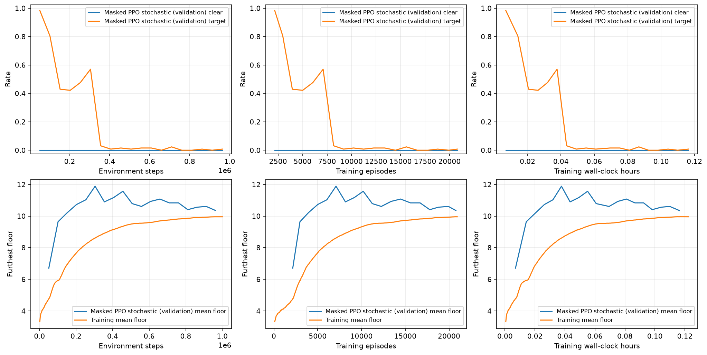
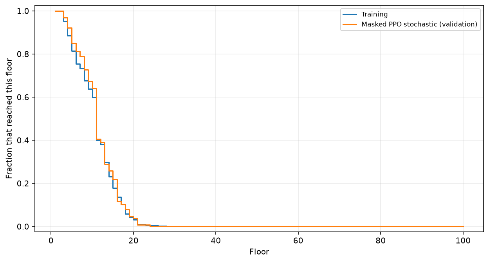
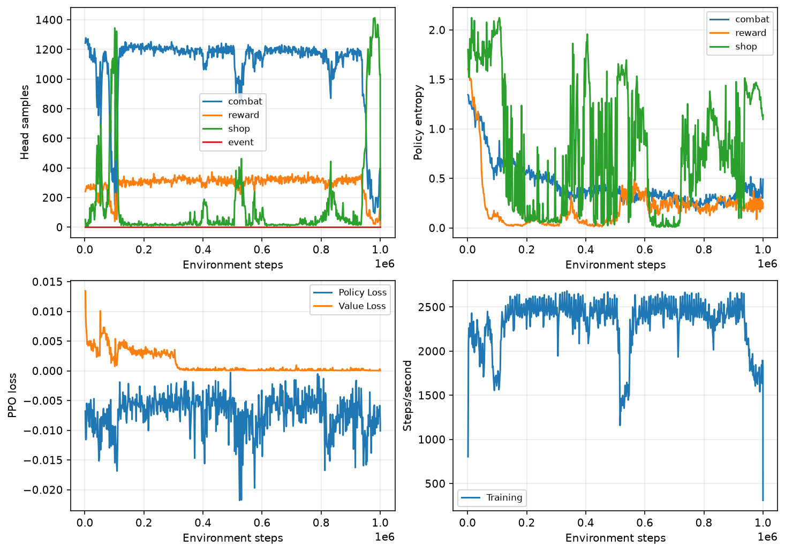
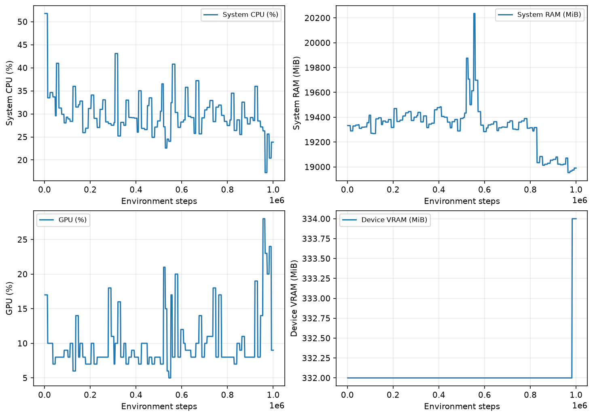

# Local reinforcement learning results

Recorded training progress reached 1,000,008 environment steps. Recorded training wall-clock time was 0.122 hours. The last measured throughput was 309.5 steps/s.

The table shows all completed training episodes and the latest evaluation for each stage, policy, and split. Evaluation rows retain their own seed manifest and stopping profile in SQLite when supplied. Only panels that share seeds and stopping rules support a direct performance comparison. Training curriculum success is aggregated across the target active in each episode.

| Cohort | Episodes | Clear rate | 95% clear interval | Mean floor | Median floor | Max floor | Target success | Mean reward | Mean actions | Early deadlock | Confirmed lock | Timeout |
|---|---:|---:|---:|---:|---:|---:|---:|---:|---:|---:|---:|---:|
| Training (all stages) | 20,931 | 0.00% | 0.00%–0.02% | 9.95 | 10.0 | 35 | 22.46% | 0.090 | 45.9 | 0.01% | 0.01% | 0.00% |
| Masked PPO stochastic (validation) · stage 1 · step 50,688 | 128 | 0.00% | 0.00%–2.91% | 6.70 | 5.0 | 17 | 98.44% | 0.329 | 48.9 | 0.00% | 0.00% | 0.00% |
| Masked PPO stochastic (validation) · stage 2 · step 101,376 | 128 | 0.00% | 0.00%–2.91% | 9.64 | 10.0 | 22 | 80.47% | 0.259 | 182.0 | 0.00% | 0.00% | 0.00% |
| Masked PPO stochastic (validation) · stage 3 · step 304,128 | 128 | 0.00% | 0.00%–2.91% | 11.89 | 12.0 | 24 | 57.03% | 0.175 | 50.7 | 0.00% | 0.00% | 0.00% |
| Masked PPO stochastic (validation) · stage 4 · step 963,072 | 128 | 0.00% | 0.00%–2.91% | 10.35 | 10.0 | 23 | 0.78% | 0.028 | 214.8 | 0.00% | 0.00% | 1.56% |

Rates use completed records. A confirmed lock can also count as a timeout in the faithful evaluation profile. The historical million-game random run had zero clears and used its own seed manifest.

## Evaluation timings

- Masked PPO stochastic (validation), stage 1, step 50,688. Training 25.11s. Evaluation panel 3.20s. Cumulative evaluation 3.20s. Policy 1.01s and workers/IPC 1.92s. 6,264 actions across 742 batches.
- Masked PPO stochastic (validation), stage 2, step 101,376. Training 51.06s. Evaluation panel 11.10s. Cumulative evaluation 14.30s. Policy 3.97s and workers/IPC 6.72s. 23,294 actions across 2,482 batches.
- Masked PPO stochastic (validation), stage 3, step 304,128. Training 135.61s. Evaluation panel 2.13s. Cumulative evaluation 22.49s. Policy 0.79s and workers/IPC 1.11s. 6,491 actions across 582 batches.
- Masked PPO stochastic (validation), stage 4, step 963,072. Training 418.59s. Evaluation panel 21.24s. Cumulative evaluation 68.64s. Policy 10.70s and workers/IPC 9.99s. 27,496 actions across 10,424 batches.

## Learning curves

## Floor-wise survival

## Policy heads and updates

## Hardware utilization

## Evaluation decisions

[Detailed decisions and trends](decision_statistics.md)
