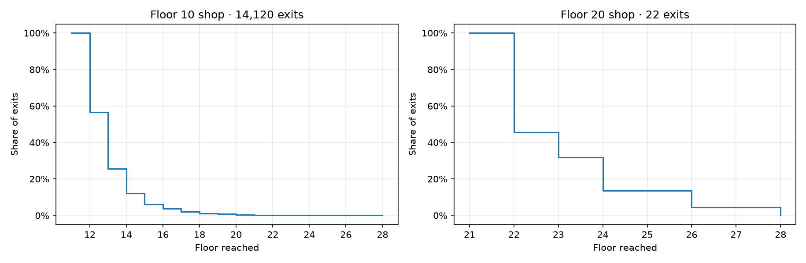
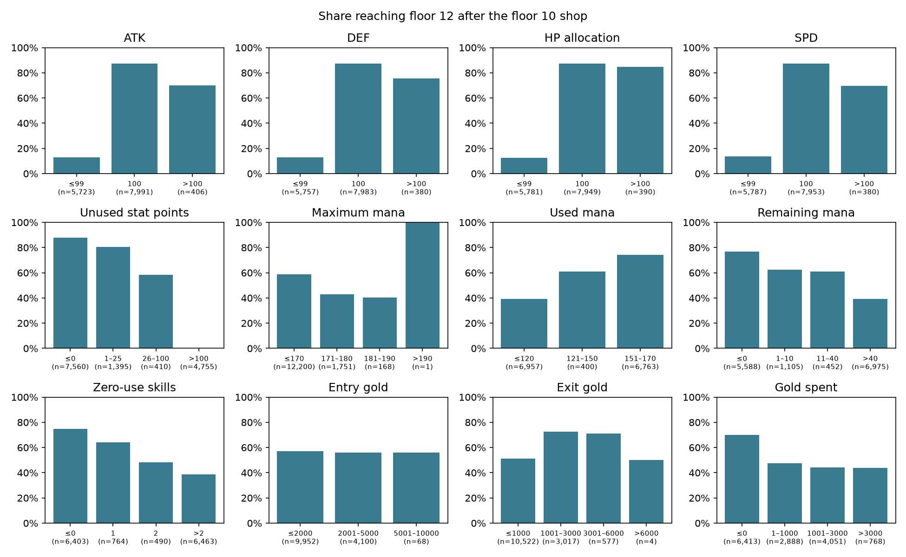
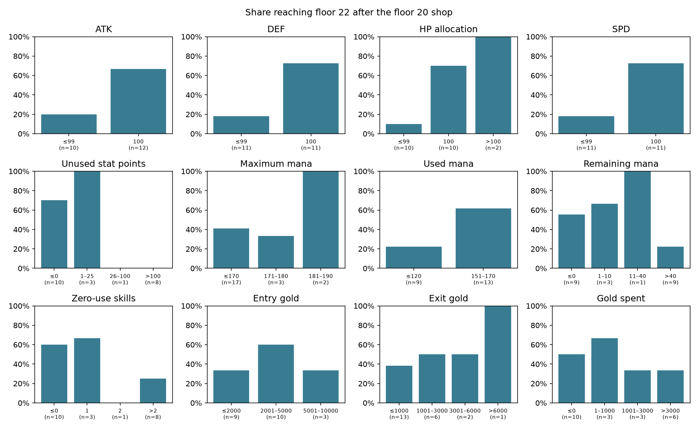

# Random baseline shop exit analysis

Replayed all **14,120** episodes whose historical furthest floor was at least 11. The original game and policy seeds, action cap and wall limit were used. Every replay matched its recorded furthest floor, action count, outcome and termination detail. We captured **14,142** shop exits. The source SQLite was opened read-only.

The observer reads gold on entry and snapshots the player immediately before leaving. HP here is the base HP stat allocation. Used mana is the sum of allotted uses × current skill cost across the equipped slots. Zero-use skills count equipped skills with no allotted uses. Locked slots are excluded. The local CSV includes the ordered loadout with each skill’s use allocation and current cost, the two seeds and the final floor.

Survival means reaching a later floor. Reaching the first floor after a shop is guaranteed by inclusion. All rates condition on the exit of the named shop. Later shops contain a selected subset of survivors. Univariate groups and skill cohorts can differ in other build decisions and encounter opportunities. These are descriptive associations. Use the group counts when interpreting sparse outcomes.



## Main findings

- **No unused stat points** (n=7,560) reached floor 12 at 87.67%. **More than 100 unused stat points** (n=4,755) reached it at 0.13%.
- **No remaining mana** (n=5,588) reached floor 12 at 76.84%. **More than 40 remaining mana** (n=6,975) reached it at 39.23%.
- **No zero-use skill** (n=6,403) reached floor 12 at 74.61%. **Three or more zero-use skills** (n=6,463) reached it at 38.54%.

## Floor 10 shop

| Group | Exits | Mean final floor | Reach 12 | Reach 15 | Reach 20 |
|---|---:|---:|---:|---:|---:|
| All exits | 14,120 | 12.09 | 56.62% | 6.22% | 0.45% |

| Measure | Minimum | Median | Maximum |
|---|---:|---:|---:|
| ATK | 1 | 100.0 | 139 |
| DEF | 1 | 100.0 | 137 |
| HP allocation | 1 | 100.0 | 144 |
| SPD | 1 | 100.0 | 151 |
| Unused stat points | 0 | 0.0 | 396 |
| Maximum mana | 170 | 170.0 | 200 |
| Used mana | 0 | 140.0 | 170 |
| Remaining mana | 0 | 30.0 | 190 |
| Zero-use skills | 0 | 1.0 | 6 |
| Entry gold | 0 | 2,000.0 | 8,000 |
| Exit gold | 0 | 0.0 | 7,000 |
| Gold spent | 0 | 1,000.0 | 6,100 |

### Allocation, mana and gold cohorts

| Group | Exits | Mean final floor | Reach 12 | Reach 15 | Reach 20 |
|---|---:|---:|---:|---:|---:|
| ATK ≤99 | 5,723 | 11.21 | 13.07% | 0.77% | 0.05% |
| ATK 100 | 7,991 | 12.72 | 87.14% | 10.30% | 0.76% |
| ATK >100 | 406 | 12.07 | 69.95% | 2.71% | 0.00% |
| DEF ≤99 | 5,757 | 11.20 | 12.87% | 0.59% | 0.05% |
| DEF 100 | 7,983 | 12.72 | 87.27% | 10.28% | 0.74% |
| DEF >100 | 380 | 12.38 | 75.53% | 6.05% | 0.53% |
| HP allocation ≤99 | 5,781 | 11.20 | 12.47% | 0.73% | 0.03% |
| HP allocation 100 | 7,949 | 12.72 | 87.36% | 10.32% | 0.74% |
| HP allocation >100 | 390 | 12.37 | 84.62% | 4.10% | 0.77% |
| SPD ≤99 | 5,787 | 11.22 | 13.55% | 0.73% | 0.07% |
| SPD 100 | 7,953 | 12.72 | 87.34% | 10.35% | 0.75% |
| SPD >100 | 380 | 12.07 | 69.74% | 3.42% | 0.00% |
| Unused stat points ≤0 | 7,560 | 12.74 | 87.67% | 10.57% | 0.79% |
| Unused stat points 1–25 | 1,395 | 12.32 | 80.36% | 4.95% | 0.29% |
| Unused stat points 26–100 | 410 | 11.85 | 58.54% | 2.44% | 0.00% |
| Unused stat points >100 | 4,755 | 11.00 | 0.13% | 0.00% | 0.00% |
| Maximum mana ≤170 | 12,200 | 12.13 | 58.80% | 6.59% | 0.47% |
| Maximum mana 171–180 | 1,751 | 11.79 | 43.00% | 3.88% | 0.29% |
| Maximum mana 181–190 | 168 | 11.79 | 40.48% | 3.57% | 1.19% |
| Maximum mana >190 | 1 | 12.00 | 100.00% | 0.00% | 0.00% |
| Used mana ≤120 | 6,957 | 11.51 | 39.15% | 0.66% | 0.01% |
| Used mana 121–150 | 400 | 12.37 | 61.00% | 9.50% | 0.00% |
| Used mana 151–170 | 6,763 | 12.67 | 74.33% | 11.74% | 0.93% |
| Remaining mana ≤0 | 5,588 | 12.73 | 76.84% | 12.37% | 0.97% |
| Remaining mana 1–10 | 1,105 | 12.38 | 62.44% | 8.69% | 0.63% |
| Remaining mana 11–40 | 452 | 12.40 | 60.84% | 9.73% | 0.44% |
| Remaining mana >40 | 6,975 | 11.51 | 39.23% | 0.67% | 0.01% |
| Zero-use skills ≤0 | 6,403 | 12.68 | 74.61% | 11.73% | 0.95% |
| Zero-use skills 1 | 764 | 12.42 | 64.14% | 10.47% | 0.26% |
| Zero-use skills 2 | 490 | 11.92 | 48.37% | 4.90% | 0.20% |
| Zero-use skills >2 | 6,463 | 11.48 | 38.54% | 0.36% | 0.00% |
| Entry gold ≤2000 | 9,952 | 12.10 | 56.94% | 6.30% | 0.48% |
| Entry gold 2001–5000 | 4,100 | 12.07 | 55.85% | 6.10% | 0.39% |
| Entry gold 5001–10000 | 68 | 11.88 | 55.88% | 1.47% | 0.00% |
| Exit gold ≤1000 | 10,522 | 11.95 | 51.26% | 5.12% | 0.34% |
| Exit gold 1001–3000 | 3,017 | 12.50 | 72.56% | 9.58% | 0.80% |
| Exit gold 3001–6000 | 577 | 12.43 | 71.06% | 8.67% | 0.69% |
| Exit gold >6000 | 4 | 12.00 | 50.00% | 0.00% | 0.00% |
| Gold spent ≤0 | 6,413 | 12.42 | 70.08% | 8.87% | 0.69% |
| Gold spent 1–1000 | 2,888 | 11.87 | 47.54% | 4.54% | 0.35% |
| Gold spent 1001–3000 | 4,051 | 11.78 | 44.19% | 3.80% | 0.22% |
| Gold spent >3000 | 768 | 11.75 | 44.01% | 3.12% | 0.13% |



### Loadouts and use allocation

There were 8,668 distinct ordered skill combinations. The table shows the ten most frequent combinations, ordered by count, then by skill names.

| Group | Exits | Mean final floor | Reach 12 | Reach 15 | Reach 20 |
|---|---:|---:|---:|---:|---:|
| wolf fang, whisker needle, drain, power up | 46 | 12.80 | 69.57% | 8.70% | 2.17% |
| wolf fang, drain, whisker needle, power up | 45 | 13.40 | 86.67% | 24.44% | 0.00% |
| wolf fang, double strike, whisker needle, power up | 44 | 12.64 | 68.18% | 6.82% | 4.55% |
| wolf fang, magic arrow, kiss, power up | 44 | 12.95 | 68.18% | 20.45% | 0.00% |
| wolf fang, whisker needle, double strike, afterimage | 42 | 11.90 | 59.52% | 2.38% | 0.00% |
| wolf fang, whisker needle, double strike, defend | 40 | 12.57 | 77.50% | 10.00% | 0.00% |
| wolf fang, whisker needle, double strike, power up | 39 | 13.67 | 84.62% | 23.08% | 5.13% |
| wolf fang, whisker needle, elemental orb, afterimage | 39 | 12.95 | 69.23% | 12.82% | 2.56% |
| thunder, magic arrow, kiss, power up | 38 | 13.18 | 76.32% | 13.16% | 5.26% |
| wolf fang, elemental orb, whisker needle, defend | 38 | 12.95 | 81.58% | 18.42% | 0.00% |

For the 15 most frequently equipped skills, the table compares reach to floor 12 between zero and positive allotted uses.

| Skill | Equipped | Median uses | Zero uses | Reach with zero uses | Reach with positive uses |
|---|---:|---:|---:|---:|---:|
| wolf fang | 6,276 | 20 | 1,561 | 37.80% | 72.24% |
| thunder | 4,195 | 20 | 1,901 | 41.35% | 71.75% |
| kiss | 3,226 | 10 | 1,264 | 39.72% | 70.90% |
| power up | 2,987 | 10 | 943 | 39.77% | 69.67% |
| drain | 2,586 | 10 | 723 | 38.73% | 74.24% |
| afterimage | 2,504 | 10 | 844 | 38.15% | 70.72% |
| whisker needle | 2,498 | 10 | 606 | 38.94% | 73.57% |
| double strike | 2,436 | 10 | 629 | 39.90% | 72.39% |
| elemental orb | 2,370 | 10 | 735 | 38.91% | 74.25% |
| defend | 2,226 | 10 | 930 | 38.28% | 72.99% |
| magic arrow | 2,093 | 10 | 534 | 35.21% | 71.78% |
| soul strike | 1,862 | 10 | 641 | 41.81% | 71.09% |
| shooting star | 1,793 | 10 | 601 | 40.27% | 73.07% |
| skull dagger | 1,766 | 0 | 1,050 | 41.43% | 72.21% |
| fast claw | 1,453 | 10 | 387 | 34.37% | 69.79% |

## Floor 20 shop

| Group | Exits | Mean final floor | Reach 22 | Reach 25 | Reach 30 |
|---|---:|---:|---:|---:|---:|
| All exits | 22 | 22.14 | 45.45% | 13.64% | 0.00% |

| Measure | Minimum | Median | Maximum |
|---|---:|---:|---:|
| ATK | 1 | 100.0 | 100 |
| DEF | 1 | 99.0 | 100 |
| HP allocation | 1 | 100.0 | 110 |
| SPD | 1 | 94.5 | 100 |
| Unused stat points | 0 | 11.5 | 396 |
| Maximum mana | 170 | 170.0 | 190 |
| Used mana | 0 | 170.0 | 170 |
| Remaining mana | 0 | 10.0 | 184 |
| Zero-use skills | 0 | 1.0 | 5 |
| Entry gold | 900 | 3,000.0 | 8,000 |
| Exit gold | 0 | 600.0 | 8,000 |
| Gold spent | 0 | 1,000.0 | 8,000 |

### Allocation, mana and gold cohorts

| Group | Exits | Mean final floor | Reach 22 | Reach 25 | Reach 30 |
|---|---:|---:|---:|---:|---:|
| ATK ≤99 | 10 | 21.20 | 20.00% | 0.00% | 0.00% |
| ATK 100 | 12 | 22.92 | 66.67% | 25.00% | 0.00% |
| DEF ≤99 | 11 | 21.18 | 18.18% | 0.00% | 0.00% |
| DEF 100 | 11 | 23.09 | 72.73% | 27.27% | 0.00% |
| HP allocation ≤99 | 10 | 21.10 | 10.00% | 0.00% | 0.00% |
| HP allocation 100 | 10 | 23.20 | 70.00% | 30.00% | 0.00% |
| HP allocation >100 | 2 | 22.00 | 100.00% | 0.00% | 0.00% |
| SPD ≤99 | 11 | 21.18 | 18.18% | 0.00% | 0.00% |
| SPD 100 | 11 | 23.09 | 72.73% | 27.27% | 0.00% |
| Unused stat points ≤0 | 10 | 23.20 | 70.00% | 30.00% | 0.00% |
| Unused stat points 1–25 | 3 | 22.00 | 100.00% | 0.00% | 0.00% |
| Unused stat points 26–100 | 1 | 21.00 | 0.00% | 0.00% | 0.00% |
| Unused stat points >100 | 8 | 21.00 | 0.00% | 0.00% | 0.00% |
| Maximum mana ≤170 | 17 | 22.24 | 41.18% | 17.65% | 0.00% |
| Maximum mana 171–180 | 3 | 21.33 | 33.33% | 0.00% | 0.00% |
| Maximum mana 181–190 | 2 | 22.50 | 100.00% | 0.00% | 0.00% |
| Used mana ≤120 | 9 | 21.22 | 22.22% | 0.00% | 0.00% |
| Used mana 151–170 | 13 | 22.77 | 61.54% | 23.08% | 0.00% |
| Remaining mana ≤0 | 9 | 22.56 | 55.56% | 22.22% | 0.00% |
| Remaining mana 1–10 | 3 | 23.33 | 66.67% | 33.33% | 0.00% |
| Remaining mana 11–40 | 1 | 23.00 | 100.00% | 0.00% | 0.00% |
| Remaining mana >40 | 9 | 21.22 | 22.22% | 0.00% | 0.00% |
| Zero-use skills ≤0 | 10 | 22.90 | 60.00% | 30.00% | 0.00% |
| Zero-use skills 1 | 3 | 22.33 | 66.67% | 0.00% | 0.00% |
| Zero-use skills 2 | 1 | 21.00 | 0.00% | 0.00% | 0.00% |
| Zero-use skills >2 | 8 | 21.25 | 25.00% | 0.00% | 0.00% |
| Entry gold ≤2000 | 9 | 21.67 | 33.33% | 11.11% | 0.00% |
| Entry gold 2001–5000 | 10 | 22.50 | 60.00% | 10.00% | 0.00% |
| Entry gold 5001–10000 | 3 | 22.33 | 33.33% | 33.33% | 0.00% |
| Exit gold ≤1000 | 13 | 21.92 | 38.46% | 7.69% | 0.00% |
| Exit gold 1001–3000 | 6 | 22.17 | 50.00% | 16.67% | 0.00% |
| Exit gold 3001–6000 | 2 | 22.00 | 50.00% | 0.00% | 0.00% |
| Exit gold >6000 | 1 | 25.00 | 100.00% | 100.00% | 0.00% |
| Gold spent ≤0 | 10 | 22.20 | 50.00% | 20.00% | 0.00% |
| Gold spent 1–1000 | 3 | 22.00 | 66.67% | 0.00% | 0.00% |
| Gold spent 1001–3000 | 3 | 23.00 | 33.33% | 33.33% | 0.00% |
| Gold spent >3000 | 6 | 21.67 | 33.33% | 0.00% | 0.00% |



### Loadouts and use allocation

There were 22 distinct ordered skill combinations. The table shows the ten most frequent combinations, ordered by count, then by skill names.

| Group | Exits | Mean final floor | Reach 22 | Reach 25 | Reach 30 |
|---|---:|---:|---:|---:|---:|
| afterimage, spider web, fast claw, bonemerang | 1 | 21.00 | 0.00% | 0.00% | 0.00% |
| elemental orb, thunder, afterimage, heal | 1 | 21.00 | 0.00% | 0.00% | 0.00% |
| recovery, meditation, elemental orb, magician hat | 1 | 22.00 | 100.00% | 0.00% | 0.00% |
| regenerate, kiss, weakness, trick or treat | 1 | 21.00 | 0.00% | 0.00% | 0.00% |
| revive, plague, drain, bonemerang | 1 | 21.00 | 0.00% | 0.00% | 0.00% |
| thunder, kiss, soul strike, power up, bonemerang | 1 | 23.00 | 100.00% | 0.00% | 0.00% |
| thunder, magic arrow, kiss, afterimage | 1 | 23.00 | 100.00% | 0.00% | 0.00% |
| thunder, magic arrow, kiss, power up | 1 | 25.00 | 100.00% | 100.00% | 0.00% |
| thunder, power up, soul strike, curse, shooting star | 1 | 22.00 | 100.00% | 0.00% | 0.00% |
| trick or treat, earth castle, molt, recovery | 1 | 21.00 | 0.00% | 0.00% | 0.00% |

For the 15 most frequently equipped skills, the table compares reach to floor 22 between zero and positive allotted uses.

| Skill | Equipped | Median uses | Zero uses | Reach with zero uses | Reach with positive uses |
|---|---:|---:|---:|---:|---:|
| power up | 11 | 10 | 1 | 100.00% | 50.00% |
| wolf fang | 10 | 20 | 0 | — | 50.00% |
| kiss | 7 | 10 | 3 | 33.33% | 75.00% |
| whisker needle | 6 | 10 | 0 | — | 50.00% |
| afterimage | 5 | 10 | 2 | 0.00% | 66.67% |
| thunder | 5 | 20 | 2 | 50.00% | 100.00% |
| double strike | 4 | 10 | 1 | 0.00% | 66.67% |
| drain | 4 | 10 | 0 | — | 50.00% |
| soul strike | 4 | 10 | 1 | 100.00% | 66.67% |
| bonemerang | 3 | 0 | 3 | 33.33% | — |
| elemental orb | 3 | 0 | 2 | 50.00% | 100.00% |
| fast claw | 3 | 10 | 1 | 0.00% | 0.00% |
| magic arrow | 3 | 10 | 0 | — | 100.00% |
| shooting star | 3 | 10 | 1 | 100.00% | 0.00% |
| curse | 2 | 0 | 2 | 50.00% | — |

[All per-skill and exact-use cohorts](skill_use_cohorts.csv)

## Reproduce locally

```console
python -m experiments.shop_exit_replay data/baseline_random_1m/baseline.sqlite3 data/shop_exit_replay/shops.csv
python -m experiments.shop_exit_analysis data/shop_exit_replay/shops.csv docs/shop_exit_replay
```

[Original baseline report](../baseline_random_1m_results.md)
